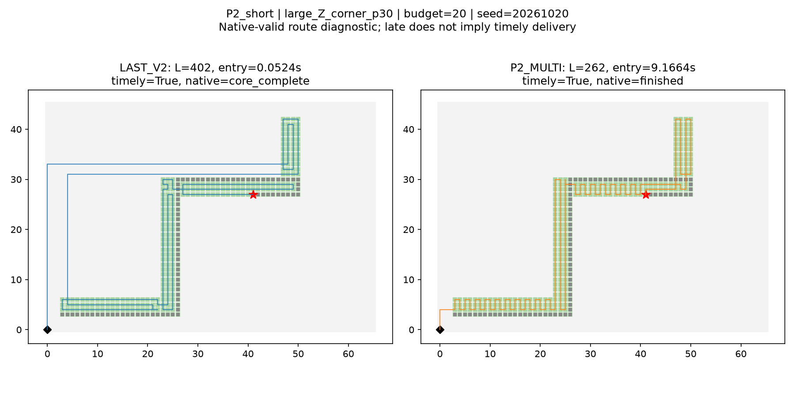
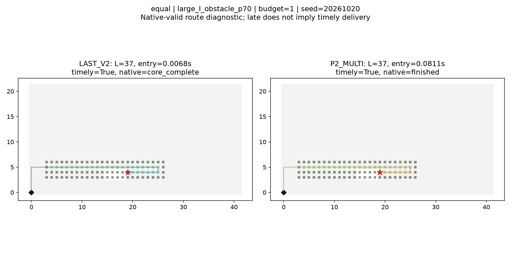
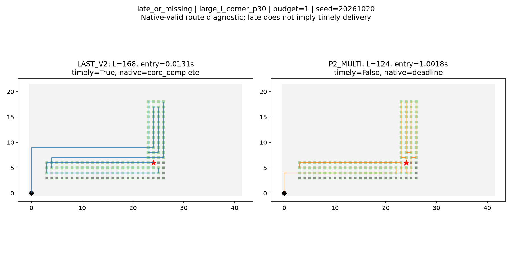

# LAST V2与P2共同预算开发比较

2026-10-20。**执行完成，待负责人审核。** 54已见状态、三方法、1/20秒、三种子，972调用全部保留。不是留出/最优性/论文创新证据，不预设赢家。

**本批结果不支持LAST相对P2的路线竞争优势。** 20秒双方162/162及时合法，LAST对P2为0短38平124长，总16428对13180步（按54状态三种子均值求和为5476对4393.333333），LAST多24.6434%。P2显著多花实际计算时间，但路线更短；不能称LAST支配。1秒P2全部162返回合法，其中125及时、37迟到；及时配对LAST0短38平87长（N125），软返回配对0短38平124长（N162），不能把后者当严格截止胜率。

LAST原PPCPP上的收益仍存在（每预算5530→5476、27短27平），但不足支持本批强主算法竞争力。本轮停止，不立即添加规则追赶P2。

流程记录：独立审核与analysis.json已成功生成，随后CSV导出因重复lengths/entry_times关键字报TypeError；原analyze.py/analysis.log保留。export_v02.py只从未改analysis.json补出剩余CSV和失败说明，0正式失效/重跑，不把这次导出故障隐藏为全流程一次通过。

## 1秒：完整交付与原生返回

|方法|N|合法|及时|迟到合法|无路线|非法|>10ms|入口均值/中位/P95/最大秒|外审均值秒|原生状态|来源|
|---|---|---|---|---|---|---|---|---|---|---|---|
|PPCPP|162|162|162|0|0|0|0|0.006213/0.003269/0.022076/0.025628|0.004992|{'core_complete': 162}|{'P0': 162}|
|LAST_V2|162|162|162|0|0|0|0|0.012943/0.007392/0.046149/0.055504|0.024538|{'core_complete': 162}|{'P0': 81, 'P1': 81}|
|P2_MULTI|162|162|125|37|0|0|8|0.380591/0.146454/1.009644/1.013360|0.000525|{'finished': 125, 'deadline': 37}|{'H_raw': 6, 'H_scan_opt': 51, 'H_NN_opt': 15, 'common_fallback': 3, 'old_suffix': 15, 'V_scan_opt': 57, 'reverse_V_raw': 5, 'shuffle_1_opt': 3, 'shuffle_0_opt': 1, 'perturb_V_opt': 4, 'perturb_H_opt': 2}|

|a|b|视图|配对N/162|a短/平/长|同配对a/b总步数|a−b|逐配对相对差均值|
|---|---|---|---|---|---|---|---|
|LAST_V2|PPCPP|timely_valid|162|81/81/0|16428/16590|-162|-0.01621048347972066|
|LAST_V2|PPCPP|route_valid|162|81/81/0|16428/16590|-162|-0.01621048347972066|
|LAST_V2|P2_MULTI|timely_valid|125|0/38/87|7139/6331|808|0.11885420662676822|
|LAST_V2|P2_MULTI|route_valid|162|0/38/124|16428/13260|3168|0.16540060227112674|
|PPCPP|P2_MULTI|timely_valid|125|0/28/97|7287/6331|956|0.1433829639272167|
|PPCPP|P2_MULTI|route_valid|162|0/28/134|16590/13260|3330|0.18487282280600983|

timely_valid：LAST–P2共有41/54状态三种子均成对，按三种子均值LAST短/平/长=0/12/29。不完整状态不补0步。
最大绝对状态贡献：large_I_straight_p70，三种子配对有符号差合计126，占所有状态绝对贡献和0.155941；正负贡献可能抵消，不能把此占比误作净差占比。
route_valid：LAST–P2共有54/54状态三种子均成对，按三种子均值LAST短/平/长=0/12/42。不完整状态不补0步。
该视图三种子均完整的54状态等权总量（每状态三种子均值再求和）：LAST=5476.000000，P2=4420.000000；原配对总量是162次，不能叫162张图。
最大绝对状态贡献：large_Z_straight_p30，三种子配对有符号差合计408，占所有状态绝对贡献和0.128788；正负贡献可能抵消，不能把此占比误作净差占比。

## 20秒：完整交付与原生返回

|方法|N|合法|及时|迟到合法|无路线|非法|>10ms|入口均值/中位/P95/最大秒|外审均值秒|原生状态|来源|
|---|---|---|---|---|---|---|---|---|---|---|---|
|PPCPP|162|162|162|0|0|0|0|0.006316/0.003443/0.021481/0.027773|0.005533|{'core_complete': 162}|{'P0': 162}|
|LAST_V2|162|162|162|0|0|0|0|0.012983/0.007588/0.044205/0.072698|0.018080|{'core_complete': 162}|{'P0': 81, 'P1': 81}|
|P2_MULTI|162|162|162|0|0|0|0|0.913669/0.145424/4.295179/9.166431|0.000534|{'finished': 162}|{'H_raw': 6, 'H_scan_opt': 46, 'H_NN_opt': 15, 'common_fallback': 3, 'old_suffix': 15, 'V_scan_opt': 60, 'reverse_V_raw': 5, 'shuffle_1_opt': 3, 'perturb_V_opt': 5, 'shuffle_0_opt': 1, 'perturb_H_opt': 3}|

|a|b|视图|配对N/162|a短/平/长|同配对a/b总步数|a−b|逐配对相对差均值|
|---|---|---|---|---|---|---|---|
|LAST_V2|PPCPP|timely_valid|162|81/81/0|16428/16590|-162|-0.01621048347972066|
|LAST_V2|PPCPP|route_valid|162|81/81/0|16428/16590|-162|-0.01621048347972066|
|LAST_V2|P2_MULTI|timely_valid|162|0/38/124|16428/13180|3248|0.1681514128023568|
|LAST_V2|P2_MULTI|route_valid|162|0/38/124|16428/13180|3248|0.1681514128023568|
|PPCPP|P2_MULTI|timely_valid|162|0/28/134|16590/13180|3410|0.1876236333372399|
|PPCPP|P2_MULTI|route_valid|162|0/28/134|16590/13180|3410|0.1876236333372399|

timely_valid：LAST–P2共有54/54状态三种子均成对，按三种子均值LAST短/平/长=0/12/42。不完整状态不补0步。
该视图三种子均完整的54状态等权总量（每状态三种子均值再求和）：LAST=5476.000000，P2=4393.333333；原配对总量是162次，不能叫162张图。
最大绝对状态贡献：large_Z_corner_p30，三种子配对有符号差合计420，占所有状态绝对贡献和0.129310；正负贡献可能抵消，不能把此占比误作净差占比。
route_valid：LAST–P2共有54/54状态三种子均成对，按三种子均值LAST短/平/长=0/12/42。不完整状态不补0步。
该视图三种子均完整的54状态等权总量（每状态三种子均值再求和）：LAST=5476.000000，P2=4393.333333；原配对总量是162次，不能叫162张图。
最大绝对状态贡献：large_Z_corner_p30，三种子配对有符号差合计420，占所有状态绝对贡献和0.129310；正负贡献可能抵消，不能把此占比误作净差占比。

## 协议、接口和计时解释

预算是最大可用时间，PPCPP/LAST自然结束即返回，不空等；相同上限不等于相同CPU用量。共同暖入口包含解码/验证/Snapshot、契约、全部几何/搜索/offer内部合法性检查及完整原raw JSON编码；启动/导入/磁盘和独立外审在外。P2薄适配复现baseline_suite的P2分支，仅绕过其设置seconds之后的外部audit；源码p2_adapter.py、接口差异adapter_scope.md。原P2搜索/保底/权重/缓存/中止频率不变。

原生deadline可以返回内部已接受路线，P2不清空；LAST保持原整体晚到拒收，不捞中间P0。实际交付按route_valid且entry_seconds<budget；软视图只要求实际返回合法路线，保留所有迟到。两个视图分预算、同输入同种子配对；失败不计0步，不从不同成功集合总量造排名。P2若贴线迟到是原生预算耗尽加返回/编码成本的观测，不能据此说LAST全面优越。

外审时间是本轮离线审核阶段独立测量，未加入入口；LAST包含全分支奖励/BFS/采集审核，P2只对实际原生返回及阶段/接受记录审核，两种外审任务不同，不能把外审时间拼成算法速度排名。native_seconds与entry_seconds起点不同；原生接受记录相对P2内核开始，不能直接用它替代实际入口交付时刻。原事件和全部接受记录完整保存，未把最后接受时间当按时交付。

## 门槛和环境

49固定门槛完成：9夹具×原P2/适配器/PPCPP/LAST=36；LAST九个已完成P0后的共同截止注入=9；P2原/适配在接受前/保底接受后截止=4。九P2夹具自然完成或原环境不可行处理的完整非时间结果对照一致；时钟插桩仅隔离门槛，正式未插桩。保底已观察，未观察到的来源不臆称覆盖；门槛原件及来源见gates/。缓存Spy证明两个求解对象不共享cache/distance_rows；合法迟到分类单元验证保留路线但不进入及时视图。

事前最终封存9381文件，覆盖包内Python、.deps全源/二进制/元数据、冻结源码配置、实际导入链和可识别非系统DLL、项目生产/审核/输入/配置。在任何规划器调用前，先发现并补足独立审核与输入配置范围，再封存最终清单；environment_discovery_v01保留，非事后补录。每worker验证完成标志、实际导入哈希和唯一输入读取，整批前后全清单重核；Windows系统DLL仅记路径，未覆盖全机或不可发现动态加载依赖，限制明确保留。没有升级依赖或改导入链。

LAST所有完成分支逐决策及双指标重核；P0与同批原PPCPP自然完成配对324/324一致。三方法每条返回路线均双指标核验原F/四邻接/覆盖/历史/暂缓/返航和距离预算。P2来源必须等于最后改进记录来源、路线步数必须等于最后接受步数，接受改进严格变短；原阶段和core_finished保留。

## 分层

|因素|层|状态|预算|及时N 短/平/长|软返回N 短/平/长|软返回LAST−P2|
|---|---|---|---|---|---|---|
|size|large|18|1|18 0/3/15|54 0/3/51|2634|
|size|large|18|20|54 0/3/51|54 0/3/51|2714|
|size|medium|18|1|53 0/10/43|54 0/10/44|302|
|size|medium|18|20|54 0/10/44|54 0/10/44|302|
|size|small|18|1|54 0/25/29|54 0/25/29|232|
|size|small|18|20|54 0/25/29|54 0/25/29|232|
|family|I|18|1|48 0/24/24|54 0/24/30|608|
|family|I|18|20|54 0/24/30|54 0/24/30|608|
|family|L|18|1|39 0/11/28|54 0/11/43|956|
|family|L|18|20|54 0/11/43|54 0/11/43|964|
|family|Z|18|1|38 0/3/35|54 0/3/51|1604|
|family|Z|18|20|54 0/3/51|54 0/3/51|1676|
|event|corner|18|1|38 0/4/34|54 0/4/50|1484|
|event|corner|18|20|54 0/4/50|54 0/4/50|1558|
|event|obstacle|18|1|48 0/24/24|54 0/24/30|154|
|event|obstacle|18|20|54 0/24/30|54 0/24/30|154|
|event|straight|18|1|39 0/10/29|54 0/10/44|1530|
|event|straight|18|20|54 0/10/44|54 0/10/44|1536|
|progress|30|27|1|56 0/22/34|81 0/22/59|1748|
|progress|30|27|20|81 0/22/59|81 0/22/59|1828|
|progress|70|27|1|69 0/16/53|81 0/16/65|1420|
|progress|70|27|20|81 0/16/65|81 0/16/65|1420|

## 完整指标与三种子

972调用与完整指标.csv含每次所有指标，324状态预算方法三种子.csv列三原值/均值/范围/计时/稳定性；不得取最好种子代表P2。analysis.metric_totals保留各方法各视图分母，覆盖率等比例不能跨不同成功集直接比较。下列按各自返回合法视图列分母和重复级计数，并非不同成功集上的胜负判定。

|预算|方法|N|总步|新采集|历史重复|本轮重复|非目标|90度|180度|完成步号合计|返航尾段|公开完成/公开|暂缓|
|---|---|---|---|---|---|---|---|---|---|---|---|---|---|
|1|PPCPP|162|16590|10224|621|717|5028|2256|102|12444|4146|18081/18144|63|
|1|LAST_V2|162|16428|10224|627|693|4884|2388|93|13473|2955|18081/18144|63|
|1|P2_MULTI|162|13260|10224|682|199|2155|4017|86|12096|1164|18081/18144|63|
|20|PPCPP|162|16590|10224|621|717|5028|2256|102|12444|4146|18081/18144|63|
|20|LAST_V2|162|16428|10224|627|693|4884|2388|93|13473|2955|18081/18144|63|
|20|P2_MULTI|162|13180|10224|670|176|2110|4010|81|12016|1164|18081/18144|63|

P2预算增加1→20秒，同状态同种子双方合法返回配对N=162；20秒短/平/长=5/157/0，步数差合计-80。这是预算敏感诊断，未把20秒成绩混入1秒。

native_seconds列在PPCPP/LAST中是P0内核秒数（LAST不包含P1），在P2中是适配器原生分支秒数，不能混作三方法完整内核排名。统一排名只看完整entry_seconds。P2没有PPCPP式trace，状态CSV中的stable_trace对P2只反映字段缺省，不构成P2决策稳定证据；P2实际路线稳定性与三种子范围另列。

## 固定正反图

LAST_short类别缺失，不补图。

P2_short：large_Z_corner_p30，预算20秒、seed=20261020，视图=route_valid。

equal：large_I_obstacle_p70，预算1秒、seed=20261020，视图=route_valid。

late_or_missing：large_I_corner_p30，预算1秒、seed=20261020，视图=actual delivery: late/missing。

## 结论边界与停止

根据上列两预算/两视图的配对结果判断路线差距；及时配对不足时必须保持无法判断，不能利用P2原生软截止状态制造全面胜出。LAST在原PPCPP上的既有改进并不自动说明相对P2竞争力；P2是强自建工程基线，不是论文算法，也不能推导其他基线更弱。总步数、90/180度转弯、计算及交付率分别列出，不新增能耗权重改变胜负。

54全是已见开发状态，共享9道路与单一历史规划器；无未知大图、紧资源、多历史规划器或留出证据，不确认主算法/创新。固定972调用结束即停，不加算法/地图/种子/预算、不调LAST/P2、不跑最优或留出、不提交推送。

复核：`./运行环境/python/python.exe -B -X utf8 PPCPP_LAST_P2共同预算开发比较_v0.1_20261020/verify.py`。只读复核，不运行规划器。
