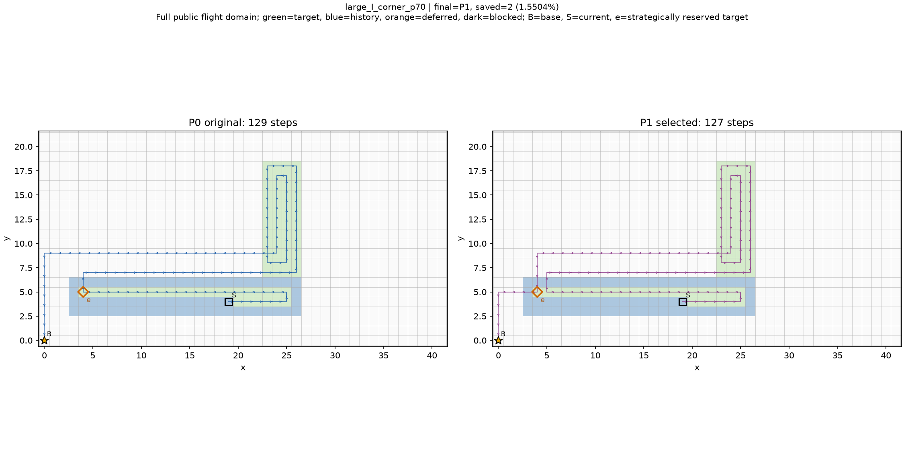
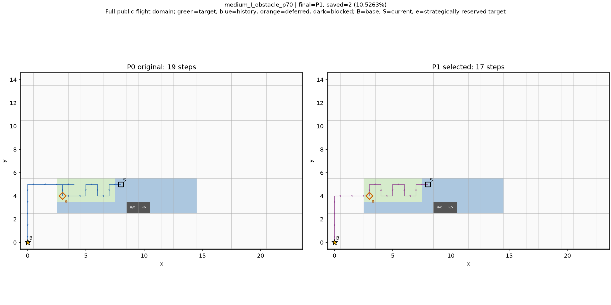
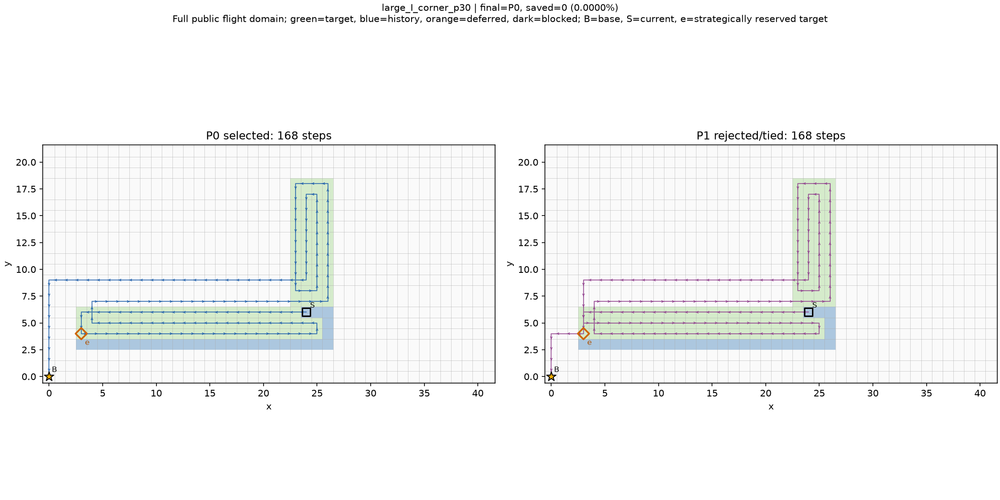
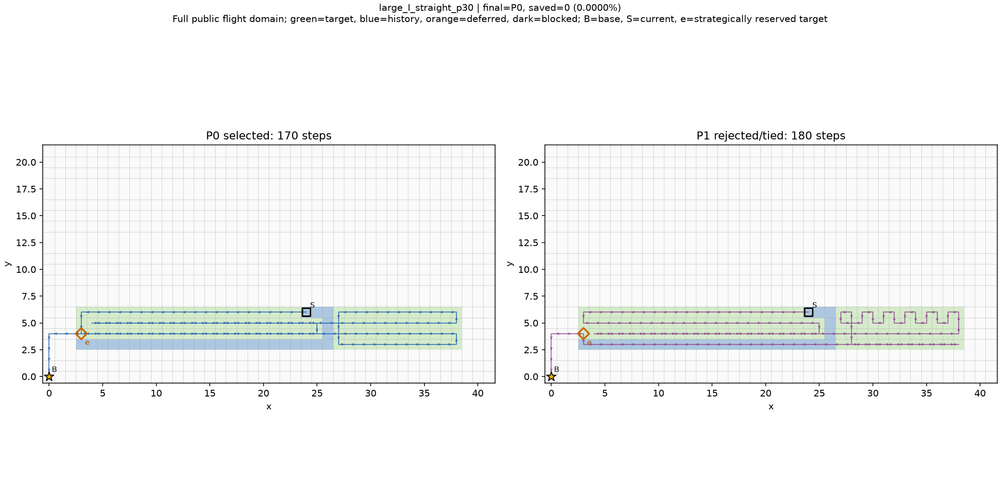

# LAST固定实现：新开发地图验证结果

2026-10-20，v0.1。**执行完成，待负责人审核**。固定算法的新开发输入验证，不是最终留出、算法改进、强基线排名或论文主算法确认。

## 结论与实际取舍

固定54槽位全部有效，9准备、108新输入原版/ONE等价及540正式调用完成。正式两方法各270/270完整合法及时，双方54状态均5次完整route/trace稳定。LAST对原版27短27平0长，总5530→5476省54步，总量减少0.9765%、逐状态相对差均值−1.6210%；没有排除失败后才得到的子集收益，本轮实际没有失败/迟到。

全部27改善状态均只省2步。改善分布于18个非旧复制、非D4等价事件后道路/遮挡组，I/L/Z各6组，达到运行前规定的“本固定新开发矩阵观察到跨形状收益保留”判据。最大改善单例省2，占总省54的3.7037%；绝对最大并非单例撑起总体，但中规格16状态贡献32步（59.2593%），仍须保留收益分布。

**路线收益保留，但计算开销明显扩大。** 原版入口均值6.462889ms，LAST90.339822ms，约13.9782倍；LAST最大0.639499秒。相同20秒上限不是相同实际CPU用量，及时不意味着开销可忽略。平均少不到1%的总路程，并且90度转弯增加，当前不能据此认定方法实际价值充分或批准主算法/强P2排名。先交负责人审核路程—计算取舍，本轮不改缓存或规则。

## 固定实现与问题口径

candidate.py/runtime.py/worker.py/audit.py/common.py与已审核LAST逐字节一致，原PPCPP、奖励、几何、模型与契约依赖受protocol/source_seal哈希保护。沿用单一输入最近基地e、F-e覆盖其他任务、恢复F到e返航、完整总步严格更短择优且同值保P0。原权重/捕食者(-1,0)/朝向/连接器/缓存作用域/截止均不变，无新终点、过滤、试走或精确补全。

四邻接等长、下视单格即时采集，历史保留。策略性禁入e不是真实障碍，不改F/T/H或暂缓；真实新障碍禁飞且遮挡，未完成被挡暂缓、历史已完成被挡仍保留。统一1000000步宽松距离预算，所有成功路线核验；不研究真实能耗或紧资源。没有完整P0时不替代补救；P1策略性不可达与整入口超时分开。整体20秒晚到拒收，P0仅诊断不能回填及时输出。

## 生成前几何与历史

3族I/L/Z×3规格×3事件×30%/70%=54计划槽位；9基础道路共享历史，不是54独立地图。small/medium/large(L,w)=(6,2)/(12,3)/(24,4)，是本轮相对命名，不是真实大规模性能验证。各族直扩/拐扩均按L//2的固定新增长度，半带障碍固定首水平段中部、备用侧仅避免current，无第三位置。F按族/规格预先公开完整矩形，含道路外合法通路，未按事件裁域。

Z两角间不含角方块的独立直段为L-w=4/9/20格，分别至少2w；与上轮紧凑阶梯小图不同。原图/扩展无重叠、全宽末端接合，无分叉。m=3固定余量；域最大3036格、公开目标最大336，低于10000/1500上限。精确矩形坐标、ASCII全图在几何坐标表.json/几何概览.md，均在任何准备前固定。几何数量/连接/非重叠、障碍首备与所有冲突格、当前即时采集、历史被挡、保留连续通行带均在正式前preflight通过。

9次准备只输入当时初始任务/F，不给事件或可行见证。首次累计ceil(旧目标×30%/70%)截前缀，逐格H/current/previous及旧后缀保存；三事件共享同一历史。54历史与54当前覆盖返航见证由独立坐标谓词/路径/双指标审核，见证不传算法。障碍首侧遇当前格改备用实际1槽位，规则固定且记录不删。所有54可检任务可达，无准备失败/无新增/无效/超规模；未换图补图。

|基础图|L|w|公开F|旧目标|准备步数|准备入口秒|
|---|---|---|---|---|---|---|
|small_I|6|2|165|12|24|0.001085|
|medium_I|12|3|360|36|50|0.001975|
|large_I|24|4|924|96|110|0.005170|
|small_L|6|2|255|24|36|0.001430|
|medium_L|12|3|648|72|102|0.004506|
|large_L|24|4|1932|192|208|0.012335|
|small_Z|6|2|357|36|50|0.002440|
|medium_Z|12|3|972|108|142|0.019284|
|large_Z|24|4|3036|288|306|0.021549|

准备、108门槛、独立外审均不混正式性能。仅前置ONE门槛采用新输入，因此称开发验证而非盲测。门槛108完整route/trace逐状态等价，输入哈希不变；因生产与审核核心字节一致，旧218边界/隔离/9截止及8夹具界引用已封存证据，不在本轮运行任何精确搜索。独立audit_adapter只在计时外缓存同一输入的BFS距离，60固定小图查询与原未缓存BFS双核一致，audit.py未改，不能把这种审核加速算作算法提速。

## 旧复制与形状分组

从封存协议定位原件：LAST旧主36/补24=60、STRUCT新开发36、FIRST/SECOND/STRUCT原20+受控27=47，共143路径/143字节输入。不是把多个复制文件重复计数；old_input_catalog逐条来源、protocol和哈希可查。

|旧集合|条数|
|---|---|
|LAST60|60|
|STRUCT_new36|36|
|timing_original20_controlled27|47|

新54状态对旧143：原始完整状态复制0、统一平移完整状态复制0、完整任务D4复制0、道路/遮挡形状D4复制0。新54形成27形状组、54完整状态组；各形状通常两进度。shape只用公开目标+遮挡，完整状态另含F/H/current/base/previous/predator/初始/当前/公开/暂缓目标、旧后缀和资源。签名不同不证明统计独立，对称/历史变体不计独立新形状。

排除明确旧完整状态复制后仍54状态27短27平、省54；再保守排除旧形状复制后也完全相同。因此本轮收益不是旧输入复制造成的，但仍只代表9规则基础道路和PPCPP单一历史来源。

## 全槽位、重复级与配对分母

54槽位准备/输入/门槛全部通过；两方法270调用各自完整合法及时270，异常/技术故障/输出损坏/看门狗/截止/超软预算>10ms均0，最大超时量0。双方5次均成功且完整轨迹稳定的交集N=54。所有540结果保留，不挑最好重复；270个状态—重复组LAST中P0完整route/trace等于同批原版，108方法—状态组5次稳定。

|方法|正式调用|合法|严格及时|5次成功稳定状态|软超时>10ms|最大超时秒|
|---|---|---|---|---|---|---|
|PPCPP|270|270|270|54|0|0|
|LAST|270|270|270|54|0|0|

原版与LAST均新调用、同封装/机器/线程1/入口，不拼旧计时。执行顺序按重复和协议槽位，方法先后随输入序号+重复号交替；进程启动/导入/磁盘/外审不计，解码/构造/全部分支/距离/几何/内部审核/完整原输出编码都在统一20秒内。90秒看门狗没有扩充20秒。

## 全54状态比较

每状态只计一次；P1包括未选分支。全状态表/5次原始时间及每调用分段CSV另存，原已无收益的状态未删。

|状态|形状组|PPCPP|P1|LAST|省步|相对省步%|最终选择|P1状态|e|
|---|---|---|---|---|---|---|---|---|---|
|small_I_straight_p30|G15|21|21|21|0|0.0000|P0|core_complete|[3, 4]|
|small_I_straight_p70|G15|26|26|26|0|0.0000|P0|core_complete|[3, 4]|
|small_I_corner_p30|G01|21|21|21|0|0.0000|P0|core_complete|[3, 4]|
|small_I_corner_p70|G01|26|24|24|2|7.6923|P1|core_complete|[3, 4]|
|small_I_obstacle_p30|G11|17|17|17|0|0.0000|P0|core_complete|[3, 4]|
|small_I_obstacle_p70|G11|10|10|10|0|0.0000|P0|core_complete|[3, 4]|
|medium_I_straight_p30|G26|52|50|50|2|3.8462|P1|core_complete|[3, 4]|
|medium_I_straight_p70|G26|57|59|57|0|0.0000|P0|core_complete|[3, 4]|
|medium_I_corner_p30|G25|64|62|62|2|3.1250|P1|core_complete|[3, 4]|
|medium_I_corner_p70|G25|57|57|57|0|0.0000|P0|core_complete|[3, 4]|
|medium_I_obstacle_p30|G06|34|32|32|2|5.8824|P1|core_complete|[3, 4]|
|medium_I_obstacle_p70|G06|19|17|17|2|10.5263|P1|core_complete|[3, 4]|
|large_I_straight_p30|G22|170|180|170|0|0.0000|P0|core_complete|[3, 4]|
|large_I_straight_p70|G22|131|131|131|0|0.0000|P0|core_complete|[4, 5]|
|large_I_corner_p30|G14|168|168|168|0|0.0000|P0|core_complete|[3, 4]|
|large_I_corner_p70|G14|129|127|127|2|1.5504|P1|core_complete|[4, 5]|
|large_I_obstacle_p30|G20|78|76|76|2|2.5641|P1|core_complete|[3, 4]|
|large_I_obstacle_p70|G20|37|37|37|0|0.0000|P0|core_complete|[4, 5]|
|small_L_straight_p30|G18|29|29|29|0|0.0000|P0|core_complete|[3, 4]|
|small_L_straight_p70|G18|42|40|40|2|4.7619|P1|core_complete|[3, 4]|
|small_L_corner_p30|G03|31|31|31|0|0.0000|P0|core_complete|[3, 4]|
|small_L_corner_p70|G03|42|40|40|2|4.7619|P1|core_complete|[3, 4]|
|small_L_obstacle_p30|G24|23|23|23|0|0.0000|P0|core_complete|[3, 4]|
|small_L_obstacle_p70|G24|14|14|14|0|0.0000|P0|core_complete|[3, 4]|
|medium_L_straight_p30|G16|93|91|91|2|2.1505|P1|core_complete|[3, 4]|
|medium_L_straight_p70|G16|76|74|74|2|2.6316|P1|core_complete|[3, 4]|
|medium_L_corner_p30|G02|97|95|95|2|2.0619|P1|core_complete|[3, 4]|
|medium_L_corner_p70|G02|76|74|74|2|2.6316|P1|core_complete|[3, 4]|
|medium_L_obstacle_p30|G13|75|73|73|2|2.6667|P1|core_complete|[3, 4]|
|medium_L_obstacle_p70|G13|46|44|44|2|4.3478|P1|core_complete|[3, 4]|
|large_L_straight_p30|G19|285|285|285|0|0.0000|P0|core_complete|[3, 4]|
|large_L_straight_p70|G19|207|207|207|0|0.0000|P0|core_complete|[3, 4]|
|large_L_corner_p30|G21|285|285|285|0|0.0000|P0|core_complete|[3, 4]|
|large_L_corner_p70|G21|207|207|207|0|0.0000|P0|core_complete|[3, 4]|
|large_L_obstacle_p30|G17|147|145|145|2|1.3605|P1|core_complete|[3, 4]|
|large_L_obstacle_p70|G17|69|67|67|2|2.8986|P1|core_complete|[3, 4]|
|small_Z_straight_p30|G04|40|40|40|0|0.0000|P0|core_complete|[3, 4]|
|small_Z_straight_p70|G04|58|56|56|2|3.4483|P1|core_complete|[3, 4]|
|small_Z_corner_p30|G07|42|42|42|0|0.0000|P0|core_complete|[3, 4]|
|small_Z_corner_p70|G07|58|56|56|2|3.4483|P1|core_complete|[3, 4]|
|small_Z_obstacle_p30|G08|34|34|34|0|0.0000|P0|core_complete|[3, 4]|
|small_Z_obstacle_p70|G08|18|18|18|0|0.0000|P0|core_complete|[3, 4]|
|medium_Z_straight_p30|G09|122|120|120|2|1.6393|P1|core_complete|[3, 4]|
|medium_Z_straight_p70|G09|110|108|108|2|1.8182|P1|core_complete|[3, 4]|
|medium_Z_corner_p30|G05|126|124|124|2|1.5873|P1|core_complete|[3, 4]|
|medium_Z_corner_p70|G05|110|108|108|2|1.8182|P1|core_complete|[3, 4]|
|medium_Z_obstacle_p30|G27|104|102|102|2|1.9231|P1|core_complete|[3, 4]|
|medium_Z_obstacle_p70|G27|58|56|56|2|3.4483|P1|core_complete|[3, 4]|
|large_Z_straight_p30|G10|402|402|402|0|0.0000|P0|core_complete|[3, 4]|
|large_Z_straight_p70|G10|285|285|285|0|0.0000|P0|core_complete|[3, 4]|
|large_Z_corner_p30|G23|402|402|402|0|0.0000|P0|core_complete|[3, 4]|
|large_Z_corner_p70|G23|285|285|285|0|0.0000|P0|core_complete|[3, 4]|
|large_Z_obstacle_p30|G12|216|214|214|2|0.9259|P1|core_complete|[3, 4]|
|large_Z_obstacle_p70|G12|99|97|97|2|2.0202|P1|core_complete|[3, 4]|

## 按道路族、尺寸、事件、进度分层

|因素|层|槽位|配对|短/平/长|原步数|LAST步数|净省|逐状态相对差%|改善组数|
|---|---|---|---|---|---|---|---|---|---|
|family|I|18|18|7/11/0|1117|1103|14|-1.9548|6|
|family|L|18|18|10/8/0|1844|1824|20|-1.6818|6|
|family|Z|18|18|10/8/0|2569|2549|20|-1.2265|6|
|size|large|18|18|6/12/0|3602|3590|12|-0.6289|4|
|size|medium|18|18|16/2/0|1376|1344|32|-2.8947|9|
|size|small|18|18|5/13/0|552|542|10|-1.3396|5|
|event|corner|18|18|9/9/0|2226|2208|18|-1.5932|7|
|event|obstacle|18|18|11/7/0|1098|1076|22|-2.1424|6|
|event|straight|18|18|7/11/0|2206|2192|14|-1.1276|5|
|progress|30|27|27|12/15/0|3178|3154|24|-1.1012|12|
|progress|70|27|27|15/12/0|2352|2322|30|-2.1409|15|

I族7/18改善省14，L/Z各10/18省20。small5、medium16、large6状态改善，分别省10/32/12；三个尺寸都有未改善。三事件直扩7/18、拐扩9/18、障碍11/18改善；30%12/27、70%15/27。长宽/面积/历史同时变化，不把这些数字解释为宽度、规模、进度的独立因果效应；large绝对路程较长而每例仍只省2步。

### 按道路/遮挡形状组

27组来自9基础道路的3事件，不是27独立随机试验。进度配对不当新形状；组内P1坏分支也保留。

|组|槽位|配对|短/平/长|省步|P1短/平/长|旧复制|
|---|---|---|---|---|---|---|
|G01|small_I_corner_p30,small_I_corner_p70|2|1/1/0|2|1/1/0|False|
|G02|medium_L_corner_p30,medium_L_corner_p70|2|2/0/0|4|2/0/0|False|
|G03|small_L_corner_p30,small_L_corner_p70|2|1/1/0|2|1/1/0|False|
|G04|small_Z_straight_p30,small_Z_straight_p70|2|1/1/0|2|1/1/0|False|
|G05|medium_Z_corner_p30,medium_Z_corner_p70|2|2/0/0|4|2/0/0|False|
|G06|medium_I_obstacle_p30,medium_I_obstacle_p70|2|2/0/0|4|2/0/0|False|
|G07|small_Z_corner_p30,small_Z_corner_p70|2|1/1/0|2|1/1/0|False|
|G08|small_Z_obstacle_p30,small_Z_obstacle_p70|2|0/2/0|0|0/2/0|False|
|G09|medium_Z_straight_p30,medium_Z_straight_p70|2|2/0/0|4|2/0/0|False|
|G10|large_Z_straight_p30,large_Z_straight_p70|2|0/2/0|0|0/2/0|False|
|G11|small_I_obstacle_p30,small_I_obstacle_p70|2|0/2/0|0|0/2/0|False|
|G12|large_Z_obstacle_p30,large_Z_obstacle_p70|2|2/0/0|4|2/0/0|False|
|G13|medium_L_obstacle_p30,medium_L_obstacle_p70|2|2/0/0|4|2/0/0|False|
|G14|large_I_corner_p30,large_I_corner_p70|2|1/1/0|2|1/1/0|False|
|G15|small_I_straight_p30,small_I_straight_p70|2|0/2/0|0|0/2/0|False|
|G16|medium_L_straight_p30,medium_L_straight_p70|2|2/0/0|4|2/0/0|False|
|G17|large_L_obstacle_p30,large_L_obstacle_p70|2|2/0/0|4|2/0/0|False|
|G18|small_L_straight_p30,small_L_straight_p70|2|1/1/0|2|1/1/0|False|
|G19|large_L_straight_p30,large_L_straight_p70|2|0/2/0|0|0/2/0|False|
|G20|large_I_obstacle_p30,large_I_obstacle_p70|2|1/1/0|2|1/1/0|False|
|G21|large_L_corner_p30,large_L_corner_p70|2|0/2/0|0|0/2/0|False|
|G22|large_I_straight_p30,large_I_straight_p70|2|0/2/0|0|0/1/1|False|
|G23|large_Z_corner_p30,large_Z_corner_p70|2|0/2/0|0|0/2/0|False|
|G24|small_L_obstacle_p30,small_L_obstacle_p70|2|0/2/0|0|0/2/0|False|
|G25|medium_I_corner_p30,medium_I_corner_p70|2|1/1/0|2|1/1/0|False|
|G26|medium_I_straight_p30,medium_I_straight_p70|2|1/1/0|2|1/0/1|False|
|G27|medium_Z_obstacle_p30,medium_Z_obstacle_p70|2|2/0/0|4|2/0/0|False|

跨形状最低判据通过：I/L/Z各6个非旧复制改善组，相互非D4等价；不把18组当独立随机成功数，也不设置结果后的收益百分比门槛。

## 全分支状态、不利候选与代价

54/54状态均U非空，P1全部完整，策略性不可达0；空U0、原分支失败0、替代异常0、整体截止0。每状态一次P1对P0：27短、25平、2长，最终选P1=27、P0=27。按270次LAST调用计：P1全部270完整，135短、125平、10长，135次选P1。这些重复计数不当作270新地图。

|不利状态|P0|P1|多步|最终选择|原5次均值ms|LAST5次均值ms|
|---|---|---|---|---|---|---|
|medium_I_straight_p70|57|59|2|P0|2.192620|11.262200|
|large_I_straight_p30|170|180|10|P0|7.399680|97.103480|

两坏分支分别多10与2步，最终都保P0，但全部额外计算仍计入LAST。最终完整成功不变长是完整保留P0的构造，不作为额外创新或服务质量任意预算不退化证明。本轮两法及时率相同，不能外推任意规模。

工作阶段额外连接代价（相同连接端点在F-e路径长度减原F图距离）本轮合计0，逐段证据在analysis.calls.audit和states.audit。只说明这些实际连接不因禁入多走最短连接步，不表示P1全过程相对P0没有覆盖顺序/返航损失；两个P1更长例仍然存在，不能混淆端点固定的连接账与全路线差。

## 完整指标与账本

三列均54状态一次，包含全部成功P1，不只选中分支。返航已含总步，四分类之和=步数，转弯不能推真实能耗。

|指标|PPCPP|LAST最终|P1全部替代|
|---|---|---|---|
|N|54|54|54|
|length|5530|5476|5488|
|fresh_target_steps|3408|3408|3408|
|historical_target_steps|207|209|232|
|repeated_new_target_steps|239|231|245|
|non_target_steps|1676|1628|1603|
|turns90|752|796|842|
|turns180|34|31|33|
|completion_step|4148|4491|5104|
|return_tail_steps|1382|985|384|
|initial_credit|0|0|0|
|active_targets|5982|5982|5982|
|active_covered|5982|5982|5982|
|remaining_before|3408|3408|3408|
|newly_completed|3408|3408|3408|
|published_targets|6048|6048|6048|
|published_covered|6027|6027|6027|
|deferred|21|21|21|
|missing_active|0|0|0|
|target_arrivals|3854|3848|3885|
|duplicate_target_arrivals|446|440|477|
|active_coverage|1.0|1.0|1.0|
|published_coverage|0.9965277777777778|0.9965277777777778|0.9965277777777778|
|overlap|0.11572392319667878|0.11434511434511435|0.12277992277992278|

净省54步由历史重复多2、本轮重复少8、非目标少48组成；90度752→796多44、180度34→31少3，并非全指标改善。覆盖完成前4148→4491多343步，返航1382→985少397，净少54；不能把397尾段差单独当作可追回收益。目标到达重复比例11.5724%→11.4345%，不是图像面积重叠。

当前可检5982与本次待检3408格次完成100%、漏检0；公开6048完成6027，99.6528%，暂缓21格次不算完成。45格次以前已完成而后来被障碍覆盖仍保留；共享事件/历史的格次不是独立物理面积。

## 时间与分段成本

所有270次/方法全部计入，包括坏P1、同长与保原；没有只挑获益/快的重复。P95按(n−1)×0.95插值。

|方法|N|均值ms|中位ms|P95ms|最大ms|
|---|---|---|---|---|---|
|PPCPP|270|6.462889|3.332550|22.097270|39.481600|
|LAST|270|90.339822|24.965550|458.183165|639.499000|

|方法|P0 ms|候选ms|P1含审核ms|最终审核ms|编码ms|
|---|---|---|---|---|---|
|PPCPP|4.627921|0.000000|0.000000|0.029356|0.465126|
|LAST|4.525553|77.203643|4.395599|0.029684|0.767241|

LAST候选生成均值77.203643ms，占总入口均值约85.4591%，远高于P1均值4.395599ms。源码仍对每个待检q查询distance(q,base)，全部查询/几何成本真实进入计时；这里是已有实现的成本定位，不在本轮缓存提速或改查询方向。P0/候选/P1/审核/编码分段仅解释，总入口另含解码/构造/隔离快照与框架成本。

上轮小图约2.1倍与本轮约14倍来自不同输入/尺度，不当成同条件速度退化配对；可以确认的是本轮在本机约增加83.88ms平均入口，仅换取54状态合计54步。5重复仍不足跨机器或硬实时结论，绝对秒和比例同时保留。

各族/尺寸/事件/进度/形状/旧复制分层计时见全部分层计时.csv；逐调用完整分段见540调用时间与分段.csv。

### 每状态5次入口毫秒原值

|状态|PPCPP r0..r4 ms|LAST r0..r4 ms|
|---|---|---|
|small_I_straight_p30|0.857800, 0.873400, 0.899100, 0.903200, 0.892600|3.557000, 3.694000, 3.629300, 3.702600, 3.964600|
|small_I_straight_p70|0.983500, 1.010000, 1.016900, 1.025600, 1.015400|2.913800, 2.796000, 2.762100, 2.776600, 2.724600|
|small_I_corner_p30|0.863700, 0.893100, 0.892200, 0.874500, 0.895800|3.530900, 3.620400, 5.770200, 3.540900, 3.543700|
|small_I_corner_p70|1.054500, 1.013400, 1.025900, 1.048500, 1.038800|2.959600, 2.794000, 2.849400, 2.896200, 2.799900|
|small_I_obstacle_p30|0.896500, 0.986500, 0.900300, 0.863500, 0.885100|2.542700, 2.381600, 2.467100, 2.513500, 2.367200|
|small_I_obstacle_p70|0.748400, 0.701600, 0.673900, 0.657800, 0.713600|1.584900, 1.557900, 1.565400, 1.565700, 1.648000|
|medium_I_straight_p30|1.826400, 1.831800, 1.905500, 1.866000, 1.880200|14.673700, 15.149600, 14.892600, 14.798400, 14.455600|
|medium_I_straight_p70|2.526900, 1.997200, 2.049500, 2.432800, 1.956700|11.092300, 11.159300, 11.269200, 11.438500, 11.351700|
|medium_I_corner_p30|2.034800, 2.070500, 2.029300, 2.004500, 2.002300|15.350900, 14.994400, 19.011900, 14.949000, 15.404800|
|medium_I_corner_p70|3.018800, 2.095400, 2.137900, 2.134000, 2.099000|11.352300, 11.436800, 14.376100, 11.287500, 12.336400|
|medium_I_obstacle_p30|1.520500, 1.528600, 1.508200, 1.570400, 1.531900|10.339700, 9.470200, 9.810200, 9.415500, 9.887700|
|medium_I_obstacle_p70|1.317800, 1.437600, 1.298100, 1.344100, 1.282800|5.474200, 5.364800, 5.771800, 5.465900, 5.304900|
|large_I_straight_p30|6.616900, 6.853200, 7.145000, 6.925800, 9.457500|91.301100, 111.801900, 96.072000, 91.531300, 94.811100|
|large_I_straight_p70|5.884500, 5.827600, 5.864800, 6.885300, 5.912200|66.529100, 64.079600, 65.257000, 72.170300, 63.590000|
|large_I_corner_p30|6.094600, 6.155700, 6.068800, 6.859800, 6.163900|95.497300, 98.300500, 90.164700, 89.212100, 98.625600|
|large_I_corner_p70|5.387200, 5.434700, 5.775000, 5.436900, 5.409100|62.663300, 62.674500, 66.169400, 65.353400, 63.167100|
|large_I_obstacle_p30|4.864200, 4.561200, 4.846700, 4.669400, 4.649200|57.775500, 56.774400, 52.244800, 52.109100, 52.253500|
|large_I_obstacle_p70|3.337900, 3.519200, 3.235700, 3.337300, 3.234800|24.847900, 24.698800, 23.959800, 24.668900, 31.257900|
|small_L_straight_p30|1.242300, 1.404000, 1.171800, 1.233600, 1.202100|6.290500, 6.687400, 6.560000, 6.254600, 6.559200|
|small_L_straight_p70|1.467500, 1.483300, 1.485800, 1.470400, 1.466100|5.400200, 5.356400, 5.617900, 5.321700, 6.322400|
|small_L_corner_p30|1.727700, 1.602000, 1.626500, 1.623800, 1.601100|7.566200, 7.074700, 7.090800, 7.500200, 7.073600|
|small_L_corner_p70|1.471800, 1.480600, 1.493900, 1.480100, 1.543000|5.577600, 5.665200, 5.392700, 5.381100, 8.486400|
|small_L_obstacle_p30|1.084500, 1.998200, 1.114100, 1.066600, 1.110600|5.109300, 5.325200, 5.303800, 5.165800, 5.140700|
|small_L_obstacle_p70|0.957500, 0.951100, 0.943000, 0.981500, 0.960100|3.450600, 4.023100, 3.578600, 4.450700, 3.455800|
|medium_L_straight_p30|3.223200, 4.389700, 3.954900, 3.236900, 3.244100|37.941500, 49.535800, 36.491000, 39.994600, 37.720300|
|medium_L_straight_p70|3.864500, 6.718400, 4.046100, 3.870900, 3.949000|24.914300, 27.477600, 26.294800, 24.756500, 26.291100|
|medium_L_corner_p30|4.723800, 4.717200, 4.870700, 4.750500, 4.826200|40.008100, 38.216900, 39.128500, 44.686400, 38.832000|
|medium_L_corner_p70|4.078200, 3.947500, 3.920900, 3.988000, 3.924300|24.693100, 24.110100, 24.583700, 25.016800, 24.521200|
|medium_L_obstacle_p30|2.881800, 2.833600, 2.925500, 2.791700, 2.895300|27.967200, 29.552700, 29.053500, 42.044300, 32.278300|
|medium_L_obstacle_p70|2.338400, 2.318800, 2.305400, 2.357700, 2.344600|14.493800, 14.458500, 15.998300, 14.583700, 14.641700|
|large_L_straight_p30|14.775600, 14.936000, 15.633200, 15.174900, 14.691800|269.959600, 278.630800, 272.413900, 280.327200, 330.148400|
|large_L_straight_p70|12.493100, 12.310800, 12.099400, 12.504100, 12.097600|179.203600, 182.345400, 172.126200, 176.224400, 167.624800|
|large_L_corner_p30|16.152400, 18.362400, 15.157900, 14.716200, 15.193800|285.264000, 269.864000, 265.341100, 286.494700, 293.987700|
|large_L_corner_p70|12.007300, 16.295400, 21.918500, 12.414000, 12.063400|161.420600, 162.647300, 171.680900, 169.823000, 162.916000|
|large_L_obstacle_p30|11.472900, 11.734200, 11.488800, 11.589800, 11.325900|217.118400, 196.802100, 195.076800, 197.440300, 194.097800|
|large_L_obstacle_p70|8.795700, 8.720500, 8.832100, 8.638800, 8.589100|95.899200, 93.742000, 101.138600, 96.670300, 89.869800|
|small_Z_straight_p30|2.261500, 2.125900, 2.095500, 2.172500, 2.149700|13.389400, 13.538400, 12.344100, 12.218800, 12.199100|
|small_Z_straight_p70|2.353100, 2.339200, 2.284700, 2.329100, 2.339200|9.333500, 9.057400, 8.632700, 8.719800, 8.607500|
|small_Z_corner_p30|3.186100, 3.327800, 3.222700, 3.157100, 3.262200|13.120100, 14.100700, 13.539600, 12.944700, 16.848600|
|small_Z_corner_p70|2.360000, 2.336100, 2.350500, 2.336700, 2.484900|8.661400, 8.649600, 8.991300, 9.141600, 8.640700|
|small_Z_obstacle_p30|1.999900, 2.046100, 2.017600, 2.155300, 2.023700|11.139200, 10.390400, 10.457200, 10.696200, 10.755200|
|small_Z_obstacle_p70|1.497100, 1.539900, 1.519500, 1.625500, 1.563600|6.044800, 6.160000, 5.872100, 5.835600, 5.796700|
|medium_Z_straight_p30|6.236400, 6.342800, 6.159800, 6.296900, 6.250200|78.362400, 82.421600, 81.010200, 78.588200, 78.371700|
|medium_Z_straight_p70|5.931000, 5.547100, 5.570500, 5.542000, 5.561600|46.300200, 44.388200, 44.845000, 45.339300, 60.163100|
|medium_Z_corner_p30|7.532500, 7.084600, 10.257600, 7.046800, 7.237800|84.596100, 81.783100, 89.684000, 88.450200, 82.207600|
|medium_Z_corner_p70|7.889900, 5.720600, 5.747400, 5.663500, 5.536100|60.272400, 44.412900, 48.177600, 45.356400, 47.020800|
|medium_Z_obstacle_p30|6.579300, 6.807100, 6.178700, 6.410600, 5.946400|68.863100, 65.730000, 66.687600, 67.413700, 67.556300|
|medium_Z_obstacle_p70|3.864800, 3.784100, 3.930300, 3.832700, 4.343200|30.154400, 29.744200, 29.078000, 29.067400, 29.608100|
|large_Z_straight_p30|25.597800, 25.917400, 25.534400, 26.108900, 39.481600|594.738600, 601.617100, 583.607200, 590.335100, 566.023600|
|large_Z_straight_p70|21.990200, 32.865500, 21.780400, 21.174300, 21.489800|322.322400, 357.793700, 335.164900, 368.137600, 355.657800|
|large_Z_corner_p30|25.951000, 25.621100, 25.658200, 33.565700, 36.488400|572.304100, 590.922300, 578.038800, 573.461800, 639.499000|
|large_Z_corner_p70|21.723500, 21.473900, 24.539900, 21.992000, 22.183400|329.624300, 332.624800, 321.628500, 335.721500, 339.520300|
|large_Z_obstacle_p30|19.170800, 19.760900, 19.452700, 23.034900, 21.430600|481.827400, 448.870400, 465.802700, 468.975900, 467.050100|
|large_Z_obstacle_p70|15.231100, 15.184000, 17.114800, 15.857200, 15.683900|219.152600, 261.460200, 251.784200, 204.505600, 209.664100|

## 固定选图与收益集中度

绝对改善最大：large_I_corner_p70（所有正例均省2，按编号选）；相对改善最大：medium_I_obstacle_p70（19→17，10.5263%）；无改善最小：large_I_corner_p30；P1更长最小：large_I_straight_p30。正式策略性不可达与失败/迟到类别为空，不补图。最大改善单例占总省3.7037%，不能把相对最大单例10.5263%当总体。









## 独立核验、未解决项与停止

全部9准备、54历史/54可行见证、108等价、540正式及全部P0/P1/final双指标/逐决策通过，生产读取路径每次只有原始输入，导入模块不含精确/分析；270个P0配对和108组5重复稳定。未运行精确最优查询，既不宣称达到最优也不投射旧小图最优差距。审核适配仅为计时外距离缓存，原审核源码未改且前置等值验证。

本轮无协议偏差、无无效/准备失败/门槛失败、无正式故障/迟到/未解决项；没有改运行模块、追结果加图、加终点或提预算。所有旧复制检查为0，因此无剔除后才出现的结论变化。几何是9个规则道路、固定基地/捕食者与单一历史来源，仍非一般施工道路/方向因果或现场证据。

交付审核首次verify.py在重审后整表比较遇到calls中坐标tuple/保存JSON list表示差异；完整失败日志verify_initial.log及原脚本保留。另版verify_v02.py只规范化重算calls，正式数据和运行/审核核心不改，失效和需重跑正式项均0；该交付审核故障不混入正式失败计数，详见交付审核器v0.2影响说明.md。

按540上限矩阵停止。本轮比FIRST/STRUCT全平背景保留了净路线收益，但只有约0.98%总步收益，约14倍入口计算和更多90度转弯必须一并评估。保留LAST为待审核开发候选，当前不确立主算法/创新，也不自动启动更大图、强P2排名或任何算法提速/改规则。由负责人判断是否值得继续投入。旧冻结/历史封存/最终留出不改，未提交推送GitHub。

## 交付核验

**执行完成，待负责人审核。**

```powershell
& ./运行环境/python/python.exe -B -X utf8 PPCPP_LAST新开发地图验证_v0.1_20261020/verify_v02.py
```

README及review_packet提供证据映射、前置门槛和只读核验说明。
