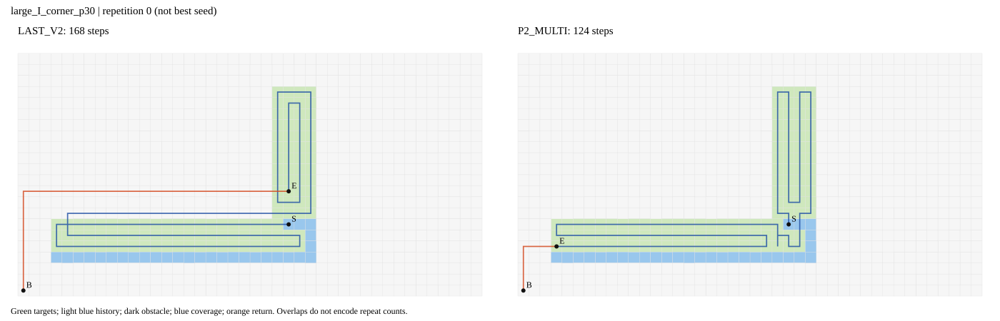
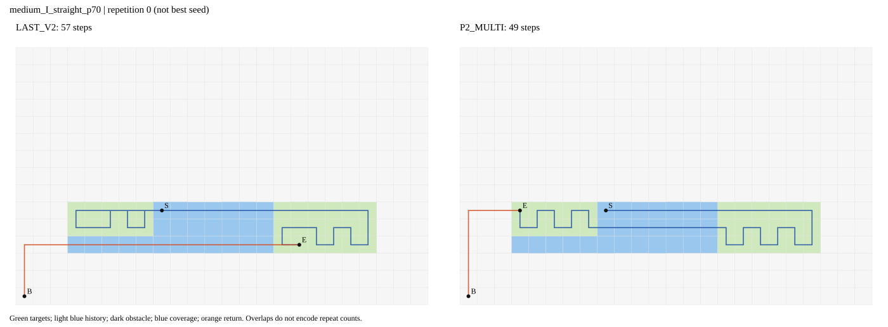
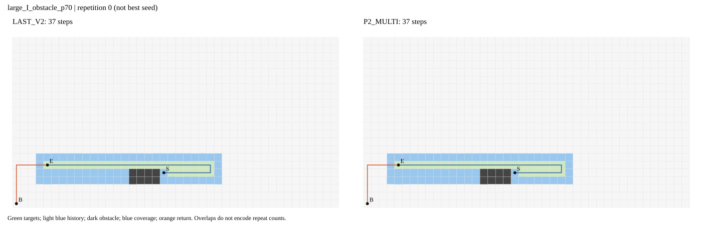
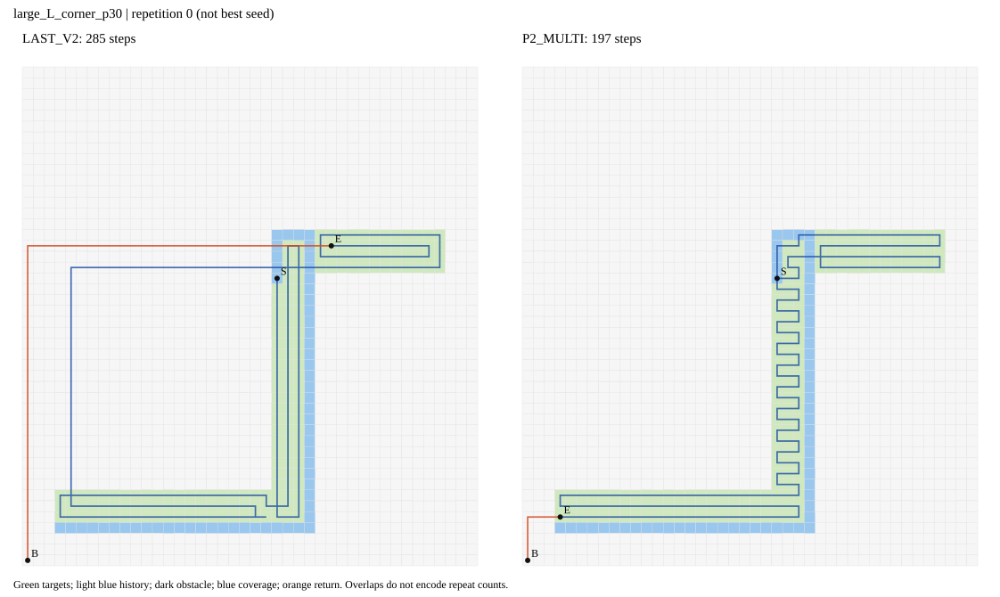
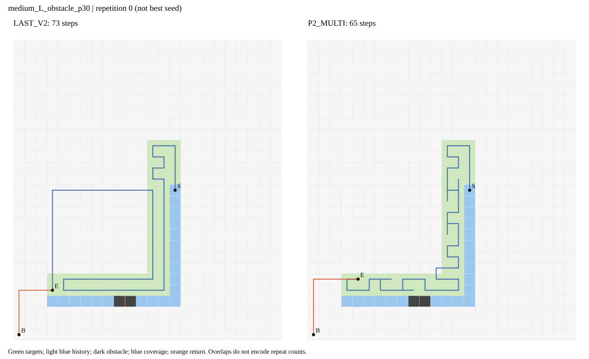
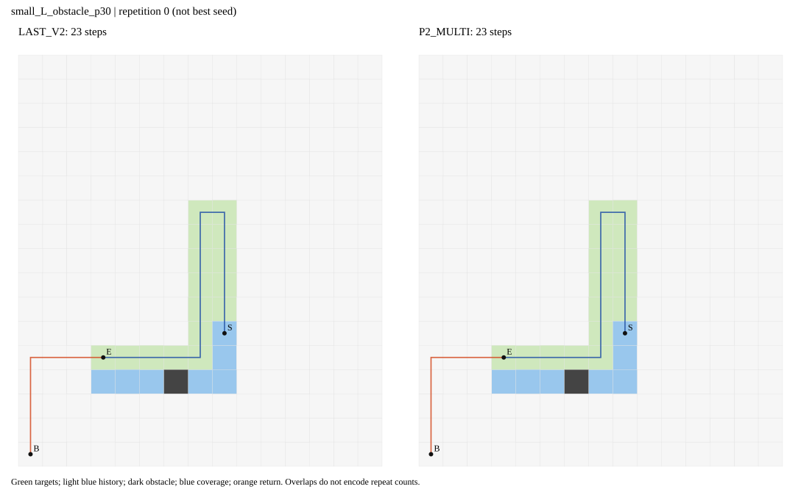
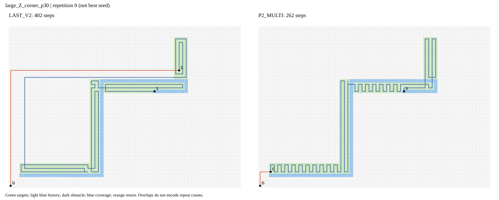
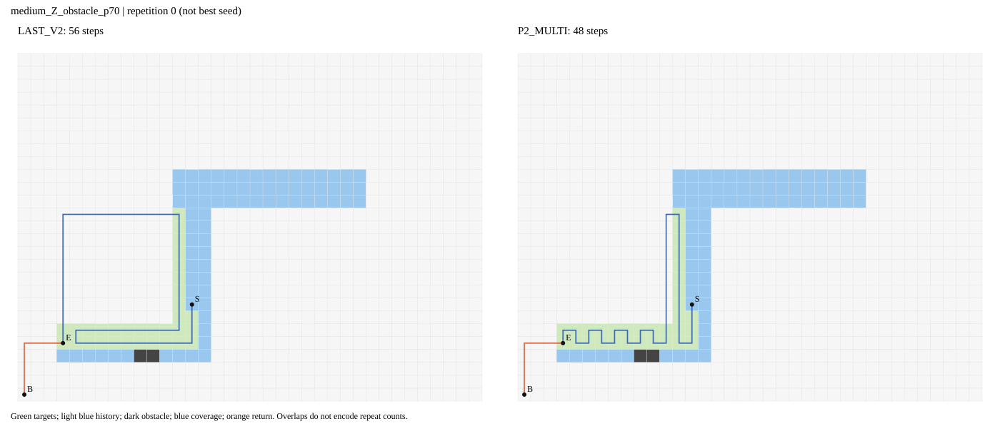
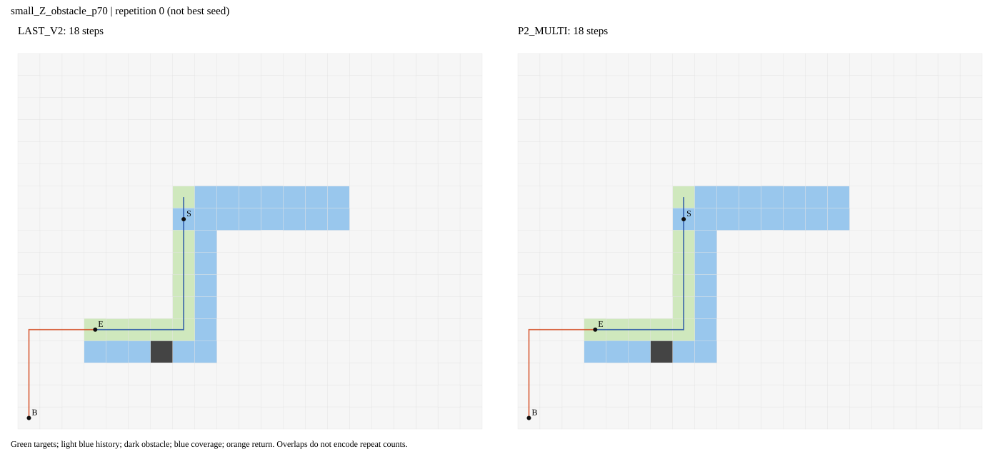

# PPCPP/LAST与P2差距只读诊断

2026-10-20。仅已有数据；新增求解0，留出未用。主分析20秒全部及时配对，54状态每项三种子均值求和。

|指标|LAST|P2|LAST−P2|
|---|---|---|---|
|length|5476.0|4393.333333333333|1082.666666666667|
|fresh_target_steps|3408.0|3408.0|0.0|
|historical_target_steps|209.0|223.33333333333334|-14.333333333333343|
|repeated_new_target_steps|231.0|58.666666666666664|172.33333333333334|
|non_target_steps|1628.0|703.3333333333334|924.6666666666666|
|completion_step|4491.0|4005.3333333333335|485.6666666666665|
|return_tail_steps|985.0|388.0|597.0|
|turns90|796.0|1336.6666666666667|-540.6666666666667|
|turns180|31.0|27.0|4.0|

## 日志证据

{
  "final_sources": {
    "H_NN_opt": 15,
    "V_scan_opt": 60,
    "old_suffix": 15,
    "H_scan_opt": 46,
    "perturb_H_opt": 3,
    "perturb_V_opt": 5,
    "shuffle_1_opt": 3,
    "reverse_V_raw": 5,
    "common_fallback": 3,
    "H_raw": 6,
    "shuffle_0_opt": 1
  },
  "recorded_raw_beats_LAST": 39,
  "core_beats_LAST": 117,
  "later_than_core_improves": 17,
  "later_than_core_saved": 18.666666666666668
}

## 全54状态（差值均为LAST−P2）

|状态|LAST三种子|P2三种子|总差|历史重复差|本轮重复差|非目标差|覆盖前差|返航差|P2最终来源|
|---|---|---|---|---|---|---|---|---|---|
|large_I_corner_p30|[168, 168, 168]|[124, 124, 124]|44|-1|1|44|18|26|['H_NN_opt', 'H_NN_opt', 'H_NN_opt']|
|large_I_corner_p70|[127, 127, 127]|[89, 89, 89]|38|0|-1|39|38|0|['V_scan_opt', 'V_scan_opt', 'V_scan_opt']|
|large_I_obstacle_p30|[76, 76, 76]|[72, 72, 72]|4|0|6|-2|6|-2|['V_scan_opt', 'V_scan_opt', 'V_scan_opt']|
|large_I_obstacle_p70|[37, 37, 37]|[37, 37, 37]|0|0|0|0|0|0|['old_suffix', 'old_suffix', 'old_suffix']|
|large_I_straight_p30|[170, 170, 170]|[126, 126, 126]|44|-1|45|0|19|25|['H_scan_opt', 'H_scan_opt', 'H_scan_opt']|
|large_I_straight_p70|[131, 131, 131]|[89, 89, 89]|42|16|27|-1|19|23|['H_scan_opt', 'H_scan_opt', 'H_scan_opt']|
|large_L_corner_p30|[285, 285, 285]|[197, 195, 197]|88.66666666666667|-2|6.666666666666667|84|38.666666666666664|50|['H_scan_opt', 'perturb_H_opt', 'H_scan_opt']|
|large_L_corner_p70|[207, 207, 207]|[167, 167, 167]|40|0|2|38|-10|50|['H_scan_opt', 'H_scan_opt', 'H_scan_opt']|
|large_L_obstacle_p30|[145, 145, 145]|[139, 139, 139]|6|0|6|0|6|0|['V_scan_opt', 'V_scan_opt', 'V_scan_opt']|
|large_L_obstacle_p70|[67, 67, 67]|[63, 63, 63]|4|0|4|0|4|0|['V_scan_opt', 'V_scan_opt', 'V_scan_opt']|
|large_L_straight_p30|[285, 285, 285]|[193, 199, 199]|88|-5|2|91|38|50|['perturb_V_opt', 'H_scan_opt', 'H_scan_opt']|
|large_L_straight_p70|[207, 207, 207]|[167, 167, 167]|40|-2|3|39|-10|50|['V_scan_opt', 'V_scan_opt', 'V_scan_opt']|
|large_Z_corner_p30|[402, 402, 402]|[262, 262, 262]|140|-2|2|140|66|74|['V_scan_opt', 'V_scan_opt', 'V_scan_opt']|
|large_Z_corner_p70|[285, 285, 285]|[195, 195, 195]|90|-6|2|94|16|74|['H_NN_opt', 'H_NN_opt', 'H_NN_opt']|
|large_Z_obstacle_p30|[214, 214, 214]|[208, 208, 208]|6|0|6|0|6|0|['V_scan_opt', 'V_scan_opt', 'V_scan_opt']|
|large_Z_obstacle_p70|[97, 97, 97]|[93, 93, 93]|4|0|4|0|4|0|['V_scan_opt', 'V_scan_opt', 'V_scan_opt']|
|large_Z_straight_p30|[402, 402, 402]|[266, 266, 266]|136|8|44|84|62|74|['H_scan_opt', 'H_scan_opt', 'H_scan_opt']|
|large_Z_straight_p70|[285, 285, 285]|[195, 195, 195]|90|2|4|84|16|74|['H_NN_opt', 'H_NN_opt', 'H_NN_opt']|
|medium_I_corner_p30|[62, 62, 62]|[56, 56, 56]|6|0|0|6|6|0|['V_scan_opt', 'V_scan_opt', 'V_scan_opt']|
|medium_I_corner_p70|[57, 57, 57]|[49, 47, 49]|8.666666666666666|0|-0.6666666666666666|9.333333333333334|-5.333333333333333|14|['V_scan_opt', 'shuffle_1_opt', 'V_scan_opt']|
|medium_I_obstacle_p30|[32, 32, 32]|[32, 32, 32]|0|0|0|0|0|0|['V_scan_opt', 'V_scan_opt', 'V_scan_opt']|
|medium_I_obstacle_p70|[17, 17, 17]|[17, 17, 17]|0|0|0|0|0|0|['V_scan_opt', 'V_scan_opt', 'V_scan_opt']|
|medium_I_straight_p30|[50, 50, 50]|[50, 50, 50]|0|0|0|0|0|0|['V_scan_opt', 'V_scan_opt', 'V_scan_opt']|
|medium_I_straight_p70|[57, 57, 57]|[49, 49, 49]|8|6|4|-2|-3|11|['V_scan_opt', 'V_scan_opt', 'V_scan_opt']|
|medium_L_corner_p30|[95, 95, 95]|[87, 85, 87]|8.666666666666666|0|0|8.666666666666666|8.666666666666666|0|['reverse_V_raw', 'perturb_V_opt', 'reverse_V_raw']|
|medium_L_corner_p70|[74, 74, 74]|[70, 70, 70]|4|-1|0|5|4|0|['V_scan_opt', 'V_scan_opt', 'V_scan_opt']|
|medium_L_obstacle_p30|[73, 73, 73]|[65, 67, 67]|6.666666666666667|0|-2.6666666666666665|9.333333333333334|7.333333333333333|-0.6666666666666666|['shuffle_1_opt', 'H_scan_opt', 'H_scan_opt']|
|medium_L_obstacle_p70|[44, 44, 44]|[42, 42, 42]|2|0|0|2|2|0|['V_scan_opt', 'V_scan_opt', 'V_scan_opt']|
|medium_L_straight_p30|[91, 91, 91]|[85, 85, 85]|6|0|-1|7|6|0|['H_scan_opt', 'H_scan_opt', 'H_scan_opt']|
|medium_L_straight_p70|[74, 74, 74]|[74, 70, 72]|2|-1.3333333333333333|-5|8.333333333333334|2.3333333333333335|-0.3333333333333333|['V_scan_opt', 'shuffle_1_opt', 'perturb_H_opt']|
|medium_Z_corner_p30|[124, 124, 124]|[122, 122, 122]|2|-2|5|-1|2|0|['reverse_V_raw', 'reverse_V_raw', 'reverse_V_raw']|
|medium_Z_corner_p70|[108, 108, 108]|[98, 98, 98]|10|-10|0|20|10|0|['V_scan_opt', 'V_scan_opt', 'V_scan_opt']|
|medium_Z_obstacle_p30|[102, 102, 102]|[96, 92, 94]|8|0|0|8|8|0|['V_scan_opt', 'perturb_V_opt', 'perturb_V_opt']|
|medium_Z_obstacle_p70|[56, 56, 56]|[48, 46, 48]|8.666666666666666|0|-2.3333333333333335|11|8.666666666666666|0|['V_scan_opt', 'perturb_V_opt', 'V_scan_opt']|
|medium_Z_straight_p30|[120, 120, 120]|[114, 114, 114]|6|0|1|5|6|0|['V_scan_opt', 'V_scan_opt', 'V_scan_opt']|
|medium_Z_straight_p70|[108, 108, 108]|[94, 94, 94]|14|-7|1|20|14|0|['V_scan_opt', 'V_scan_opt', 'V_scan_opt']|
|small_I_corner_p30|[21, 21, 21]|[21, 21, 21]|0|0|0|0|0|0|['H_scan_opt', 'H_scan_opt', 'H_scan_opt']|
|small_I_corner_p70|[24, 24, 24]|[20, 20, 20]|4|0|0|4|4|0|['H_NN_opt', 'H_NN_opt', 'H_NN_opt']|
|small_I_obstacle_p30|[17, 17, 17]|[17, 17, 17]|0|0|0|0|0|0|['common_fallback', 'common_fallback', 'common_fallback']|
|small_I_obstacle_p70|[10, 10, 10]|[10, 10, 10]|0|0|0|0|0|0|['old_suffix', 'old_suffix', 'old_suffix']|
|small_I_straight_p30|[21, 21, 21]|[21, 21, 21]|0|0|0|0|0|0|['H_raw', 'H_raw', 'H_raw']|
|small_I_straight_p70|[26, 26, 26]|[22, 22, 22]|4|3|2|-1|-1|5|['H_raw', 'H_raw', 'H_raw']|
|small_L_corner_p30|[31, 31, 31]|[31, 29, 29]|1.3333333333333333|0|1.3333333333333333|0|1.3333333333333333|0|['H_scan_opt', 'shuffle_0_opt', 'perturb_H_opt']|
|small_L_corner_p70|[40, 40, 40]|[28, 28, 28]|12|-3|-1|16|12|0|['H_scan_opt', 'H_scan_opt', 'H_scan_opt']|
|small_L_obstacle_p30|[23, 23, 23]|[23, 23, 23]|0|0|0|0|0|0|['old_suffix', 'old_suffix', 'old_suffix']|
|small_L_obstacle_p70|[14, 14, 14]|[14, 14, 14]|0|0|0|0|0|0|['old_suffix', 'old_suffix', 'old_suffix']|
|small_L_straight_p30|[29, 29, 29]|[29, 29, 29]|0|0|0|0|0|0|['H_scan_opt', 'H_scan_opt', 'H_scan_opt']|
|small_L_straight_p70|[40, 40, 40]|[28, 28, 28]|12|-7|-1|20|12|0|['H_scan_opt', 'H_scan_opt', 'H_scan_opt']|
|small_Z_corner_p30|[42, 42, 42]|[38, 38, 38]|4|0|4|0|4|0|['H_scan_opt', 'H_scan_opt', 'H_scan_opt']|
|small_Z_corner_p70|[56, 56, 56]|[38, 38, 38]|18|0|-1|19|18|0|['H_NN_opt', 'H_NN_opt', 'H_NN_opt']|
|small_Z_obstacle_p30|[34, 34, 34]|[32, 32, 32]|2|0|2|0|2|0|['H_scan_opt', 'H_scan_opt', 'H_scan_opt']|
|small_Z_obstacle_p70|[18, 18, 18]|[18, 18, 18]|0|0|0|0|0|0|['old_suffix', 'old_suffix', 'old_suffix']|
|small_Z_straight_p30|[40, 40, 40]|[38, 38, 38]|2|0|2|0|2|0|['H_scan_opt', 'H_scan_opt', 'H_scan_opt']|
|small_Z_straight_p70|[56, 56, 56]|[38, 38, 38]|18|1|1|16|18|0|['H_scan_opt', 'H_scan_opt', 'H_scan_opt']|

## 固定案例

### I / maximum / large_I_corner_p30

|重复|LAST|P2|已记录raw最短|core结束在手|最终来源|接受改进链|
|---|---|---|---|---|---|---|
|0|168|124|150|124|H_NN_opt|182:common_fallback → 150:H_NN_raw → 136:H_scan_opt → 124:H_NN_opt|
|1|168|124|150|124|H_NN_opt|182:common_fallback → 150:H_NN_raw → 136:H_scan_opt → 124:H_NN_opt|
|2|168|124|150|124|H_NN_opt|182:common_fallback → 150:H_NN_raw → 136:H_scan_opt → 124:H_NN_opt|

### I / typical / medium_I_straight_p70

|重复|LAST|P2|已记录raw最短|core结束在手|最终来源|接受改进链|
|---|---|---|---|---|---|---|
|0|57|49|61|49|V_scan_opt|65:common_fallback → 61:H_NN_raw → 59:H_scan_opt → 55:H_NN_opt → 49:V_scan_opt|
|1|57|49|61|49|V_scan_opt|65:common_fallback → 61:H_NN_raw → 59:H_scan_opt → 55:H_NN_opt → 49:V_scan_opt|
|2|57|49|61|49|V_scan_opt|65:common_fallback → 61:H_NN_raw → 59:H_scan_opt → 55:H_NN_opt → 49:V_scan_opt|

### I / equal / large_I_obstacle_p70

|重复|LAST|P2|已记录raw最短|core结束在手|最终来源|接受改进链|
|---|---|---|---|---|---|---|
|0|37|37|37|37|old_suffix|37:old_suffix|
|1|37|37|37|37|old_suffix|37:old_suffix|
|2|37|37|37|37|old_suffix|37:old_suffix|

### L / maximum / large_L_corner_p30

|重复|LAST|P2|已记录raw最短|core结束在手|最终来源|接受改进链|
|---|---|---|---|---|---|---|
|0|285|197|271|197|H_scan_opt|307:common_fallback → 271:H_NN_raw → 197:H_scan_opt|
|1|285|195|271|197|perturb_H_opt|307:common_fallback → 271:H_NN_raw → 197:H_scan_opt → 195:perturb_H_opt|
|2|285|197|271|197|H_scan_opt|307:common_fallback → 271:H_NN_raw → 197:H_scan_opt|

### L / typical / medium_L_obstacle_p30

|重复|LAST|P2|已记录raw最短|core结束在手|最终来源|接受改进链|
|---|---|---|---|---|---|---|
|0|73|65|75|67|shuffle_1_opt|75:old_suffix → 67:H_scan_opt → 65:shuffle_1_opt|
|1|73|67|75|67|H_scan_opt|75:old_suffix → 67:H_scan_opt|
|2|73|67|75|67|H_scan_opt|75:old_suffix → 67:H_scan_opt|

### L / equal / small_L_obstacle_p30

|重复|LAST|P2|已记录raw最短|core结束在手|最终来源|接受改进链|
|---|---|---|---|---|---|---|
|0|23|23|23|23|old_suffix|23:old_suffix|
|1|23|23|23|23|old_suffix|23:old_suffix|
|2|23|23|23|23|old_suffix|23:old_suffix|

### Z / maximum / large_Z_corner_p30

|重复|LAST|P2|已记录raw最短|core结束在手|最终来源|接受改进链|
|---|---|---|---|---|---|---|
|0|402|262|304|262|V_scan_opt|416:common_fallback → 412:H_raw → 304:H_NN_raw → 286:H_scan_opt → 262:V_scan_opt|
|1|402|262|304|262|V_scan_opt|416:common_fallback → 412:H_raw → 304:H_NN_raw → 286:H_scan_opt → 262:V_scan_opt|
|2|402|262|304|262|V_scan_opt|416:common_fallback → 412:H_raw → 304:H_NN_raw → 286:H_scan_opt → 262:V_scan_opt|

### Z / typical / medium_Z_obstacle_p70

|重复|LAST|P2|已记录raw最短|core结束在手|最终来源|接受改进链|
|---|---|---|---|---|---|---|
|0|56|48|58|48|V_scan_opt|58:old_suffix → 56:H_scan_opt → 48:V_scan_opt|
|1|56|46|58|48|perturb_V_opt|58:old_suffix → 56:H_scan_opt → 48:V_scan_opt → 46:perturb_V_opt|
|2|56|48|58|48|V_scan_opt|58:old_suffix → 56:H_scan_opt → 48:V_scan_opt|

### Z / equal / small_Z_obstacle_p70

|重复|LAST|P2|已记录raw最短|core结束在手|最终来源|接受改进链|
|---|---|---|---|---|---|---|
|0|18|18|18|18|old_suffix|18:old_suffix|
|1|18|18|18|18|old_suffix|18:old_suffix|
|2|18|18|18|18|old_suffix|18:old_suffix|

## 证据边界

improvements仅记录严格变短的接受候选，不包含所有未接受候选的长度或中间路线。raw最短比LAST短是存在该候选的证据；未记录raw优势不是不存在优势。core_finished包含横纵扫描、最近邻及每初值8轮2-opt，不能叫纯扫描。接受下降属于按实际顺序更新的账目，不是独立机制因果贡献。图仅展示最终路线，重叠线不能直接看出经过次数，次数以逐格指标为准。