# 三组预登记详细案例

只读后处理，真实执行链及结果不改。按平均D_H−D_U最大、最小、绝对值最小依次去重；全部四条件与三seed保留。三seed共享输入，不是独立地图。图中采集段与返航按保存的completion_step分界，颜色不表示可删除步数。

## maximum：g00_b009

平均D_H−D_U=-12，分类reverse。

|条件|实际H比例|接触k|A至当前位置最小图距|A至基地最小图距|
|---|---|---|---|---|
|CONTROL|9/54=0.1667|None|NA|NA|
|H_SIDE|9/54=0.1667|6|4|4|
|MIXED_SIDE|9/54=0.1667|3|1|10|
|U_SIDE|9/54=0.1667|0|2|13|

|条件|seed|方法|L|C|R|首次新采|历史到达|本轮重复|非目标|90°|180°|入口秒|
|---|---|---|---|---|---|---|---|---|---|---|---|---|
|CONTROL|20261020|PPCPP|54|45|9|45|0|1|8|35|1|0.002403|
|CONTROL|20261020|P2_MULTI|52|45|7|45|0|0|7|37|0|0.159628|
|CONTROL|20261021|PPCPP|54|45|9|45|0|1|8|35|1|0.002436|
|CONTROL|20261021|P2_MULTI|52|45|7|45|0|0|7|37|0|0.159807|
|CONTROL|20261022|PPCPP|54|45|9|45|0|1|8|35|1|0.002424|
|CONTROL|20261022|P2_MULTI|52|45|7|45|0|0|7|37|0|0.164798|
|H_SIDE|20261020|PPCPP|64|60|4|57|1|2|4|41|0|0.003029|
|H_SIDE|20261020|P2_MULTI|66|60|6|57|1|3|5|39|1|0.284261|
|H_SIDE|20261021|PPCPP|64|60|4|57|1|2|4|41|0|0.003102|
|H_SIDE|20261021|P2_MULTI|66|60|6|57|1|3|5|39|1|0.280659|
|H_SIDE|20261022|PPCPP|64|60|4|57|1|2|4|41|0|0.003037|
|H_SIDE|20261022|P2_MULTI|66|60|6|57|1|3|5|39|1|0.277808|
|MIXED_SIDE|20261020|PPCPP|74|64|10|57|1|1|15|39|0|0.002931|
|MIXED_SIDE|20261020|P2_MULTI|72|61|11|57|0|5|10|25|2|0.290465|
|MIXED_SIDE|20261021|PPCPP|74|64|10|57|1|1|15|39|0|0.003488|
|MIXED_SIDE|20261021|P2_MULTI|70|63|7|57|2|4|7|43|1|0.304694|
|MIXED_SIDE|20261022|PPCPP|74|64|10|57|1|1|15|39|0|0.003262|
|MIXED_SIDE|20261022|P2_MULTI|72|61|11|57|0|5|10|25|2|0.289483|
|U_SIDE|20261020|PPCPP|80|67|13|57|1|1|21|39|0|0.003004|
|U_SIDE|20261020|P2_MULTI|70|63|7|57|0|6|7|37|0|0.288853|
|U_SIDE|20261021|PPCPP|80|67|13|57|1|1|21|39|0|0.002992|
|U_SIDE|20261021|P2_MULTI|70|63|7|57|0|6|7|37|0|0.272866|
|U_SIDE|20261022|PPCPP|80|67|13|57|1|1|21|39|0|0.002992|
|U_SIDE|20261022|P2_MULTI|70|63|7|57|0|6|7|37|0|0.272124|

|seed|D_H|D_U|D_H−D_U|其中C差分|其中R差分|首次新采差分|历史差分|本轮重复差分|非目标差分|
|---|---|---|---|---|---|---|---|---|---|
|20261020|-2|10|-12|-4|-8|0|-1|4|-15|
|20261021|-2|10|-12|-4|-8|0|-1|4|-15|
|20261022|-2|10|-12|-4|-8|0|-1|4|-15|

### CONTROL

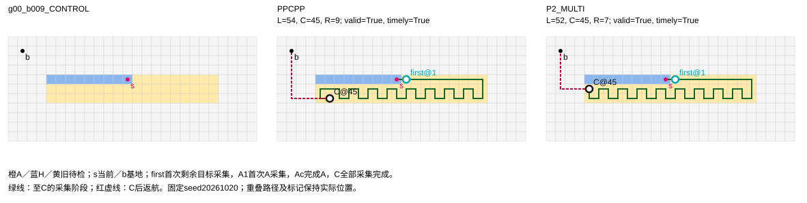

|方法（seed20261020）|首次A|完成A|A完成时旧剩余|完成前进入|未完成退出|再次进入|分类|
|---|---|---|---|---|---|---|---|
|PPCPP|NA|NA|NA|NA|NA|NA|not_applicable|
|P2_MULTI|NA|NA|NA|NA|NA|NA|not_applicable|

原PPCPP首次涉及A记录：{"applicable": false, "reason": "CONTROL_no_A"}。

### H_SIDE

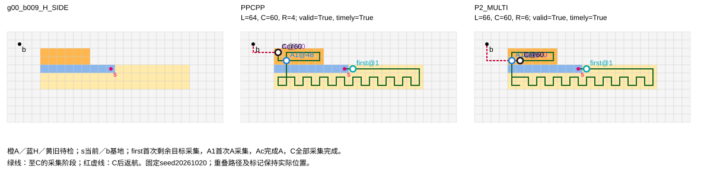

|方法（seed20261020）|首次A|完成A|A完成时旧剩余|完成前进入|未完成退出|再次进入|分类|
|---|---|---|---|---|---|---|---|
|PPCPP|48|60|0|1|0|0|single_continuous_visit|
|P2_MULTI|49|60|0|1|0|0|single_continuous_visit|

原PPCPP首次涉及A：保存trace指针`$.result.raw.branches.P0.trace[45]`，类型`recovery`，current=[5, 6]，goal=[5, 3]，索引45。已存options/rewards为：

```json
null
```

字面执行段：[[5, 6], [5, 5], [5, 4], [5, 3]]。未保存奖励不反推；P2只观察最终轨迹。

### MIXED_SIDE

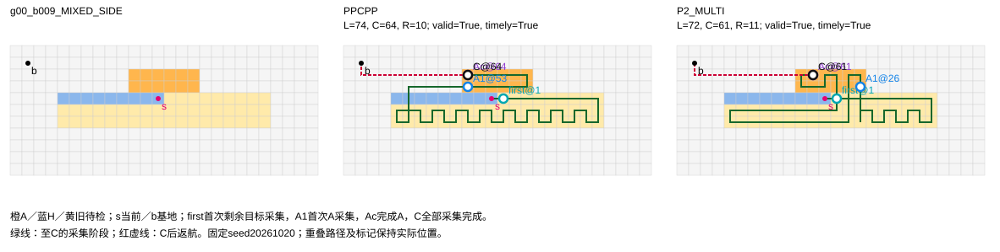

|方法（seed20261020）|首次A|完成A|A完成时旧剩余|完成前进入|未完成退出|再次进入|分类|
|---|---|---|---|---|---|---|---|
|PPCPP|53|64|0|1|0|0|single_continuous_visit|
|P2_MULTI|26|61|0|2|1|1|unfinished_exit_and_reentry|

原PPCPP首次涉及A：保存trace指针`$.result.raw.branches.P0.trace[0]`，类型`local`，current=[12, 4]，goal=[13, 4]，索引0。已存options/rewards为：

```json
[{"cell": [12, 3], "distance_reward": 0.0, "straight_reward": 0.5, "boundary_reward": 0.25, "score": 1.125}, {"cell": [12, 5], "distance_reward": 0.481491495306779, "straight_reward": 0.5, "boundary_reward": 0.25, "score": 1.606491495306779}, {"cell": [13, 4], "distance_reward": 1.0, "straight_reward": 1.0, "boundary_reward": 0.25, "score": 3.125}]
```

字面执行段：[[12, 4], [13, 4]]。未保存奖励不反推；P2只观察最终轨迹。

### U_SIDE

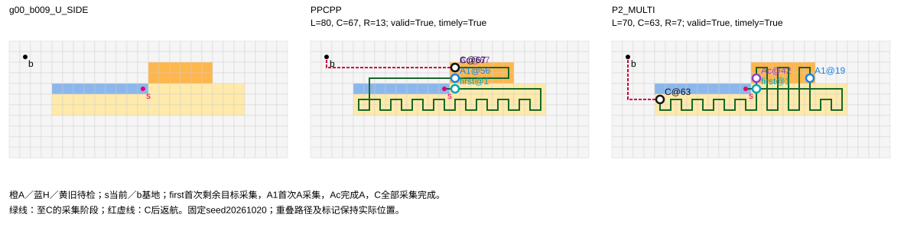

|方法（seed20261020）|首次A|完成A|A完成时旧剩余|完成前进入|未完成退出|再次进入|分类|
|---|---|---|---|---|---|---|---|
|PPCPP|56|67|0|1|0|0|single_continuous_visit|
|P2_MULTI|19|42|20|3|2|2|unfinished_exit_and_reentry|

原PPCPP首次涉及A：保存trace指针`$.result.raw.branches.P0.trace[1]`，类型`local`，current=[13, 4]，goal=[14, 4]，索引1。已存options/rewards为：

```json
[{"cell": [13, 3], "distance_reward": 0.0, "straight_reward": 0.5, "boundary_reward": 0.5, "score": 1.25}, {"cell": [13, 5], "distance_reward": 0.45446680728782096, "straight_reward": 0.5, "boundary_reward": 0.25, "score": 1.579466807287821}, {"cell": [14, 4], "distance_reward": 1.0, "straight_reward": 1.0, "boundary_reward": 0.25, "score": 3.125}]
```

字面执行段：[[13, 4], [14, 4]]。未保存奖励不反推；P2只观察最终轨迹。

该组只定位实际路线差和访问顺序，位置还改变距离与布局；反复进入或历史到达不自动等于浪费。

## minimum：g04_b028

平均D_H−D_U=-52，分类reverse。

|条件|实际H比例|接触k|A至当前位置最小图距|A至基地最小图距|
|---|---|---|---|---|
|CONTROL|28/126=0.2222|None|NA|NA|
|H_SIDE|28/126=0.2222|14|15|4|
|MIXED_SIDE|28/126=0.2222|7|1|25|
|U_SIDE|28/126=0.2222|0|2|32|

|条件|seed|方法|L|C|R|首次新采|历史到达|本轮重复|非目标|90°|180°|入口秒|
|---|---|---|---|---|---|---|---|---|---|---|---|---|
|CONTROL|20261020|PPCPP|107|98|9|98|0|1|8|83|1|0.00404|
|CONTROL|20261020|P2_MULTI|105|98|7|98|0|0|7|85|0|0.891343|
|CONTROL|20261021|PPCPP|107|98|9|98|0|1|8|83|1|0.003997|
|CONTROL|20261021|P2_MULTI|105|98|7|98|0|0|7|85|0|0.940815|
|CONTROL|20261022|PPCPP|107|98|9|98|0|1|8|83|1|0.004011|
|CONTROL|20261022|P2_MULTI|105|98|7|98|0|0|7|85|0|0.905864|
|H_SIDE|20261020|PPCPP|133|129|4|126|1|2|4|89|0|0.005358|
|H_SIDE|20261020|P2_MULTI|135|129|6|126|1|3|5|87|1|1.702629|
|H_SIDE|20261021|PPCPP|133|129|4|126|1|2|4|89|0|0.005224|
|H_SIDE|20261021|P2_MULTI|135|129|6|126|1|3|5|87|1|1.513648|
|H_SIDE|20261022|PPCPP|133|129|4|126|1|2|4|89|0|0.005172|
|H_SIDE|20261022|P2_MULTI|135|129|6|126|1|3|5|87|1|1.566751|
|MIXED_SIDE|20261020|PPCPP|173|148|25|126|1|1|45|87|0|0.005569|
|MIXED_SIDE|20261020|P2_MULTI|147|140|7|126|7|7|7|85|0|1.506334|
|MIXED_SIDE|20261021|PPCPP|173|148|25|126|1|1|45|87|0|0.005128|
|MIXED_SIDE|20261021|P2_MULTI|147|140|7|126|7|7|7|85|0|1.599689|
|MIXED_SIDE|20261022|PPCPP|173|148|25|126|1|1|45|87|0|0.005409|
|MIXED_SIDE|20261022|P2_MULTI|147|140|7|126|7|7|7|85|0|1.572395|
|U_SIDE|20261020|PPCPP|187|155|32|126|1|1|59|87|0|0.005356|
|U_SIDE|20261020|P2_MULTI|137|130|7|126|1|0|10|86|0|1.511073|
|U_SIDE|20261021|PPCPP|187|155|32|126|1|1|59|87|0|0.005327|
|U_SIDE|20261021|P2_MULTI|137|130|7|126|1|0|10|86|0|1.499673|
|U_SIDE|20261022|PPCPP|187|155|32|126|1|1|59|87|0|0.008935|
|U_SIDE|20261022|P2_MULTI|137|130|7|126|1|0|10|86|0|1.645452|

|seed|D_H|D_U|D_H−D_U|其中C差分|其中R差分|首次新采差分|历史差分|本轮重复差分|非目标差分|
|---|---|---|---|---|---|---|---|---|---|
|20261020|-2|50|-52|-25|-27|0|0|-2|-50|
|20261021|-2|50|-52|-25|-27|0|0|-2|-50|
|20261022|-2|50|-52|-25|-27|0|0|-2|-50|

### CONTROL

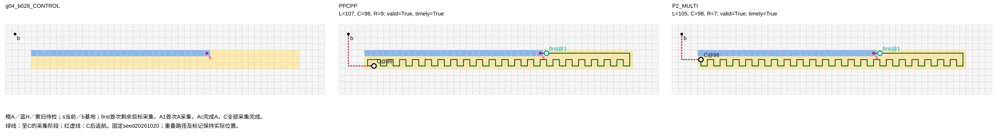

|方法（seed20261020）|首次A|完成A|A完成时旧剩余|完成前进入|未完成退出|再次进入|分类|
|---|---|---|---|---|---|---|---|
|PPCPP|NA|NA|NA|NA|NA|NA|not_applicable|
|P2_MULTI|NA|NA|NA|NA|NA|NA|not_applicable|

原PPCPP首次涉及A记录：{"applicable": false, "reason": "CONTROL_no_A"}。

### H_SIDE

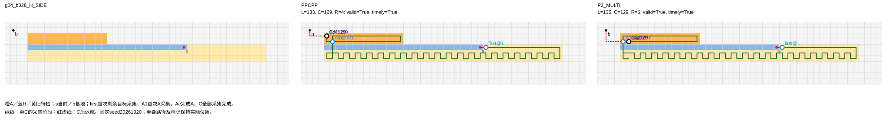

|方法（seed20261020）|首次A|完成A|A完成时旧剩余|完成前进入|未完成退出|再次进入|分类|
|---|---|---|---|---|---|---|---|
|PPCPP|101|129|0|1|0|0|single_continuous_visit|
|P2_MULTI|102|129|0|1|0|0|single_continuous_visit|

原PPCPP首次涉及A：保存trace指针`$.result.raw.branches.P0.trace[98]`，类型`recovery`，current=[5, 6]，goal=[5, 3]，索引98。已存options/rewards为：

```json
null
```

字面执行段：[[5, 6], [5, 5], [5, 4], [5, 3]]。未保存奖励不反推；P2只观察最终轨迹。

### MIXED_SIDE

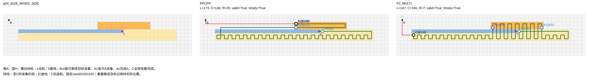

|方法（seed20261020）|首次A|完成A|A完成时旧剩余|完成前进入|未完成退出|再次进入|分类|
|---|---|---|---|---|---|---|---|
|PPCPP|121|148|0|1|0|0|single_continuous_visit|
|P2_MULTI|32|95|44|7|6|6|unfinished_exit_and_reentry|

原PPCPP首次涉及A：保存trace指针`$.result.raw.branches.P0.trace[0]`，类型`local`，current=[31, 4]，goal=[32, 4]，索引0。已存options/rewards为：

```json
[{"cell": [31, 3], "distance_reward": 0.0, "straight_reward": 0.5, "boundary_reward": 0.25, "score": 1.125}, {"cell": [31, 5], "distance_reward": 0.22516069866620395, "straight_reward": 0.5, "boundary_reward": 0.25, "score": 1.350160698666204}, {"cell": [32, 4], "distance_reward": 1.0, "straight_reward": 1.0, "boundary_reward": 0.25, "score": 3.125}]
```

字面执行段：[[31, 4], [32, 4]]。未保存奖励不反推；P2只观察最终轨迹。

### U_SIDE

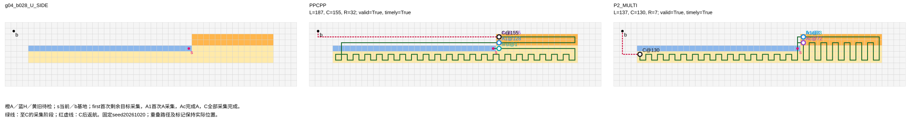

|方法（seed20261020）|首次A|完成A|A完成时旧剩余|完成前进入|未完成退出|再次进入|分类|
|---|---|---|---|---|---|---|---|
|PPCPP|128|155|0|1|0|0|single_continuous_visit|
|P2_MULTI|3|72|56|8|7|7|unfinished_exit_and_reentry|

原PPCPP首次涉及A：保存trace指针`$.result.raw.branches.P0.trace[1]`，类型`local`，current=[32, 4]，goal=[33, 4]，索引1。已存options/rewards为：

```json
[{"cell": [32, 3], "distance_reward": 0.0, "straight_reward": 0.5, "boundary_reward": 0.5, "score": 1.25}, {"cell": [32, 5], "distance_reward": 0.21900486217976883, "straight_reward": 0.5, "boundary_reward": 0.25, "score": 1.3440048621797689}, {"cell": [33, 4], "distance_reward": 1.0, "straight_reward": 1.0, "boundary_reward": 0.25, "score": 3.125}]
```

字面执行段：[[32, 4], [33, 4]]。未保存奖励不反推；P2只观察最终轨迹。

该组只定位实际路线差和访问顺序，位置还改变距离与布局；反复进入或历史到达不自动等于浪费。

## closest_zero：g01_b009

平均D_H−D_U=-12，分类reverse。

|条件|实际H比例|接触k|A至当前位置最小图距|A至基地最小图距|
|---|---|---|---|---|
|CONTROL|9/90=0.1000|None|NA|NA|
|H_SIDE|9/90=0.1000|6|4|4|
|MIXED_SIDE|9/90=0.1000|3|1|10|
|U_SIDE|9/90=0.1000|0|2|13|

|条件|seed|方法|L|C|R|首次新采|历史到达|本轮重复|非目标|90°|180°|入口秒|
|---|---|---|---|---|---|---|---|---|---|---|---|---|
|CONTROL|20261020|PPCPP|92|81|11|81|0|2|9|35|1|0.00344|
|CONTROL|20261020|P2_MULTI|88|81|7|81|0|0|7|37|0|0.646715|
|CONTROL|20261021|PPCPP|92|81|11|81|0|2|9|35|1|0.003302|
|CONTROL|20261021|P2_MULTI|88|81|7|81|0|0|7|37|0|0.527788|
|CONTROL|20261022|PPCPP|92|81|11|81|0|2|9|35|1|0.003353|
|CONTROL|20261022|P2_MULTI|88|81|7|81|0|0|7|37|0|0.517692|
|H_SIDE|20261020|PPCPP|102|97|5|93|1|4|4|41|1|0.003978|
|H_SIDE|20261020|P2_MULTI|104|98|6|93|1|5|5|39|1|0.78282|
|H_SIDE|20261021|PPCPP|102|97|5|93|1|4|4|41|1|0.004053|
|H_SIDE|20261021|P2_MULTI|104|98|6|93|1|5|5|39|1|0.766485|
|H_SIDE|20261022|PPCPP|102|97|5|93|1|4|4|41|1|0.003925|
|H_SIDE|20261022|P2_MULTI|104|98|6|93|1|5|5|39|1|0.799281|
|MIXED_SIDE|20261020|PPCPP|110|100|10|93|1|2|14|39|0|0.003765|
|MIXED_SIDE|20261020|P2_MULTI|106|96|10|93|1|2|10|45|0|0.860406|
|MIXED_SIDE|20261021|PPCPP|110|100|10|93|1|2|14|39|0|0.00378|
|MIXED_SIDE|20261021|P2_MULTI|106|96|10|93|1|2|10|45|0|0.782438|
|MIXED_SIDE|20261022|PPCPP|110|100|10|93|1|2|14|39|0|0.003761|
|MIXED_SIDE|20261022|P2_MULTI|106|96|10|93|1|2|10|45|0|0.780819|
|U_SIDE|20261020|PPCPP|116|103|13|93|1|2|20|39|0|0.003842|
|U_SIDE|20261020|P2_MULTI|106|99|7|93|0|6|7|37|0|0.770706|
|U_SIDE|20261021|PPCPP|116|103|13|93|1|2|20|39|0|0.003849|
|U_SIDE|20261021|P2_MULTI|106|99|7|93|0|6|7|37|0|0.75026|
|U_SIDE|20261022|PPCPP|116|103|13|93|1|2|20|39|0|0.003899|
|U_SIDE|20261022|P2_MULTI|106|99|7|93|0|6|7|37|0|0.73625|

|seed|D_H|D_U|D_H−D_U|其中C差分|其中R差分|首次新采差分|历史差分|本轮重复差分|非目标差分|
|---|---|---|---|---|---|---|---|---|---|
|20261020|-2|10|-12|-5|-7|0|-1|3|-14|
|20261021|-2|10|-12|-5|-7|0|-1|3|-14|
|20261022|-2|10|-12|-5|-7|0|-1|3|-14|

### CONTROL

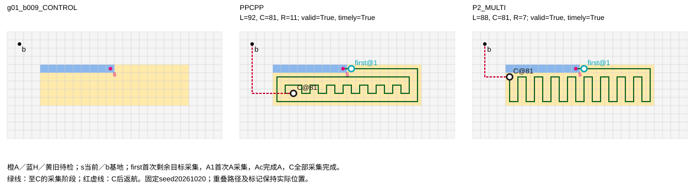

|方法（seed20261020）|首次A|完成A|A完成时旧剩余|完成前进入|未完成退出|再次进入|分类|
|---|---|---|---|---|---|---|---|
|PPCPP|NA|NA|NA|NA|NA|NA|not_applicable|
|P2_MULTI|NA|NA|NA|NA|NA|NA|not_applicable|

原PPCPP首次涉及A记录：{"applicable": false, "reason": "CONTROL_no_A"}。

### H_SIDE

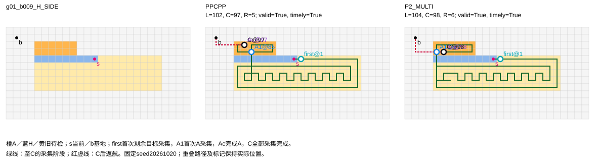

|方法（seed20261020）|首次A|完成A|A完成时旧剩余|完成前进入|未完成退出|再次进入|分类|
|---|---|---|---|---|---|---|---|
|PPCPP|85|97|0|1|0|0|single_continuous_visit|
|P2_MULTI|87|98|0|1|0|0|single_continuous_visit|

原PPCPP首次涉及A：保存trace指针`$.result.raw.branches.P0.trace[81]`，类型`recovery`，current=[6, 7]，goal=[6, 3]，索引81。已存options/rewards为：

```json
null
```

字面执行段：[[6, 7], [6, 6], [6, 5], [6, 4], [6, 3]]。未保存奖励不反推；P2只观察最终轨迹。

### MIXED_SIDE

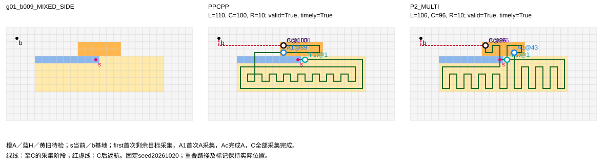

|方法（seed20261020）|首次A|完成A|A完成时旧剩余|完成前进入|未完成退出|再次进入|分类|
|---|---|---|---|---|---|---|---|
|PPCPP|89|100|0|1|0|0|single_continuous_visit|
|P2_MULTI|43|96|0|2|1|1|unfinished_exit_and_reentry|

原PPCPP首次涉及A：保存trace指针`$.result.raw.branches.P0.trace[0]`，类型`local`，current=[12, 4]，goal=[13, 4]，索引0。已存options/rewards为：

```json
[{"cell": [12, 3], "distance_reward": 0.0, "straight_reward": 0.5, "boundary_reward": 0.25, "score": 1.125}, {"cell": [12, 5], "distance_reward": 0.481491495306779, "straight_reward": 0.5, "boundary_reward": 0.25, "score": 1.606491495306779}, {"cell": [13, 4], "distance_reward": 1.0, "straight_reward": 1.0, "boundary_reward": 0.25, "score": 3.125}]
```

字面执行段：[[12, 4], [13, 4]]。未保存奖励不反推；P2只观察最终轨迹。

### U_SIDE

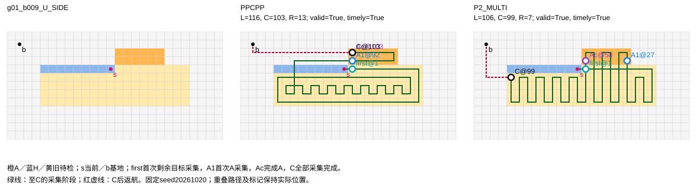

|方法（seed20261020）|首次A|完成A|A完成时旧剩余|完成前进入|未完成退出|再次进入|分类|
|---|---|---|---|---|---|---|---|
|PPCPP|92|103|0|1|0|0|single_continuous_visit|
|P2_MULTI|27|58|40|3|2|2|unfinished_exit_and_reentry|

原PPCPP首次涉及A：保存trace指针`$.result.raw.branches.P0.trace[1]`，类型`local`，current=[13, 4]，goal=[14, 4]，索引1。已存options/rewards为：

```json
[{"cell": [13, 3], "distance_reward": 0.0, "straight_reward": 0.5, "boundary_reward": 0.5, "score": 1.25}, {"cell": [13, 5], "distance_reward": 0.45446680728782096, "straight_reward": 0.5, "boundary_reward": 0.25, "score": 1.579466807287821}, {"cell": [14, 4], "distance_reward": 1.0, "straight_reward": 1.0, "boundary_reward": 0.25, "score": 3.125}]
```

字面执行段：[[13, 4], [14, 4]]。未保存奖励不反推；P2只观察最终轨迹。

该组只定位实际路线差和访问顺序，位置还改变距离与布局；反复进入或历史到达不自动等于浪费。
