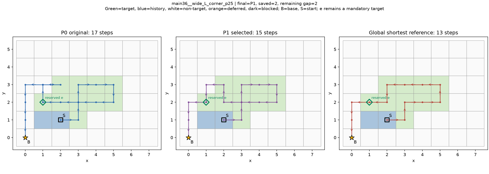
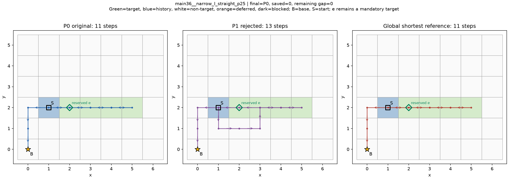

# PPCPP保留末采集格候选：实现与开发验收结果

2026-10-20。候选PPCPP_LAST_RESERVE_v0.1，简称LAST。**执行完成，待负责人审核**。只通过当前开发可行性检查，不确认为主算法或论文创新。

## 结论与性质

固定60开发状态×两方法×3重复=360次新正式调用，全部完整合法及时，无截止/异常/看门狗；三个重复完整route/trace稳定。主36：8短28平0长，总430→414少16步（3.7209%，逐状态平均减少2.7720%）。补24：2短22平0长，266→262少4步（1.5038%，逐状态平均减少1.1040%）。分别计状态一次，重复不是新地图。

主批改善来自L/Z两道路族、4个非等价已知几何组，各两相关历史进度；补批2改善仍是原一个L形拐扩几何。当前固定实现达到“跨不同族/非等价几何有严格改善、正确且及时”的开发可行性门槛，但输入全是已见开发回测，不能当独立新验证。未启动大图或强P2共同预算比较。

原已最优状态全部保留：主批原28/36最优，LAST32/36最优；补批原22/24，LAST24/24。主批理论28步追回16，仍剩12；补批4步全追回。最终完整成功不长于原版，主要由保留P0并严格比较的构造保证，不能把零退化率当创新。

## 策略性保留如何实现

真实F/T/H/公开与暂缓账本不改。U=T-H-{current}，e按原F至基地的最短图距离和坐标序选择；不读取原路线结束格或精确结果。P0先由冻结原版完整求解，失败则直接失败。P1从真实原位置/朝向用私有状态重来；阶段一F_work=F-{e}、pending=U-{e}，仍用原奖励、最近恢复和原连接器，沿途逐格采集。只检查阶段一待检可达，不套用即时返航预检；阶段二恢复F，到e再返航，按真实原输入审核。仅严格更短采用P1，同值保P0。e不是物理障碍，不能记暂缓或提前经过不采集。

变化代码集中candidate.py：输入候选距离、私有work_snapshot、工作待检可达检查（不用work.precheck）、原局部/恢复在F_work运行、release恢复F的两段连接、完整审核和严格择优。P0通过原native.solve调用不改；runtime.py只统一入口截止/编码/ONE消融，worker.py只管理输入与读路径审计。原奖励权重/捕食者/历史朝向/tie规则均不改。

全程同一个20秒截止，包含解码/验证/构造/P0/e距离/工作缓存/P1/审核/完整原输出编码。P0和P1没有各自20秒；即便P0完成，只要整体晚到，route为空且不作为及时输出接受。诊断分支继续保留。启动/导入、磁盘、外审不计。各输入统一1000000距离预算，当前小图不活跃。

## 门槛与版本记录

首次gates.py导入时碰到冻结代码同名audit.py，门槛调用0、正式0；失败脚本/gates.log保留。另版gates_v02.py仅显式按绝对路径加载本地审核器，不改候选或审核公式。随后218门槛调用全通过：180开发（60输入×PPCPP/ONE/LAST）、27固定夹具（9×3）、1缓存Spy、9截止注入、1原分支失败。另8次仅夹具精确last查询离线核验P1不短于最优，不计正式求解。

60组三方法门槛核对ONE完整route/trace及LAST中P0等于当次原版；正式180状态-重复组P0仍逐路线/trace等于同批原版。全部原分支和P1的成功轨迹独立重算原奖励、工作图BFS最近恢复、逐格采集、保留e不提前进入、release后原图连接及最终择优。三种图缓存是独立对象，Spy核其free/cache/distance_rows；输入未改，P0在P1前后完整序列化一致。

固定夹具覆盖空任务、单任务、当前位置即时采集、候选同距、e必经导致reservation_infeasible、e=base移除后基地不可达但其他任务仍可完成、障碍图距离、恢复连接逐格采集、历史目标后来被挡。实际最近恢复不会在去最近目标之前途经更近待检格，故“沿途多目标采集”另用真实append_segment收集器的固定远端连接单测，不假造原生恢复例。

9个可控时钟推进注入分别在P0完成、候选距离、phase1、release、return、最终审核前/后、编码前/后。每次P0已完整，整入口仍deadline拒收，未回填P0。原分支资源不足另1夹具，未生成P1。全部固定门槛通过后source_seal冻结，再开始360正式。

## 分批正式结果与候选状态

|批次|状态|完整及时调用|短/平/长|原总步|LAST总步|省步|P1短/平/长|空U|原最优→最终最优|
|---|---|---|---|---|---|---|---|---|---|
|main36|36|216|8/28/0|430|414|16|8/22/5|1|28→32|
|supp24|24|144|2/22/0|266|262|4|2/15/6|1|22→24|

主批35替代完整、1空任务；补批23替代完整、1空任务。正式reservation_infeasible=0、P1异常=0、原分支失败=0、整体截止=0；策略性不可达只在门槛观察到，不补正式图。主批5条、补批6条更长替代均保存并保P0；主22条/补15条同长也保P0。按三重复调用计，LAST180次含174完整P1、6空U；选P1共30次，对应10个状态。

## main36：全部逐状态

|状态|原P0|P1|选中|LAST|L*|追回|剩余差|e|P1−Lnear|额外工作连接步|
|---|---|---|---|---|---|---|---|---|---|---|
|narrow_I_corner_p25|11|11|P0|11|11|0|0|[2, 2]|0|0|
|narrow_I_corner_p60|10|10|P0|10|10|0|0|[3, 2]|0|0|
|narrow_I_obstacle_p25|9|9|P0|9|9|0|0|[3, 2]|0|0|
|narrow_I_obstacle_p60|4|不适用|P0|4|4|0|0|None|无参考|0|
|narrow_I_straight_p25|11|13|P0|11|11|0|0|[2, 2]|0|2|
|narrow_I_straight_p60|10|12|P0|10|10|0|0|[3, 2]|0|2|
|narrow_L_corner_p25|14|14|P0|14|14|0|0|[3, 2]|0|0|
|narrow_L_corner_p60|13|13|P0|13|13|0|0|[3, 3]|0|0|
|narrow_L_obstacle_p25|12|12|P0|12|12|0|0|[3, 2]|0|0|
|narrow_L_obstacle_p60|11|11|P0|11|11|0|0|[3, 4]|0|0|
|narrow_L_straight_p25|12|12|P0|12|12|0|0|[3, 2]|0|0|
|narrow_L_straight_p60|11|13|P0|11|11|0|0|[3, 3]|0|2|
|narrow_Z_corner_p25|15|15|P0|15|15|0|0|[2, 2]|0|0|
|narrow_Z_corner_p60|13|13|P0|13|13|0|0|[3, 3]|0|0|
|narrow_Z_obstacle_p25|11|11|P0|11|11|0|0|[2, 3]|0|0|
|narrow_Z_obstacle_p60|9|11|P0|9|9|0|0|[3, 3]|0|2|
|narrow_Z_straight_p25|15|15|P0|15|15|0|0|[2, 2]|0|0|
|narrow_Z_straight_p60|13|15|P0|13|13|0|0|[3, 3]|0|2|
|wide_I_corner_p25|11|11|P0|11|11|0|0|[1, 2]|0|0|
|wide_I_corner_p60|9|9|P0|9|9|0|0|[1, 2]|0|0|
|wide_I_obstacle_p25|7|7|P0|7|7|0|0|[1, 2]|0|0|
|wide_I_obstacle_p60|5|5|P0|5|5|0|0|[1, 2]|0|0|
|wide_I_straight_p25|11|11|P0|11|11|0|0|[1, 2]|0|0|
|wide_I_straight_p60|11|11|P0|11|11|0|0|[1, 2]|0|0|
|wide_L_corner_p25|17|15|P1|15|13|2|2|[1, 2]|2|0|
|wide_L_corner_p60|14|12|P1|12|12|2|0|[1, 2]|0|0|
|wide_L_obstacle_p25|9|9|P0|9|9|0|0|[1, 2]|0|0|
|wide_L_obstacle_p60|6|6|P0|6|6|0|0|[1, 2]|0|0|
|wide_L_straight_p25|13|13|P0|13|13|0|0|[1, 2]|0|0|
|wide_L_straight_p60|10|10|P0|10|10|0|0|[1, 2]|0|0|
|wide_Z_corner_p25|22|20|P1|20|16|2|4|[1, 2]|4|0|
|wide_Z_corner_p60|21|19|P1|19|15|2|4|[1, 2]|4|0|
|wide_Z_obstacle_p25|16|14|P1|14|14|2|0|[1, 2]|0|0|
|wide_Z_obstacle_p60|11|9|P1|9|9|2|0|[1, 2]|0|0|
|wide_Z_straight_p25|18|16|P1|16|14|2|2|[1, 2]|2|0|
|wide_Z_straight_p60|15|13|P1|13|13|2|0|[1, 2]|0|0|

## supp24：全部逐状态

|状态|原P0|P1|选中|LAST|L*|追回|剩余差|e|P1−Lnear|额外工作连接步|
|---|---|---|---|---|---|---|---|---|---|---|
|s1_I_corner_p25|12|14|P0|12|12|0|0|[2, 1]|无参考|2|
|s1_I_corner_p60|10|10|P0|10|10|0|0|[4, 1]|无参考|0|
|s1_I_obstacle_p25|10|12|P0|10|10|0|0|[2, 1]|无参考|0|
|s1_I_obstacle_p60|4|不适用|P0|4|4|0|0|None|无参考|0|
|s1_I_straight_p25|12|14|P0|12|12|0|0|[2, 1]|无参考|2|
|s1_I_straight_p60|10|12|P0|10|10|0|0|[4, 1]|无参考|2|
|s1_L_corner_p25|11|11|P0|11|11|0|0|[2, 2]|0|0|
|s1_L_corner_p60|9|9|P0|9|9|0|0|[2, 2]|0|0|
|s1_L_obstacle_p25|11|11|P0|11|11|0|0|[4, 1]|0|0|
|s1_L_obstacle_p60|9|11|P0|9|9|0|0|[4, 2]|无参考|2|
|s1_L_straight_p25|15|15|P0|15|15|0|0|[3, 1]|无参考|0|
|s1_L_straight_p60|13|15|P0|13|13|0|0|[4, 2]|无参考|2|
|s2_I_corner_p25|13|13|P0|13|13|0|0|[1, 2]|0|0|
|s2_I_corner_p60|10|10|P0|10|10|0|0|[1, 2]|0|0|
|s2_I_obstacle_p25|11|11|P0|11|11|0|0|[1, 2]|0|0|
|s2_I_obstacle_p60|6|6|P0|6|6|0|0|[1, 2]|0|0|
|s2_I_straight_p25|13|13|P0|13|13|0|0|[1, 2]|0|0|
|s2_I_straight_p60|12|12|P0|12|12|0|0|[1, 2]|0|0|
|s2_L_corner_p25|18|16|P1|16|16|2|0|[1, 2]|0|0|
|s2_L_corner_p60|13|11|P1|11|11|2|0|[1, 2]|0|0|
|s2_L_obstacle_p25|12|12|P0|12|12|0|0|[1, 2]|0|0|
|s2_L_obstacle_p60|7|7|P0|7|7|0|0|[1, 2]|0|0|
|s2_L_straight_p25|14|14|P0|14|14|0|0|[1, 2]|0|0|
|s2_L_straight_p60|11|11|P0|11|11|0|0|[1, 2]|0|0|

## 已知理论差距：实际追回与未实现的潜力

|状态|原理论差|追回|最终剩余|Lnear|P1|P1−Lnear|达到L*|
|---|---|---|---|---|---|---|---|
|main36__wide_L_corner_p25|4|2|2|13|15|2|False|
|main36__wide_L_corner_p60|2|2|0|12|12|0|True|
|main36__wide_Z_corner_p25|6|2|4|16|20|4|False|
|main36__wide_Z_corner_p60|6|2|4|15|19|4|False|
|main36__wide_Z_obstacle_p25|2|2|0|14|14|0|True|
|main36__wide_Z_obstacle_p60|2|2|0|9|9|0|True|
|main36__wide_Z_straight_p25|4|2|2|14|16|2|False|
|main36__wide_Z_straight_p60|2|2|0|13|13|0|True|
|supp24__s2_L_corner_p25|2|2|0|16|16|0|True|
|supp24__s2_L_corner_p60|2|2|0|11|11|0|True|

十个已有差距状态均实际缩短2步；主批4个达到L*、另4个未达（L拐扩25%剩2、Z直扩25%剩2、Z拐扩两进度各剩4）。这些未达例e的既有Lnear=L*，说明候选格本身可达到最优，但当前PPCPP式行进没有实现其完整潜力，不是需要再猜一个末采集格才能解释。补2例均达到L*。不据此追加搜索/候选或精确补全。

主批全部35成功P1都有同输入/同last的既有Lnear界，均未突破该下界。补批原24协议只有全局和原结束格查询，没有为所有最近格做C：23成功P1中15有可用界（同last旧查询，或全局下界加同last最短见证给出等号），8个无对应最近格最优参照，明确记无参考，不新增端点查询。两旧正例属于全局最短见证的最后格恰为e，因此受限最优可证明等于L*；不是重新运行了精确求解。所有参考只在360调用结束后离线读，输入哈希一致才用。

## 五个已知近基地反例：正确保原但仍付计算

|状态|P0|P1|Lnear|选中|原均值ms|LAST均值ms|
|---|---|---|---|---|---|---|
|narrow_I_straight_p25|11|13|13|P0|0.373700|0.873067|
|narrow_I_straight_p60|10|12|12|P0|0.375200|0.967833|
|narrow_L_straight_p60|11|13|13|P0|0.380133|0.834333|
|narrow_Z_obstacle_p60|9|11|11|P0|0.423167|0.753967|
|narrow_Z_straight_p60|13|15|15|P0|0.420800|0.893000|

5例P1均比P0长2步，均保留P0；这说明完整成本比较能排除这里的坏替代，不是近基地候选没有坏处。所有额外计算仍计入LAST入口，不能把未选P1的代价删掉。

## 临时禁入的额外通路成本

对所有P1阶段一连接，用实际F_work路径长度减原F同端点BFS距离独立重算：主批合计10步、补批10步（每状态一次，含未选替代）；每段起止/长度/原图距离见analysis.states.audit.work_segments。它衡量临时禁入对相同连接端点的代价，不等于P1对P0的总差，也不能再次与净省步相加。物理账本未改、e仍属待完成任务；真实障碍的暂缓和此策略禁入有本质不同。

## 完整指标

每状态一次；P1主35/补23，与最终主36/补24分母不同，不能直接比较总量。四分类之和=总步，返航已含。

### main36

|指标|PPCPP|LAST|P1全部成功替代|
|---|---|---|---|
|N|36|36|35|
|length|430|414|420|
|fresh_target_steps|183|183|183|
|historical_target_steps|18|18|29|
|repeated_new_target_steps|26|26|27|
|non_target_steps|203|187|181|
|turns90|129|143|174|
|turns180|22|15|19|
|completion_step|223|227|278|
|return_tail_steps|207|187|142|
|initial_credit|0|0|0|
|active_targets|294|294|292|
|active_covered|294|294|292|
|remaining_before|183|183|183|
|newly_completed|183|183|183|
|published_targets|306|306|303|
|published_covered|297|297|295|
|deferred|9|9|8|
|missing_active|0|0|0|
|target_arrivals|227|227|239|
|duplicate_target_arrivals|44|44|56|
|active_coverage|1.0|1.0|1.0|
|published_coverage|0.9705882352941176|0.9705882352941176|0.9735973597359736|
|overlap|0.19383259911894274|0.19383259911894274|0.23430962343096234|

### supp24

|指标|PPCPP|LAST|P1全部成功替代|
|---|---|---|---|
|N|24|24|23|
|length|266|262|270|
|fresh_target_steps|135|135|135|
|historical_target_steps|9|9|15|
|repeated_new_target_steps|14|12|16|
|non_target_steps|108|106|104|
|turns90|81|81|101|
|turns180|6|6|9|
|completion_step|151|151|186|
|return_tail_steps|115|111|84|
|initial_credit|0|0|0|
|active_targets|216|216|213|
|active_covered|216|216|213|
|remaining_before|135|135|135|
|newly_completed|135|135|135|
|published_targets|224|224|220|
|published_covered|219|219|216|
|deferred|5|5|4|
|missing_active|0|0|0|
|target_arrivals|158|156|166|
|duplicate_target_arrivals|23|21|31|
|active_coverage|1.0|1.0|1.0|
|published_coverage|0.9776785714285714|0.9776785714285714|0.9818181818181818|
|overlap|0.14556962025316456|0.1346153846153846|0.18674698795180722|

主批净少16全部来自非目标移动203→187，历史重复18、本轮重复26不变；90度129→143增加14，180度22→15减少7，不能称全部指标改善。覆盖阶段223→227多4，尾段207→187少20，净少16。补批本轮重复14→12、非目标108→106各少2，90/180不变81/6，覆盖阶段151不变、尾段115→111。转弯不能推真实能耗。

两批可检与待检完成100%、漏检0。主公开306完成297/暂缓9，97.0588%；补公开224完成219/暂缓5，97.7679%。历史后来被物理障碍覆盖仍保留已完成；策略性保留e不改变这些数值。格次共享地图，不是独立物理面积。

## 时间：额外计算不能忽略

|批次|方法|调用N|均值ms|中位ms|P95ms|最大ms|
|---|---|---|---|---|---|---|
|main36|PPCPP|108|0.486440|0.432600|0.751055|0.818100|
|main36|LAST|108|1.014221|0.959950|1.664890|2.020300|
|supp24|PPCPP|72|0.467512|0.444200|0.639545|1.031400|
|supp24|LAST|72|1.001507|0.985650|1.428365|1.772200|

LAST均值为原版：主2.0850倍、补2.1422倍。绝对小图耗时约1毫秒，仍约增加一倍实际计算，不能仅凭20秒内完成就说开销可忽略。这是同机同批暖入口，3重复不足稳定速度或跨机器/大图结论；不拼旧计时。P95按(n−1)×0.95线性插值。

|批次|方法|P0 ms|候选ms|P1含分支审核ms|最终审核ms|编码ms|
|---|---|---|---|---|---|---|
|main36|PPCPP|0.268562|0.000000|0.000000|0.007117|0.056225|
|main36|LAST|0.273856|0.253182|0.191956|0.005844|0.078601|
|supp24|PPCPP|0.242475|0.000000|0.000000|0.006956|0.059717|
|supp24|LAST|0.243840|0.275713|0.177438|0.005722|0.084156|

分段仅供解释，P0已含原内部审核，P1已含替代审核；额外预处理、输入解码/构造、P0完整性快照/隔离验证、选择和框架成本在总入口内，不把分段和当总时间。统一比较使用完整总入口。

### 每状态3次入口时间（毫秒）

|状态|PPCPP r0/r1/r2|LAST r0/r1/r2|
|---|---|---|
|main36__narrow_I_corner_p25|0.379700, 0.376900, 0.397400|0.893100, 0.889000, 0.891600|
|main36__narrow_I_corner_p60|0.407800, 0.386200, 0.375200|0.791100, 0.814900, 0.848600|
|main36__narrow_I_obstacle_p25|0.349200, 0.374400, 0.364800|0.511000, 0.517100, 0.513800|
|main36__narrow_I_obstacle_p60|0.279500, 0.307200, 0.310000|0.276400, 0.279000, 0.272800|
|main36__narrow_I_straight_p25|0.373400, 0.371100, 0.376600|0.889600, 0.852800, 0.876800|
|main36__narrow_I_straight_p60|0.367700, 0.381200, 0.376700|0.807600, 0.835900, 1.260000|
|main36__narrow_L_corner_p25|0.415200, 0.490300, 0.417000|0.965100, 1.017100, 0.945300|
|main36__narrow_L_corner_p60|0.419400, 0.414300, 0.414600|0.924900, 0.956200, 0.923100|
|main36__narrow_L_obstacle_p25|0.405000, 0.584400, 0.393800|0.783300, 0.775700, 0.790800|
|main36__narrow_L_obstacle_p60|0.391000, 0.386200, 0.362400|0.549700, 0.615900, 0.565500|
|main36__narrow_L_straight_p25|0.390100, 0.408600, 0.412500|0.890500, 0.906000, 0.888700|
|main36__narrow_L_straight_p60|0.396900, 0.372500, 0.371000|0.835500, 0.831700, 0.835800|
|main36__narrow_Z_corner_p25|0.430900, 0.476200, 0.434500|1.012000, 1.085600, 1.262400|
|main36__narrow_Z_corner_p60|0.409100, 0.412400, 0.412600|0.939700, 0.934800, 0.958000|
|main36__narrow_Z_obstacle_p25|0.532500, 0.522400, 0.503700|0.850900, 0.838500, 0.860000|
|main36__narrow_Z_obstacle_p60|0.371500, 0.546500, 0.351500|0.775400, 0.754100, 0.732400|
|main36__narrow_Z_straight_p25|0.432100, 0.465300, 0.433100|1.003700, 1.039600, 1.072900|
|main36__narrow_Z_straight_p60|0.414000, 0.413900, 0.434500|0.883500, 0.904800, 0.890700|
|main36__wide_I_corner_p25|0.472000, 0.448100, 0.437300|1.115500, 1.084300, 1.101900|
|main36__wide_I_corner_p60|0.425200, 0.418800, 0.519500|1.028300, 0.966900, 1.586600|
|main36__wide_I_obstacle_p25|0.405300, 0.410000, 0.402500|0.833000, 0.865300, 0.810800|
|main36__wide_I_obstacle_p60|0.333000, 0.368600, 0.344300|0.712700, 0.726100, 0.691900|
|main36__wide_I_straight_p25|0.443800, 0.461400, 0.438200|1.068900, 1.085800, 1.066500|
|main36__wide_I_straight_p60|0.551500, 0.539000, 0.641000|1.134200, 1.080300, 1.083500|
|main36__wide_L_corner_p25|0.754800, 0.716600, 0.712700|1.939800, 1.423600, 1.582700|
|main36__wide_L_corner_p60|0.625300, 0.662500, 0.614300|1.225400, 1.156000, 1.162600|
|main36__wide_L_obstacle_p25|0.492700, 0.681500, 0.456500|1.104600, 0.987000, 1.078000|
|main36__wide_L_obstacle_p60|0.382700, 0.384800, 0.427400|0.768300, 0.775100, 0.796400|
|main36__wide_L_straight_p25|0.471500, 0.527400, 0.484800|1.285000, 1.274300, 1.193000|
|main36__wide_L_straight_p60|0.454500, 0.454500, 0.464900|1.041700, 1.017800, 1.021800|
|main36__wide_Z_corner_p25|0.818100, 0.791900, 0.813600|1.690000, 1.780700, 1.688200|
|main36__wide_Z_corner_p60|0.762000, 0.756900, 0.729100|1.939500, 2.020300, 1.425300|
|main36__wide_Z_obstacle_p25|0.744100, 0.657000, 0.640700|1.621600, 1.270600, 1.210500|
|main36__wide_Z_obstacle_p60|0.573100, 0.619200, 0.554500|0.961900, 1.022800, 0.987600|
|main36__wide_Z_straight_p25|0.720100, 0.730500, 0.727500|1.587500, 1.477100, 1.562100|
|main36__wide_Z_straight_p60|0.681400, 0.742400, 0.647600|1.175900, 1.229800, 1.188000|
|supp24__s1_I_corner_p25|0.406900, 0.406300, 0.393600|0.949500, 0.990000, 0.950900|
|supp24__s1_I_corner_p60|0.385300, 0.383500, 0.380800|0.831800, 0.815600, 0.823400|
|supp24__s1_I_obstacle_p25|0.375500, 0.375200, 0.385500|0.753100, 0.788100, 1.046000|
|supp24__s1_I_obstacle_p60|0.289900, 0.294900, 0.272600|0.280500, 0.298800, 0.280600|
|supp24__s1_I_straight_p25|0.414100, 0.392600, 0.391200|0.970200, 0.892100, 1.023700|
|supp24__s1_I_straight_p60|0.360300, 0.359000, 0.358800|0.824100, 0.845800, 0.830100|
|supp24__s1_L_corner_p25|0.442700, 0.494200, 0.462800|1.013300, 0.981300, 0.959100|
|supp24__s1_L_corner_p60|0.415700, 0.435600, 0.449200|0.855700, 0.899200, 0.859700|
|supp24__s1_L_obstacle_p25|0.449000, 0.445700, 0.478300|0.870900, 0.853900, 0.838600|
|supp24__s1_L_obstacle_p60|0.357800, 0.346200, 0.371700|0.732800, 0.750600, 0.746000|
|supp24__s1_L_straight_p25|0.446200, 0.427100, 0.463200|1.020600, 1.054100, 1.204100|
|supp24__s1_L_straight_p60|0.409300, 0.424100, 0.419200|0.918000, 0.931200, 0.954500|
|supp24__s2_I_corner_p25|0.486200, 0.493800, 0.514900|1.222100, 1.205800, 1.204300|
|supp24__s2_I_corner_p60|0.447500, 0.474500, 0.434500|1.038700, 1.034900, 1.039100|
|supp24__s2_I_obstacle_p25|0.436200, 0.460800, 0.451500|1.058700, 0.975000, 0.952600|
|supp24__s2_I_obstacle_p60|0.366200, 0.362600, 0.410300|0.746300, 0.790700, 0.756400|
|supp24__s2_I_straight_p25|0.480800, 0.496700, 0.488800|1.212300, 1.185000, 1.202600|
|supp24__s2_I_straight_p60|0.562100, 0.574600, 0.580700|1.181200, 1.772200, 1.131900|
|supp24__s2_L_corner_p25|0.642900, 0.842500, 0.681100|1.485100, 1.429300, 1.427600|
|supp24__s2_L_corner_p60|0.605900, 0.563900, 0.576200|1.243600, 1.111900, 1.153100|
|supp24__s2_L_obstacle_p25|0.636800, 0.622700, 0.586900|1.252800, 1.161800, 1.225100|
|supp24__s2_L_obstacle_p60|0.393800, 0.376400, 0.371600|0.823900, 0.863300, 1.086900|
|supp24__s2_L_straight_p25|1.031400, 0.575400, 0.589700|1.280400, 1.697000, 1.333400|
|supp24__s2_L_straight_p60|0.569800, 0.557400, 0.549800|1.059900, 1.051700, 1.074000|

## 生产读取隔离与复核

正式worker为独立进程，先导入冻结源码和本地runtime/candidate，再开启求解期只读allowlist：只允许唯一原始输入文件，其余读取报错；360调用的runtime_reads均仅该输入，导入模块来源也保存，无exact.py/independent.py/分析模块。生产代码没有读取旧route/最优值/实验标签选e。输入文件读取、进程启动/导入在计时外；解码及全部算法/原结果编码计时。参考路径与哈希另封reference_seal，仅由全部正式结果完成后的离线analyze使用，不是操作系统级沙盒声明。

完整输出保存jobs/execution、360调用台账和运行日志；gate_index逐条218门槛、8夹具最优界、source_seal/protocol固定来源。verify_v02.py只读重审全部门槛/截止、360双指标及分支动作、180P0配对、120方法状态组的3重复稳定性、参考界、60行报告和manifest。不重跑正式求解或精确查询。

## 固定图示与缺类

严格改善最大同值编号最小与有理论空间未完全追回最小均为main36__wide_L_corner_p25，复用同图。P1更长最小为main36__narrow_I_straight_p25。正式策略性不可达缺类，不拿门槛补正式图。





## 偏差、局限与停止

唯一执行故障为门槛审核模块导入冲突，另版运行器修复；正式0失效、0重跑，未调规则或参数。补批8成功P1没有既有同last最优参照，明确未做该项精确差距判断，未补额外查询；其合法性/动作仍完整审核。所有预定夹具和截止门槛均在正式前完成。

交付审核首次verify.py在完整重审后比较analysis时遇到重算work_segments.goal为tuple、保存JSON为list的表示差异，AssertionError；原脚本及delivery_verify_v01_failure.json保留。另版verify_v02.py只在整表比较前规范化JSON表示，审核通过。正式候选/输入/结果不变，正式失效/重跑均0；详见交付审核器v0.2影响说明.md。

当前有跨L/Z几何的实际严格收益，可以称“该固定实现通过开发可行性检查”。证据仍是已见小图、紧凑阶梯带、单一PPCPP历史来源、宽松资源和固定基地/捕食者；正例集中既有宽规格。没有新独立开发验证、大图可扩展性、强P2同预算胜率或论文创新证据。保留一个候选和全部不利分支，到此停止；后续验证须另立方案，不自动加终点/恢复窗口/奖励或精确补全。未用留出、不改旧冻结/封存、不提交推送GitHub。

## 交付与命令

**执行完成，待负责人审核。**

```powershell
& ./运行环境/python/python.exe -B -X utf8 PPCPP保留末采集格候选_v0.1_20261020/verify_v02.py
```

README和review_packet说明复核、代码差异与原始证据映射。
