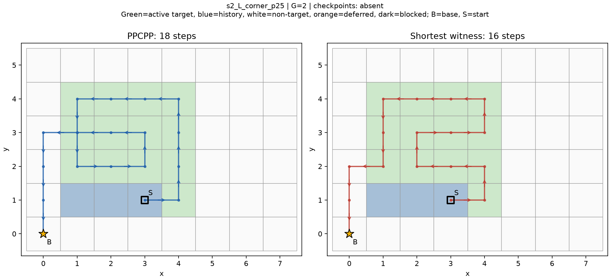
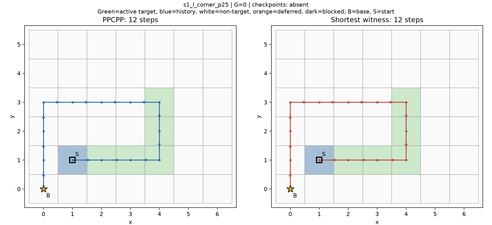

# PPCPP小图最优差距诊断结果

2026-10-20。有效执行版v0.2；**执行完成、自检通过，待研究负责人审核**。不是新算法性能排名，不是论文主算法确认。

## 结果与分母

固定24槽位全部有效，24次原PPCPP均完整合法且20秒入口内；24个全局最优全部已证明。22/24原版已最优，2/24各多2步。总步PPCPP266、最优262，差4步，相对最优总量1.5267%；逐状态相对差均值1.2784%，两种分母不同。没有无效输入、不可达、失败、迟到或unresolved。该矩阵改善空间有限，不追加地图。

4个基础道路、两进度共享真实历史，24快照不是24独立地图；2个正例也是同一宽带L形基础图/拐扩几何的两个相关进度，不是两张独立正例图。协议由已见既有开发结果者设计，不是盲测或最终留出。

实际新增调用：4次事件前准备（v0.1完成、v0.2字节复用），24次正式原PPCPP，64次正式精确查询（24全局+16首次恢复前后+1第二恢复前+23固定结束目标），没有复用旧实验计时。精确门槛271次，包装等价门槛成功2次，另v0.1查找旧golden错误中止调用1次单列。原PPCPP实际合计31次。64精确全部optimal，最大发现157195状态，最大秒数0.193843；未触及60秒/800000限制。这是本机观测，不是硬实时保证。

## 完整逐状态表

所有行global=optimal、PPCPP=完整合法及时；—表示不存在或空任务不适用，不能当0。D前/D后为首次恢复前/衔接后已固定的损失。完整C/D/R和全部指标见analysis.json。

|状态|Lp|L*|G|相对差|D前|D后|Le|结束限制代价|保留结束仍可省|
|---|---|---|---|---|---|---|---|---|---|
|s1_I_straight_p25|12|12|0|0.0000%|—|—|12|0|0|
|s1_I_straight_p60|10|10|0|0.0000%|—|—|10|0|0|
|s1_I_corner_p25|12|12|0|0.0000%|—|—|12|0|0|
|s1_I_corner_p60|10|10|0|0.0000%|—|—|10|0|0|
|s1_I_obstacle_p25|10|10|0|0.0000%|0|0|10|0|0|
|s1_I_obstacle_p60|4|4|0|0.0000%|—|—|—|—|—|
|s1_L_straight_p25|15|15|0|0.0000%|—|—|15|0|0|
|s1_L_straight_p60|13|13|0|0.0000%|—|—|13|0|0|
|s1_L_corner_p25|11|11|0|0.0000%|0|0|11|0|0|
|s1_L_corner_p60|9|9|0|0.0000%|0|0|9|0|0|
|s1_L_obstacle_p25|11|11|0|0.0000%|0|0|11|0|0|
|s1_L_obstacle_p60|9|9|0|0.0000%|—|—|9|0|0|
|s2_I_straight_p25|13|13|0|0.0000%|—|—|13|0|0|
|s2_I_straight_p60|12|12|0|0.0000%|0|0|12|0|0|
|s2_I_corner_p25|13|13|0|0.0000%|—|—|13|0|0|
|s2_I_corner_p60|10|10|0|0.0000%|—|—|10|0|0|
|s2_I_obstacle_p25|11|11|0|0.0000%|0|0|11|0|0|
|s2_I_obstacle_p60|6|6|0|0.0000%|—|—|6|0|0|
|s2_L_straight_p25|14|14|0|0.0000%|—|—|14|0|0|
|s2_L_straight_p60|11|11|0|0.0000%|0|0|11|0|0|
|s2_L_corner_p25|18|16|2|12.5000%|—|—|18|2|0|
|s2_L_corner_p60|13|11|2|18.1818%|—|—|13|2|0|
|s2_L_obstacle_p25|12|12|0|0.0000%|0|0|12|0|0|
|s2_L_obstacle_p60|7|7|0|0.0000%|—|—|7|0|0|

## 前缀归因：本轮未出现正的恢复前损失

首次恢复存在8/24，之前D=0、R=0，衔接之后D=0、R=0，8段衔接新增损失均0。只有s1_L_obstacle_p25存在第二次恢复，第4步C=11、D=0、R=0。其余16状态没有首次恢复，其余23状态没有第二次恢复，均明确记不存在。

|状态|检查点|t|查询|C|D|R|
|---|---|---|---|---|---|---|
|s1_I_obstacle_p25|first_recovery_before|1|first_recovery_before|10|0|0|
|s1_I_obstacle_p25|first_recovery_after|5|first_recovery_after|10|0|0|
|s1_L_corner_p25|first_recovery_before|4|first_recovery_before|11|0|0|
|s1_L_corner_p25|first_recovery_after|6|first_recovery_after|11|0|0|
|s1_L_corner_p60|first_recovery_before|2|first_recovery_before|9|0|0|
|s1_L_corner_p60|first_recovery_after|4|first_recovery_after|9|0|0|
|s1_L_obstacle_p25|first_recovery_before|0|first_recovery_before|11|0|0|
|s1_L_obstacle_p25|first_recovery_after|3|first_recovery_after|11|0|0|
|s1_L_obstacle_p25|second_recovery_before|4|second_recovery_before|11|0|0|
|s2_I_straight_p60|first_recovery_before|4|first_recovery_before|12|0|0|
|s2_I_straight_p60|first_recovery_after|7|first_recovery_after|12|0|0|
|s2_I_obstacle_p25|first_recovery_before|4|first_recovery_before|11|0|0|
|s2_I_obstacle_p25|first_recovery_after|8|first_recovery_after|11|0|0|
|s2_L_straight_p60|first_recovery_before|2|first_recovery_before|11|0|0|
|s2_L_straight_p60|first_recovery_after|5|first_recovery_after|11|0|0|
|s2_L_obstacle_p25|first_recovery_before|6|first_recovery_before|12|0|0|
|s2_L_obstacle_p25|first_recovery_after|8|first_recovery_after|12|0|0|

两例有差距状态都没有任何恢复：原策略通过相邻待检格完成全部采集。因此本轮不能给出“第一次恢复前D>0”的精确检查点正例，也不把“没有恢复”改记成恢复前损失为0。它只说明：在本矩阵，有差距也可发生于没有恢复入口决策的整段局部覆盖过程中。不能据此断言某个奖励项错误，也不追加其他检查点追踪首次损失。

## 最后新采集位置：两例差距均受其限制

23/24适用固定最后新采集目标查询；s1_I_obstacle_p60当前任务为空，只需返航，不适用。23例中21例结束限制代价0；其余2例Le=Lp、Le−L*=2、Lp−Le=0。固定原最后采集位置后，精确搜索也无法缩短这两例；改变结束位置是获得这两步改进的必要条件，但没有证明一个低开销实用策略能找到它。

|状态|原结束格|最短见证结束格|原覆盖步号|最短覆盖步号|原尾段|最短尾段|Le|
|---|---|---|---|---|---|---|---|
|s2_L_corner_p25|[2, 3]|[1, 2]|13|13|5|3|18|
|s2_L_corner_p60|[2, 3]|[1, 2]|8|8|5|3|13|

两例保存见证的覆盖阶段分别同为13/8步，返航尾段5→3，净差2。这里的尾段分解与Le约束查询相互支持；不能把尾段差当作固定原结束位置后还能独立减掉的路程。前缀分解和结束位置分解是重叠视角，不相加。不要推出“始终靠基地结束更好”。

## 分层：收益线索高度集中

|因素|层|N|有差距|最优|Lp合计|L*合计|差距|正结束代价|
|---|---|---|---|---|---|---|---|---|
|event|corner|8|2|6|96|92|4|2|
|event|obstacle|8|0|8|70|70|0|0|
|event|straight|8|0|8|100|100|0|0|
|shape|I|12|0|12|123|123|0|0|
|shape|L|12|2|10|143|139|4|2|
|scale|s1|12|0|12|126|126|0|0|
|scale|s2|12|2|10|140|136|4|2|
|progress|25|12|1|11|152|150|2|1|
|progress|60|12|1|11|114|112|2|1|

直扩和障碍8/8均已最优；拐扩2/8有差距。直带12/12最优，L形2/12有差距；宽1全最优，宽2的两例有差距；25%与60%各一例。这些因素在这两个相关正例中共同出现，不能声称宽度或拐角单独导致差距，更不能作为一般道路发生率。

## 完整指标与覆盖账本

下表每状态一次，PPCPP和全局最短见证均N=24。最短见证只最小化步数，转弯不是最优转弯；相同长度见证的其他指标可能不同。四分类合计=步数，返航已经包含。

|指标|PPCPP N24|最短见证 N24|
|---|---|---|
|length|266|262|
|fresh_target_steps|135|135|
|historical_target_steps|9|11|
|repeated_new_target_steps|14|7|
|non_target_steps|108|109|
|turns90|81|88|
|turns180|6|4|
|completion_step|151|149|
|return_tail_steps|115|113|
|active_targets|216|216|
|active_covered|216|216|
|remaining_before|135|135|
|newly_completed|135|135|
|published_targets|224|224|
|published_covered|219|219|
|deferred|5|5|
|missing_active|0|0|
|target_arrivals|158|153|
|duplicate_target_arrivals|23|18|
|weighted_active_coverage|1.0|1.0|
|weighted_published_coverage|0.9776785714285714|0.9776785714285714|
|weighted_overlap|0.14556962025316456|0.11764705882352941|

当前可检和扣历史后的待检均完成100%；全公开224格次完成219，97.7679%，暂缓5格次；另3格次历史已完成后来被挡，仍保留。所有成功路线在统一1000000步宽松预算内，不外推资源紧张情形。格次共享几何，不是独立物理面积。固定最后目标的23例完整指标单列analysis.json，其样本与24例不同，不直接比较总量。

## 按预登记选择的正反图

最大G同值按编号取s2_L_corner_p25；G=0编号最小s1_I_corner_p25。首次恢复前D>0类别为空，不补图。两幅图都无恢复检查点，所以标注absent；未人为找有检查点的替代图。图绘制完整F，历史、可检目标、障碍/暂缓图层、基地/当前位置、带箭头路线；这些被选状态障碍和暂缓为空，不虚构标记。





## 证明、独立审核与版本

精确状态(position,mask)在本模型充分：允许动作只由F和位置决定，历史不变、采集单调，方向无动作限制与代价，资源统一宽松。每步状态转移就是一次四邻接落格并更新位；所有边权1，BFS首次终点出队最短。受限last查询只删去未完成其他目标时首次入e的边，与“最后新采集必须为e”逐步等价。父指针路线是上界，最优性另由保存的层序发现集合与后继闭包证书支撑。independent.py不导入主BFS的邻接/掩码函数，独立校验全部64证书、父边、深度、闭包和无提前终点；微型夹具另以frozenset剩余任务Dijkstra交叉核验。两套既有指标全字段一致，原PPCPP逐决策审计通过。

v0.1仅在正式前包装门槛检索旧结果时将list文件当dict，日志保留。v0.2只修prepare.py检索目录/类型及版本标识，精确/独立审核/几何/原PPCPP不变。4准备、24输入/见证、271精确门槛字节复用，reuse.json记录并由verify_delivery.py复核。v0.1正式调用0，没有混入正式比较。没有重跑旧540次，没有改冻结/旧封存/留出，没有提交或推送GitHub。

## 唯一优先建议与停止

**只保留“覆盖结束位置与完整返航代价的联合选择”作为下一轮待讨论假设，当前不推荐直接实现新算法。** 依据是两例Le=Lp>L*，不是恢复入口触发失效；但正例仅来自一个相关几何，22例已最优，尚不足以支持泛化改进或复杂度投入。本轮按固定矩阵停止，不调奖励、不添入口/窗口、不做后处理。由研究负责人审核模型、证明、数据与归因后再决定。没有确认的主算法或创新点。

## 复核入口

项目根目录执行：

```powershell
& ./运行环境/python/python.exe -B -X utf8 PPCPP小图最优差距诊断_v0.2_20261020/verify_delivery.py
```

README.md提供核验及空目录一键重放命令；review_packet.md给出结论到证据映射。
