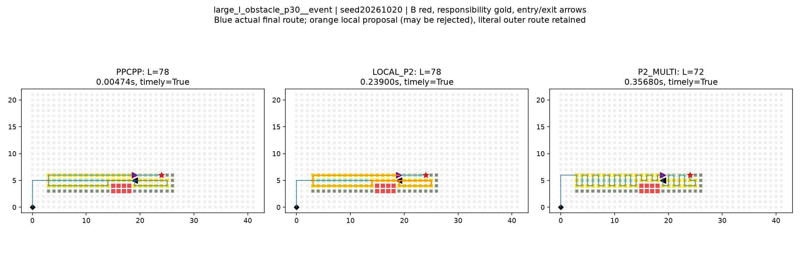
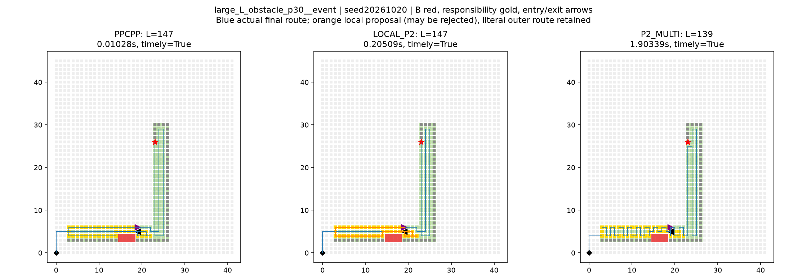
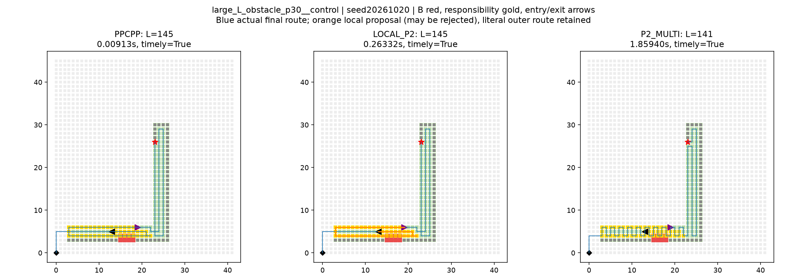
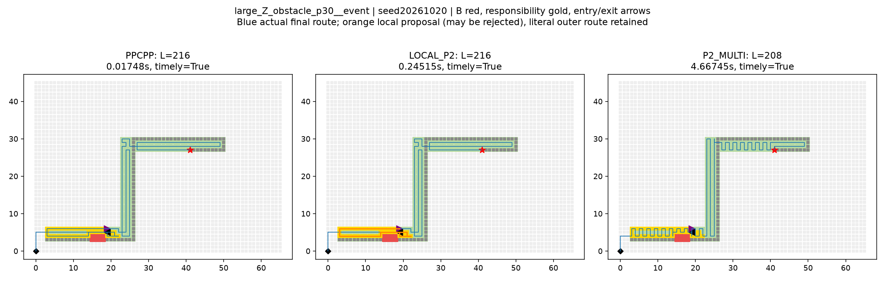
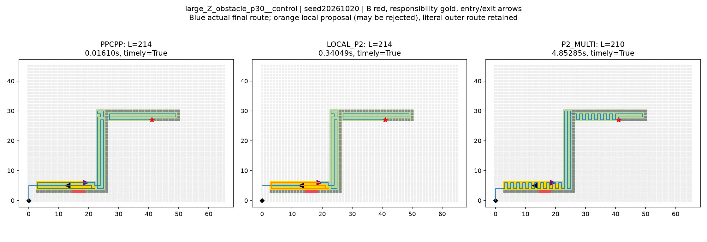

# PPCPP＋局部P2受控混合诊断

2026-10-20。**已封存，待负责人审核。** 固定18事件＋18同历史无新增障碍控制，3方法×3种子=324正式入口；固定窗口、20秒、串行新进程，不使用留出/精确/四方向/LAST/新奖励。

## event：完整入口结果

18状态三种子均值求和（仅完整配对状态，N=18/18）：PPCPP=1098.000000，混合=1098.000000，整体P2=1024.666667；混合相对原版省0.000000步（0.0000%）。相对整体P2仍差73.333333步；未取最好种子。

|方法|调用N|合法|及时|迟到合法|无路线|入口均值/中位/P95/最大ms|原生状态|最终来源|
|---|---|---|---|---|---|---|---|---|
|PPCPP|54|54|54|0|0|4.884419/3.040300/17.659240/20.194300|{'core_complete': 54}|{'PPCPP': 54}|
|LOCAL_P2|54|54|54|0|0|73.815933/15.366600/254.196685/281.810400|{'core_complete': 54}|{'P0': 54}|
|P2_MULTI|54|54|54|0|0|526.055328/57.382800/2847.043950/4667.445800|{'finished': 54}|{'common_fallback': 3, 'old_suffix': 15, 'V_scan_opt': 27, 'shuffle_1_opt': 1, 'H_scan_opt': 5, 'perturb_V_opt': 3}|

|混合参照|视图|配对N/54|短/平/长|混合/参照总步|省步|
|---|---|---|---|---|---|
|PPCPP|timely|54|0/54/0|3294/3294|0|
|PPCPP|valid|54|0/54/0|3294/3294|0|
|P2_MULTI|timely|54|0/18/36|3294/3074|-220|
|P2_MULTI|valid|54|0/18/36|3294/3074|-220|

混合该组54次：空窗3；实际局部核心51。非空窗任务占比min/mean/max=0.142857/0.463001/1.000000；步长占比min/mean/max=0.065217/0.310182/0.628205。窗口大是观察事实，不加80%切换或扩窗。
实际记录提前采到外部后缀任务的局部调用0；未出现不等于实现禁止。后缀保持原样，完整逐格指标自然把后续到达记为重复。

## control：完整入口结果

18状态三种子均值求和（仅完整配对状态，N=18/18）：PPCPP=1086.000000，混合=1086.000000，整体P2=1032.666667；混合相对原版省0.000000步（0.0000%）。相对整体P2仍差53.333333步；未取最好种子。

|方法|调用N|合法|及时|迟到合法|无路线|入口均值/中位/P95/最大ms|原生状态|最终来源|
|---|---|---|---|---|---|---|---|---|
|PPCPP|54|54|54|0|0|4.371213/3.093500/14.082660/16.096700|{'core_complete': 54}|{'PPCPP': 54}|
|LOCAL_P2|54|54|54|0|0|88.893687/16.741200/311.919010/340.490900|{'core_complete': 54}|{'P0': 54}|
|P2_MULTI|54|54|54|0|0|532.824502/60.520100/2813.159040/4852.850600|{'finished': 54}|{'old_suffix': 18, 'V_scan_opt': 18, 'H_scan_opt': 14, 'shuffle_1_opt': 1, 'perturb_V_opt': 3}|

|混合参照|视图|配对N/54|短/平/长|混合/参照总步|省步|
|---|---|---|---|---|---|
|PPCPP|timely|54|0/54/0|3258/3258|0|
|PPCPP|valid|54|0/54/0|3258/3258|0|
|P2_MULTI|timely|54|0/18/36|3258/3098|-160|
|P2_MULTI|valid|54|0/18/36|3258/3098|-160|

混合该组54次：空窗3；实际局部核心51。非空窗任务占比min/mean/max=0.142857/0.471595/1.000000；步长占比min/mean/max=0.065217/0.321649/0.701493。窗口大是观察事实，不加80%切换或扩窗。
实际记录提前采到外部后缀任务的局部调用0；未出现不等于实现禁止。后缀保持原样，完整逐格指标自然把后续到达记为重复。

## 有限继续信号与边界

预登记事件收益信号：{'passed': False, 'base_ids': [], 'families': [], 'stable': True}。只按至少两族、四不同base_id且全三重复及时完整严格改善判断；同一几何不同进度不重复计独立几何。达到也不是创新或同预算优于全局P2，未达到也只否定本窗口/固定接口的本批信号。

控制也改善时，不能称收益由障碍专门造成；事件/控制任务量因遮挡不同，不能把两者路线差直接当障碍损失。保留外部计划与固定接口可能限制收益，18事件/18控制共享9基础道路和同一PPCPP历史，三种子不是独立地图。混合若更快但仍明显长于整体P2，只是质量—时间折中，不满足主路线优势目标；本轮完成即停止，不扩大窗口追赶。

## 接口、责任与预算

每混合入口重新计时运行原PPCPP P0，不用计时外旧结果；半径2曼哈顿只做事件位置选区。种子是未采可检目标；按首次有效采集索引min..max各扩一个顶点。局部H=原H加含入口的原前缀目标；required为left<i<=right首次采集，含必要出口任务，不把入口重复分派。局部base是固定出口，不是真实基地；真实基地由保留后缀返航。局部free始终完整当前F，old_route是原窗口合法段，距离额度扣固定外部步数。

复用已有range_p2_engine_20261015，不改冻结搜索。local_engine.diff记录其相对冻结P2的既有accept回调差异；回调同时审核局部任务/出口/资源和完整拼接。该混合不复用旧范围的多窗口规则或全局保底：P2的old_suffix/common_fallback均运行在局部Snapshot上，来源完整保留。非时间非法/异常显式失败，不静默成功回P0。无改进/同值保留完整P0，严格全长更短才选拼接。P0包含原候选所以成功时不更长是构造属性。

前缀/后缀逐点字面保留；拼接只消除接口重复顶点。每个offer完整审核、选区/局部P2/拼接/比较/完整raw编码均在共同20秒暖入口，局部只获余量。整体晚到清空route，不捞P0；全局P2原生软截止保留，再用真实入口时间分及时/迟到。启动/导入/磁盘/独立外审在外，90秒只作硬看门狗。外审每次时间在analysis.calls单列，工作量不同不拼成算法速度排名。

实际正式核心调用：{'PPCPP': 216, 'local_P2': 102, 'global_P2': 108}；324是完整入口，不是核心次数。混合P0与同批原版完整route/trace等非时间字段配对108/108通过。24门槛入口另账；桩测试不作真实核心调用。

## 全指标（均为三种子调用级计数，分母列出）

|组|方法|视图|N|步数|新采集|历史重复|本轮重复|非目标|90°|180°|采完步号|返航尾段|公开完成/公开|暂缓|
|---|---|---|---|---|---|---|---|---|---|---|---|---|---|---|
|event|PPCPP|timely|54|3294|2502|21|147|624|564|27|2646|648|5121/5184|63|
|event|PPCPP|valid|54|3294|2502|21|147|624|564|27|2646|648|5121/5184|63|
|event|LOCAL_P2|timely|54|3294|2502|21|147|624|564|27|2646|648|5121/5184|63|
|event|LOCAL_P2|valid|54|3294|2502|21|147|624|564|27|2646|648|5121/5184|63|
|event|P2_MULTI|timely|54|3074|2502|21|57|494|1284|47|2682|392|5121/5184|63|
|event|P2_MULTI|valid|54|3074|2502|21|57|494|1284|47|2682|392|5121/5184|63|
|control|PPCPP|timely|54|3258|2565|15|54|624|492|27|2610|648|5184/5184|0|
|control|PPCPP|valid|54|3258|2565|15|54|624|492|27|2610|648|5184/5184|0|
|control|LOCAL_P2|timely|54|3258|2565|15|54|624|492|27|2610|648|5184/5184|0|
|control|LOCAL_P2|valid|54|3258|2565|15|54|624|492|27|2610|648|5184/5184|0|
|control|P2_MULTI|timely|54|3098|2565|15|30|488|942|20|2712|386|5184/5184|0|
|control|P2_MULTI|valid|54|3098|2565|15|30|488|942|20|2712|386|5184/5184|0|

指标定义：一步为一次四邻接等长移动，落点互斥分成首次未采目标/历史目标/本轮已采目标/非目标，四类之和=length。采集完成步号+返航尾段=length，两类分解不能相加。duplicate_target_arrivals=历史重复+本轮重复；重复率=duplicate/target_arrivals，无到达时不适用。90/180按连续移动向量点积0/-1计数，不推真实能耗。当前可检覆盖和剩余完成独立于公开完成率；deferred不计完成，历史后遮挡H保留。控制恢复本次B后若已在H仍算历史，不重复当新任务。

## 分层（同组、同输入/种子及时配对，混合对原版）

|因素|层|组|N|短/平/长|省步|混合/原版/整体P2均值ms|
|---|---|---|---|---|---|---|
|family|I|event|18|0/18/0|0|47.030778/2.000361/83.958117|
|family|I|control|18|0/18/0|0|58.843611/2.047122/94.238433|
|family|L|event|18|0/18/0|0|75.734806/4.728833/412.336694|
|family|L|control|18|0/18/0|0|91.945661/4.097711/425.238444|
|family|Z|event|18|0/18/0|0|98.682217/7.924061/1081.871172|
|family|Z|control|18|0/18/0|0|115.891789/6.968806/1078.996628|
|size|large|event|18|0/18/0|0|200.696444/10.394844/1388.298650|
|size|large|control|18|0/18/0|0|245.792033/8.690772/1408.760156|
|size|medium|event|18|0/18/0|0|17.330200/3.081356/176.266978|
|size|medium|control|18|0/18/0|0|17.398850/3.258622/175.587806|
|size|small|event|18|0/18/0|0|3.421156/1.177056/13.600356|
|size|small|control|18|0/18/0|0|3.490178/1.164244/14.125544|
|progress|30|event|27|0/27/0|0|85.756707/5.247656/872.210370|
|progress|30|control|27|0/27/0|0|105.664711/4.736444/886.740356|
|progress|70|event|27|0/27/0|0|61.875159/4.521181/179.900285|
|progress|70|control|27|0/27/0|0|72.122663/4.005981/178.908648|

完整三种子原值/均值/范围、全部分层对两参照与双视图见36状态三种子与窗口.csv、analysis.strata、324调用完整指标.csv及双视图配对.csv。不把不同成功集的总量直接当全批优势；任何失败保留分母，不补0步。

## 固定案例（重复0，同时附控制）

I/maximum缺类，不补。

I/median缺类，不补。

### I/zero：large_I_obstacle_p30__event

event：入口/出口=([19, 6], [19, 5])，原窗口/局部步长=49/49，来源=P0，局部核心来源=old_suffix。

|方法|总步|末采集格|采集前/尾段|非目标|历史/本轮重复|入口秒|
|---|---|---|---|---|---|---|
|PPCPP|78|(4, 5)|69/9|8|0/7|0.004738|
|LOCAL_P2|78|(4, 5)|69/9|8|0/7|0.238996|
|P2_MULTI|72|(3, 6)|63/9|9|0/0|0.356795|
control：入口/出口=([19, 6], [13, 5])，原窗口/局部步长=53/53，来源=P0，局部核心来源=old_suffix。

|方法|总步|末采集格|采集前/尾段|非目标|历史/本轮重复|入口秒|
|---|---|---|---|---|---|---|
|PPCPP|76|(4, 5)|67/9|8|0/1|0.003524|
|LOCAL_P2|76|(4, 5)|67/9|8|0/1|0.288971|
|P2_MULTI|74|(3, 4)|67/7|7|0/0|0.417977|
L/maximum缺类，不补。

L/median缺类，不补。

### L/zero：large_L_obstacle_p30__event

event：入口/出口=([19, 6], [19, 5])，原窗口/局部步长=43/43，来源=P0，局部核心来源=old_suffix。

|方法|总步|末采集格|采集前/尾段|非目标|历史/本轮重复|入口秒|
|---|---|---|---|---|---|---|
|PPCPP|147|(4, 5)|138/9|8|0/9|0.010278|
|LOCAL_P2|147|(4, 5)|138/9|8|0/9|0.205088|
|P2_MULTI|139|(3, 4)|132/7|7|0/2|1.903388|
control：入口/出口=([19, 6], [13, 5])，原窗口/局部步长=47/47，来源=P0，局部核心来源=old_suffix。

|方法|总步|末采集格|采集前/尾段|非目标|历史/本轮重复|入口秒|
|---|---|---|---|---|---|---|
|PPCPP|145|(4, 5)|136/9|8|0/3|0.009128|
|LOCAL_P2|145|(4, 5)|136/9|8|0/3|0.263323|
|P2_MULTI|141|(3, 4)|134/7|7|0/0|1.859405|
Z/maximum缺类，不补。

Z/median缺类，不补。

### Z/zero：large_Z_obstacle_p30__event

event：入口/出口=([19, 6], [19, 5])，原窗口/局部步长=43/43，来源=P0，局部核心来源=old_suffix。

|方法|总步|末采集格|采集前/尾段|非目标|历史/本轮重复|入口秒|
|---|---|---|---|---|---|---|
|PPCPP|216|(4, 5)|207/9|8|1/10|0.017479|
|LOCAL_P2|216|(4, 5)|207/9|8|1/10|0.245150|
|P2_MULTI|208|(3, 4)|201/7|7|1/3|4.667446|
control：入口/出口=([19, 6], [13, 5])，原窗口/局部步长=47/47，来源=P0，局部核心来源=old_suffix。

|方法|总步|末采集格|采集前/尾段|非目标|历史/本轮重复|入口秒|
|---|---|---|---|---|---|---|
|PPCPP|214|(4, 5)|205/9|8|1/4|0.016097|
|LOCAL_P2|214|(4, 5)|205/9|8|1/4|0.340491|
|P2_MULTI|210|(3, 4)|203/7|7|1/1|4.852851|
## 前置证据、失败记录与停止

18事件输入源hash与原件一致；每一控制从同基础图事件前prep输入恢复且核history/witness/cut/old_route，不重跑历史。全环境事前封存覆盖包内Python、项目.deps源/二进制/元数据、实际导入、可识别非系统DLL、原始来源/所有输入/协议/执行与独立审核源码；前后重核、每worker导入hash/唯一payload读取均保存。Windows系统DLL只记录路径，未知动态加载限制见environment_seal，不宣称全机复现。

前置基础设施故障：environment.py以同名audit导入冻结模块，AttributeError发生在0求解；environment_v02绝对路径加载离线审核，原脚本/日志保留。随后第一次gates_v02因封存异步未写完而FileNotFoundError，仍0求解；等待封存完整后相同gates_v02运行24真实入口及桩门槛通过（completed日志），没有增加门槛或重复正式成绩。两项记录于failures.json，不声称全流程一次通过。

桩明确区分：指定局部patch强制经过外部未采目标，核真实采集与后缀不删；不谎称所有可行路径都必经该外部目标，因为合法原窗口本身已经提供另一条路线。非法/异常/同值/更短及共享时钟各阶段也仅为桩，不当真实P2路线证据。

局部核心省步与完整拼接省步的恒等关系已逐调用验证，最终严格择优仍保留原PPCPP；不能把未选的较长局部路线当收益。全局未优化的外部段仍可能造成差距；固定接口的约束与PPCPP顺序混在一起，本轮没有独立归因。若固定规则无收益，不推广为所有混合方案无效。

固定324调用后停止，不扩大半径/窗口、不加阈值或1秒批、不恢复四方向、不叠加LAST、不自动下一轮。已封存，待负责人审核。

只读命令：`./运行环境/python/python.exe -B -X utf8 PPCPP局部P2混合开发诊断_v0.1_20261020/verify.py`。不启动规划器、不追加计时。
