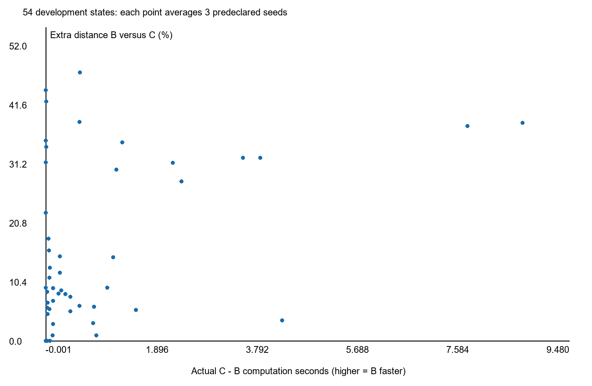

# 审核入口

00_通俗报告.md给目的、绝对量与结论边界；01_终止语义与预登记.md记录P2流程、源码行和阶段预算；plan/preregistration_seal登记完整顺序、seed与P95。outputs保存同一次原输出、新折线、计时、现有核心日志、按原边数生成的审核上限和独立回执。技术入口12、stub4与正式324分开计数。

全部流水线.json/正式全表.csv、同状态同seed配对.json、54状态等权视图.json、summary.json与调用账.json保留分母和负值。独立verify仅核验保存结果及绑定，不重跑规划、后处理或几何；新独立几何查询均保存在每次audit回执并计费。输入与源码哈希每worker检查，新进程清空缓存。冻结算法、旧证据及留出未改，不推送。

补充：02_完整阶段与可靠性统计.md列A/B/C0/C各自P95/最大耗时、倍率与合法率分母；核心阶段保存索引.json索引冻结入口已有日志；统计修正说明.md保留状态均值符号统计修正。

