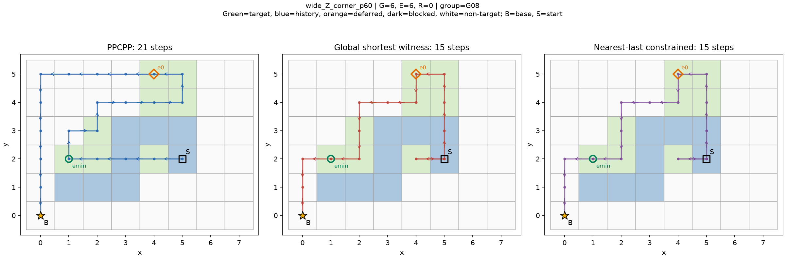
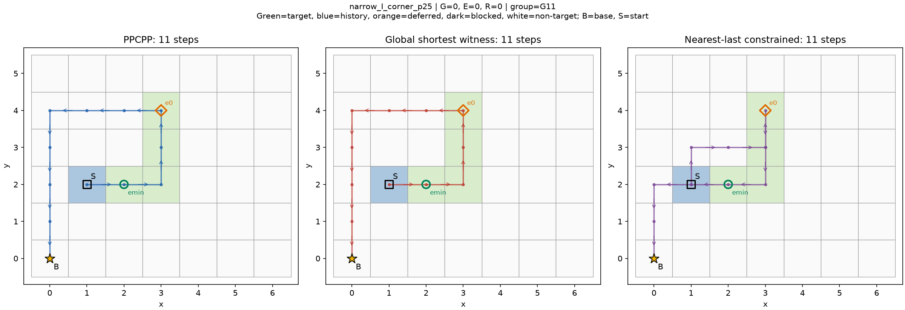
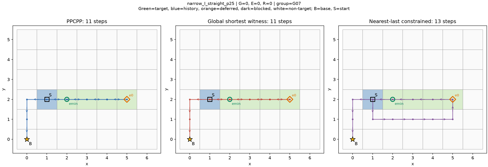

# 结束位置损失的跨几何验证结果

2026-10-20，v0.1。**执行完成，待负责人审核**。有限开发机制验证，不是新算法、排名或统计普遍性证明。

## 核心判断

预登记的跨形状判据在本固定开发矩阵中达到：L族1个、Z族3个相互非D4等价、非旧输入复制的事件后几何组出现E>0；合计8状态但只有4个正几何组，不当作8独立形状。直带I族没有正例。所有正例集中宽规格，25%/60%均出现，不证明宽度单因素作用，也不证明朝向不敏感。

36个有效槽位全部PPCPP完整合法及时；36全局最优已证明，28/36（77.7778%）原版已最优，8/36有差距。总Lp=430、L*=402、G=28；相对最优总量6.9652%，逐状态相对差均值5.7056%，两者分母不同。35个结束位置适用配对E合计26、R合计2；一个空任务不适用。E/G只在8个G>0配对上计算，逐状态平均95.8333%，总量26/28=92.8571%；不能把它说成一般道路92.8571%的损失都源于结束位置。

指定最近基地目标作为最后采集格：35个适用查询全部有解，8比L0短、22等长、5反而更长。这5例的候选图距离确实更近，不只是同距选点差异。因此“更近基地结束必然使完整路线更短”在本矩阵有明确反例。查询C是理想约束最优成本，不是已实现近基地策略。

## 固定输入与几何审核

6基础道路×3事件×2真实历史=36计划槽位；36有效，无新增为空、超规模、不可达或输入无效。narrow宽1/F42格，wide宽2/F48格；宽度与段长/面积共同变化，非单因素宽度实验。全部矩形飞行域在事件前已知，允许道路外通行，初始当前位置/基地(0,0)、捕食者(-1,0)，不扫描基地或旋转捕食者。各新增矩形有新目标且不与旧目标重叠，六基础和事件ASCII图见几何概览.md；精确坐标见几何坐标表.json及protocol.json。

六次事件前准备只给当时初始地图，不传未来事件；首次覆盖ceil(p×旧目标量)时截断，H/current/previous来自逐格真实前缀，三事件共用。24/36等样本数不混用；本轮36个完整任务状态D4签名均不同。36份独立历史/可行返航见证及最近目标候选已在正式调用前封存。输入pending不超过14、统一1000000步距离预算不活跃；每成功路线都验证预算。

与上轮24输入比较：完全重复0、统一平移完整状态等价0、完整任务D4等价0；道路/障碍形状D4等价的旧复制为2槽位（narrow_L_straight两进度），均G=0。其余正例无旧形状复制。36槽位形成20个事件后道路/障碍D4组，其中障碍避免当前格会产生进度间不同障碍位置，故多于18名义事件构型。shape签名只归一道路公开目标和遮挡，完整state签名另含F/H/current/base/previous/predator/旧后缀及账本；地图相同不当作状态相同。

## 逐槽位完整诊断

A=全局，B=固定e0，C=固定emin；“复用B”不另调用。—表示空任务不适用。所有实际A/B/C均optimal。完整坐标、时间、朝向、query_statuses和双套完整指标在analysis.json；此表保留全部36槽位。

|状态|组|Lp|L*|G|L0|E|R|e0|emin|d0/d近|Lnear|近−L0|C来源|恢复|
|---|---|---|---|---|---|---|---|---|---|---|---|---|---|---|
|narrow_I_straight_p25|G07|11|11|0|11|0|0|[5, 2]|[2, 2]|7/4|13|2|C|False|
|narrow_I_straight_p60|G07|10|10|0|10|0|0|[5, 2]|[3, 2]|7/5|12|2|C|False|
|narrow_I_corner_p25|G11|11|11|0|11|0|0|[3, 4]|[2, 2]|7/4|11|0|C|False|
|narrow_I_corner_p60|G11|10|10|0|10|0|0|[3, 4]|[3, 2]|7/5|10|0|C|False|
|narrow_I_obstacle_p25|G09|9|9|0|9|0|0|[3, 2]|[3, 2]|5/5|9|0|复用B|True|
|narrow_I_obstacle_p60|G06|4|4|0|—|—|—|None|None|—/—|—|—|None|False|
|wide_I_straight_p25|G19|11|11|0|11|0|0|[1, 2]|[1, 2]|3/3|11|0|复用B|False|
|wide_I_straight_p60|G19|11|11|0|11|0|0|[1, 2]|[1, 2]|3/3|11|0|复用B|True|
|wide_I_corner_p25|G20|11|11|0|11|0|0|[1, 2]|[1, 2]|3/3|11|0|复用B|False|
|wide_I_corner_p60|G20|9|9|0|9|0|0|[1, 2]|[1, 2]|3/3|9|0|复用B|False|
|wide_I_obstacle_p25|G13|7|7|0|7|0|0|[1, 2]|[1, 2]|3/3|7|0|复用B|True|
|wide_I_obstacle_p60|G04|5|5|0|5|0|0|[1, 2]|[1, 2]|3/3|5|0|复用B|False|
|narrow_L_straight_p25|G05|12|12|0|12|0|0|[3, 5]|[3, 2]|8/5|12|0|C|False|
|narrow_L_straight_p60|G05|11|11|0|11|0|0|[3, 5]|[3, 3]|8/6|13|2|C|False|
|narrow_L_corner_p25|G02|14|14|0|14|0|0|[5, 4]|[3, 2]|9/5|14|0|C|False|
|narrow_L_corner_p60|G02|13|13|0|13|0|0|[5, 4]|[3, 3]|9/6|13|0|C|False|
|narrow_L_obstacle_p25|G18|12|12|0|12|0|0|[3, 4]|[3, 2]|7/5|12|0|C|True|
|narrow_L_obstacle_p60|G18|11|11|0|11|0|0|[3, 4]|[3, 4]|7/7|11|0|复用B|True|
|wide_L_straight_p25|G12|13|13|0|13|0|0|[1, 2]|[1, 2]|3/3|13|0|复用B|False|
|wide_L_straight_p60|G12|10|10|0|10|0|0|[1, 2]|[1, 2]|3/3|10|0|复用B|False|
|wide_L_corner_p25|G17|17|13|4|17|4|0|[2, 3]|[1, 2]|5/3|13|-4|C|True|
|wide_L_corner_p60|G17|14|12|2|14|2|0|[2, 3]|[1, 2]|5/3|12|-2|C|True|
|wide_L_obstacle_p25|G10|9|9|0|9|0|0|[1, 2]|[1, 2]|3/3|9|0|复用B|True|
|wide_L_obstacle_p60|G10|6|6|0|6|0|0|[1, 2]|[1, 2]|3/3|6|0|复用B|True|
|narrow_Z_straight_p25|G03|15|15|0|15|0|0|[6, 3]|[2, 2]|9/4|15|0|C|False|
|narrow_Z_straight_p60|G03|13|13|0|13|0|0|[6, 3]|[3, 3]|9/6|15|2|C|False|
|narrow_Z_corner_p25|G15|15|15|0|15|0|0|[4, 5]|[2, 2]|9/4|15|0|C|False|
|narrow_Z_corner_p60|G15|13|13|0|13|0|0|[4, 5]|[3, 3]|9/6|13|0|C|False|
|narrow_Z_obstacle_p25|G16|11|11|0|11|0|0|[2, 3]|[2, 3]|5/5|11|0|复用B|True|
|narrow_Z_obstacle_p60|G16|9|9|0|9|0|0|[4, 3]|[3, 3]|7/6|11|2|C|False|
|wide_Z_straight_p25|G14|18|14|4|18|4|0|[2, 3]|[1, 2]|5/3|14|-4|C|True|
|wide_Z_straight_p60|G14|15|13|2|15|2|0|[2, 3]|[1, 2]|5/3|13|-2|C|True|
|wide_Z_corner_p25|G08|22|16|6|20|4|2|[2, 3]|[1, 2]|5/3|16|-4|C|True|
|wide_Z_corner_p60|G08|21|15|6|21|6|0|[4, 5]|[1, 2]|9/3|15|-6|C|True|
|wide_Z_obstacle_p25|G01|16|14|2|16|2|0|[2, 3]|[1, 2]|5/3|14|-2|C|True|
|wide_Z_obstacle_p60|G01|11|9|2|11|2|0|[2, 3]|[1, 2]|5/3|9|-2|C|True|

## 按几何组汇总

组表把两历史及对称形状合并；不把进度当新几何支持。组内仍可有不同任务状态。各组共享6基础道路，不是独立随机样本，组内G/E和只作账目，不作独立统计量。

|组|族|槽位|原最优|G>0|E>0|G和|E和|近候选更差|C无解|旧形状匹配|
|---|---|---|---|---|---|---|---|---|---|---|
|G01|Z|2|0|2|2|4|4|0|0|无|
|G02|L|2|2|0|0|0|0|0|0|无|
|G03|Z|2|2|0|0|0|0|1|0|无|
|G04|I|1|1|0|0|0|0|0|0|无|
|G05|L|2|2|0|0|0|0|1|0|s1_I_corner_p25,s1_I_corner_p60|
|G06|I|1|1|0|0|0|0|0|0|无|
|G07|I|2|2|0|0|0|0|2|0|无|
|G08|Z|2|0|2|2|12|10|0|0|无|
|G09|I|1|1|0|0|0|0|0|0|无|
|G10|L|2|2|0|0|0|0|0|0|无|
|G11|I|2|2|0|0|0|0|0|0|无|
|G12|L|2|2|0|0|0|0|0|0|无|
|G13|I|1|1|0|0|0|0|0|0|无|
|G14|Z|2|0|2|2|6|6|0|0|无|
|G15|Z|2|2|0|0|0|0|0|0|无|
|G16|Z|2|2|0|0|0|0|1|0|无|
|G17|L|2|0|2|2|6|6|0|0|无|
|G18|L|2|2|0|0|0|0|0|0|无|
|G19|I|2|2|0|0|0|0|0|0|无|
|G20|I|2|2|0|0|0|0|0|0|无|

四个正组：L/G17（拐扩）、Z/G14（直扩）、Z/G08（拐扩）、Z/G01（障碍）。各含25%和60%两个相关状态。L与Z正组非D4等价且非旧输入复制，达到预登记最低跨族判据；它支持“在本固定开发矩阵中跨形状重复观察到结束位置限制”，不支持随机地图发生率、一般道路普遍性或实用改进有效性。

## 分层与每族正反类别

|因素|层|N|组数|原最优|G>0|E>0|正组数|G和|E和|R和|近更差|
|---|---|---|---|---|---|---|---|---|---|---|---|
|family|I|12|8|12|0|0|0|0|0|0|2|
|family|L|12|6|10|2|2|1|6|6|0|1|
|family|Z|12|6|6|6|6|3|22|20|2|2|
|scale|narrow|18|10|18|0|0|0|0|0|0|5|
|scale|wide|18|10|10|8|8|4|28|26|2|0|
|event|corner|12|6|8|4|4|2|18|16|2|0|
|event|obstacle|12|8|10|2|2|1|4|4|0|1|
|event|straight|12|6|10|2|2|1|6|6|0|4|
|progress|25|18|18|14|4|4|4|16|14|2|1|
|progress|60|18|18|14|4|4|4|12|12|0|4|

|族|类别|全部状态编号|
|---|---|---|
|I|E>0|未观察到|
|I|G=0|narrow_I_straight_p25, narrow_I_straight_p60, narrow_I_corner_p25, narrow_I_corner_p60, narrow_I_obstacle_p25, narrow_I_obstacle_p60, wide_I_straight_p25, wide_I_straight_p60, wide_I_corner_p25, wide_I_corner_p60, wide_I_obstacle_p25, wide_I_obstacle_p60|
|I|G>0,E=0|未观察到|
|I|Lnear>L0|narrow_I_straight_p25, narrow_I_straight_p60|
|I|C不可行|未观察到|
|L|E>0|wide_L_corner_p25, wide_L_corner_p60|
|L|G=0|narrow_L_straight_p25, narrow_L_straight_p60, narrow_L_corner_p25, narrow_L_corner_p60, narrow_L_obstacle_p25, narrow_L_obstacle_p60, wide_L_straight_p25, wide_L_straight_p60, wide_L_obstacle_p25, wide_L_obstacle_p60|
|L|G>0,E=0|未观察到|
|L|Lnear>L0|narrow_L_straight_p60|
|L|C不可行|未观察到|
|Z|E>0|wide_Z_straight_p25, wide_Z_straight_p60, wide_Z_corner_p25, wide_Z_corner_p60, wide_Z_obstacle_p25, wide_Z_obstacle_p60|
|Z|G=0|narrow_Z_straight_p25, narrow_Z_straight_p60, narrow_Z_corner_p25, narrow_Z_corner_p60, narrow_Z_obstacle_p25, narrow_Z_obstacle_p60|
|Z|G>0,E=0|未观察到|
|Z|Lnear>L0|narrow_Z_straight_p60, narrow_Z_obstacle_p60|
|Z|C不可行|未观察到|

所有18个窄规格状态已最优，宽规格10/18已最优。不同尺寸同时改变宽度/段长/任务量，不把正例集中宽规格解读为宽度的独立因果作用。正例同时见于两个进度，但多个状态共享相同H来源。输入真实历史朝向已保留，未对同一状态扫描朝向/旋转捕食者，所以不能证明不受朝向影响。

## E与R必须分开解释

7个E>0状态R=0：任何更短完整路线都必须改变e0。例wide_Z_corner_p60：Lp21、L*15、L0=21，E6/R0。另wide_Z_corner_p25：Lp22、L*16、L0=20，E4/R2；保留原e0仍可省2步，改变e0只对达到全局最优是必要条件，不能说任意改善都必须改e0。这一例阻止把所有正例统一说成“固定结束格完全没空间”。本轮未观察到G>0而E=0的状态，不补图寻找。

本轮8个E>0状态全部有恢复，无恢复E>0=0；上一轮两个无恢复正例仅作为已审核背景，不拼作本轮新证据。因此本轮不能声称跨几何验证了“无恢复仍有结束损失”，更不能定位某奖励项错误。本轮不新增恢复检查点或逐步损失追踪。

## 最近基地结束候选的明确反例

narrow_I_straight_p25：原e0=(5,2)，基地图距离7；emin=(2,2)，距离4。L*=L0=Lp=11，但Lnear=13。缩短最后返航所需距离3，并没有降低完整覆盖成本；为了最后才采集(2,2)，理想路线在覆盖阶段付出更多代价，净多2步。其余4个不利状态见上表，5例都是真实严格更近，不是同距tie反例。

适用35例中Lnear对L0为8短22平5长；对Lp亦8短22平5长，8短例Lnear均等于L*。空任务narrow_I_obstacle_p60仅返航，B/C不适用。C正式无解0、未解决0；必经目标作last导致无解只在固定门槛中出现，不能把“本批无解0”理解为任意指定last都可行。C候选只读输入图距离，不读原路线或最优见证；emin=e0的13状态复用B，另外22状态实际运行C。

## 完整指标与资源边界

四分类之和=总步，返航已经计入，不重复相加。当前可检/本次待检完成100%，已公开306格次完成297（97.0588%）、暂缓9；另3格次历史完成后来被挡仍保留。PPCPP与A均N36，B/C均N35，样本分母不同；不能直接拿N35与N36的总量比较。最短见证仅步数最优，转弯/覆盖完成位置及尾段不保证唯一或最优。

|指标|PPCPP|A见证|B见证|C见证|
|---|---|---|---|---|
|N|36|36|35|35|
|length|430|402|424|408|
|fresh_target_steps|183|183|183|183|
|historical_target_steps|18|21|24|32|
|repeated_new_target_steps|26|10|23|8|
|non_target_steps|203|188|194|185|
|turns90|129|139|127|159|
|turns180|22|13|18|14|
|completion_step|223|231|221|266|
|return_tail_steps|207|171|203|142|
|initial_credit|0|0|0|0|
|active_targets|294|294|292|292|
|active_covered|294|294|292|292|
|remaining_before|183|183|183|183|
|newly_completed|183|183|183|183|
|published_targets|306|306|303|303|
|published_covered|297|297|295|295|
|deferred|9|9|8|8|
|missing_active|0|0|0|0|
|target_arrivals|227|214|230|223|
|duplicate_target_arrivals|44|31|47|40|
|weighted_active|1.0|1.0|1.0|1.0|
|weighted_published|0.9705882352941176|0.9705882352941176|0.9735973597359736|0.9735973597359736|
|weighted_overlap|0.19383259911894274|0.14485981308411214|0.20434782608695654|0.17937219730941703|

全局见证总尾段比PPCPP少36、覆盖阶段反而多8，合计净少28；这是选定见证的账目，不把尾段差直接当可独立追回收益。同长状态的指标变化也会影响这些总和。宽松距离预算1000000无约束作用，不外推真实能耗或资源紧张任务。

## 调用、最优证明与独立复算

|类别|实际数|
|---|---|
|preparation_ppcpp|6|
|formal_ppcpp|36|
|wrapper_gate_ppcpp|2|
|formal_exact|93|
|independent_formal_rechecks|93|
|completed_independent_rechecks|93|
|gate_exact_calls|273|
|gate_independent_oracle_calls|270|
|gate_checks|279|
|query_statuses|{'optimal': 93}|
|query_max_seconds|0.15054280002368614|
|query_max_states|144116|
|ppcpp_max_entry|0.0005060999537818134|

6次新准备+36正式原PPCPP+2现有输入包装等价，共44次PPCPP；门槛精确273次（上轮271重跑+必经last1+状态cap1），独立门槛oracle270次。279条门槛检查不是279张图。正式93精确=36A+35B+22C，其余13次C语义复用B；没有提限重跑、没有unresolved或正式失败。93次独立Dijkstra均在每查询60秒子进程墙钟上限内完成且一致，复算不是新增正式样本或性能数据。实际本机环境见protocol，最大原入口0.000506秒、主精确0.150543秒/144116发现状态；不作为跨机器或硬实时证明。

位掩码BFS和frozenset-Dijkstra/证书审核源码逐字节复用已审核版本。position+mask在当前静态F、单格即时采集、无转弯代价、预算不活跃时充分；单位权BFS首次出队终点最短。固定last禁止其他任务未完成时首次进入该目标，严格对应最后新采集约束。全部父边、层序低层后继闭包及返航路线独立审核，另全部93查询集合状态Dijkstra复算，不仅比较合法路径上界。两套既有指标全字段一致，原PPCPP逐决策审核全部通过。

## 按固定规则选择的正反图

E最大wide_Z_corner_p60；G=0编号最小narrow_I_corner_p25；G>0且E=0缺类不补；近候选更差编号最小narrow_I_straight_p25；C不可行缺类不补。图展示完整F及H/障碍/暂缓图层，基地、当前位置、e0/emin与三种路线，不按结果换图。被选状态没有障碍/暂缓，不虚构图层内容。







## 协议偏差和未解决项

无正式矩阵、几何/参数、预算或查询规则变更；无无效/失败/超时/未解决正式状态，全部主查询和独立复算完成。预登记额外提到障碍两坐标冲突夹具：正式前8新增检查没有单列首坐标冲突/双坐标非法检查；交付前以只读纯几何补审核6族首冲突切第二及所有合法current，0新增求解（supplemental_geometry_audit.json）。冻结坐标表每族两候选均为不同的旧道路非基地格，合法单一current不可能同时占两点，双非法分支在本固定表不可达；不把后审伪称开跑前夹具。此为验收顺序的小偏差，未改变正式输入与结果。

交付审核记录：首次verify_delivery.py因空任务None在CSV编码为空串、Markdown编码为None，报告逐行比较出现表示差异AssertionError。失败脚本和delivery_audit_v01_failed.json保留；另立verify_delivery_v02.py只规范化这一比较，重新只读审核通过。正式源码/输入/结果不变，失效数据和需重跑正式项均0。详见交付审核器v0.2影响说明.md。

## 唯一下一轮假设与停止

保留单一假设：**有限选择覆盖方向/最后采集位置时，应比较完整覆盖加返航成本，不能仅奖励靠基地的结束格。** 当前比上轮多了L与Z非等价几何重复及5个近候选反例，但正例仍只在宽规格、规则图和PPCPP单一历史来源。最低重复性判据通过不等于批准实现；先交负责人审核，再决定是否值得设计限定候选与消融。本轮不实现新算法、不加图、不枚举全终点、不排名、不使用留出、不提交推送GitHub。

## 复核命令

项目根目录执行：

```powershell
& ./运行环境/python/python.exe -B -X utf8 PPCPP结束位置跨几何验证_v0.1_20261020/verify_delivery_v02.py
```

README.md说明空目录重放和只读核验；review_packet.md映射每项结论到原始文件。
