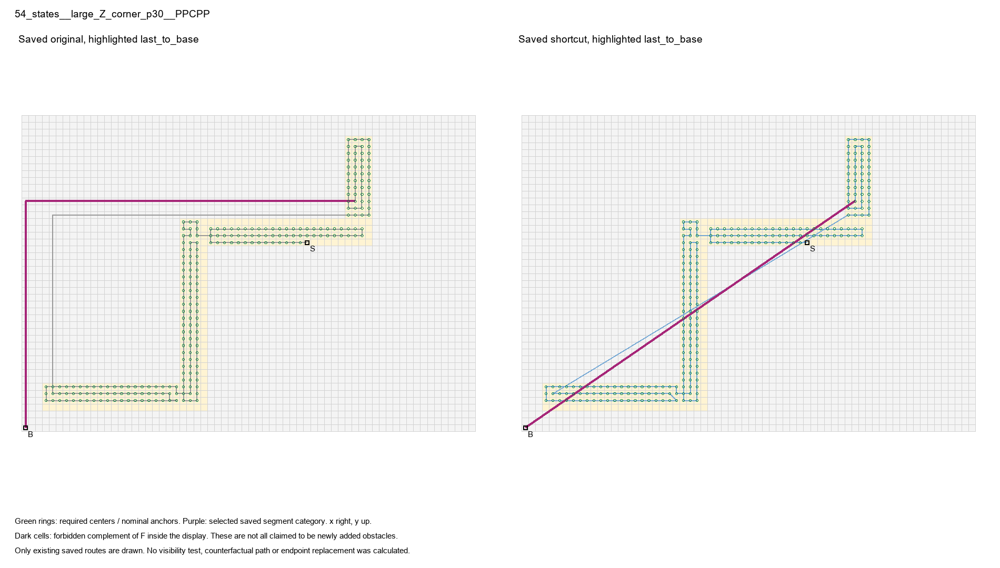
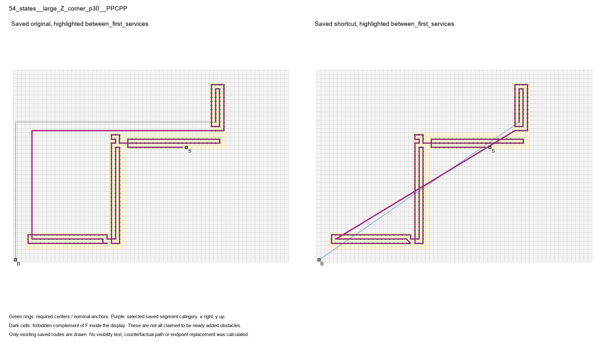
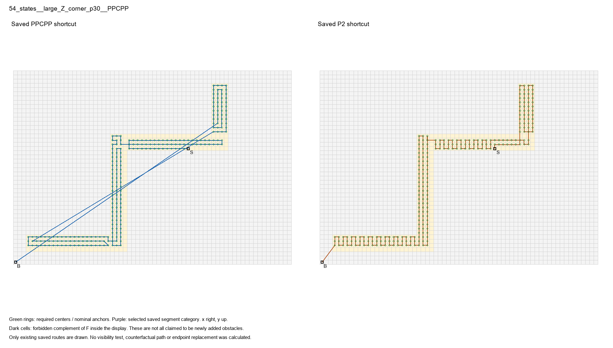

# 固定解释实例

按执行稿在各类别节省最大者中取ID最小，区间认证排序及候选数均在解释实例固定选择.json；这是解释性选择，不是代表样本。三类最大者恰为同一路线，不为图形多样性换例。

main_return：54_states__large_Z_corner_p30__PPCPP；类别节省22.750536。

between_service：54_states__large_Z_corner_p30__PPCPP；类别节省19.336408。

同轴/零位移正收益类别不存在，明确无例；不借技术夹具或新路线补位。

still_behind：54_states__large_Z_corner_p30__PPCPP；类别节省42.086945；保存新长度仍比同输入P2长约99.913055。

原格心任务圈、F及其禁止补集、当前点S、基地B来自该真实保存输入。高亮均为实际旧路径片段或实际新边，未生成任何示意替代线。
