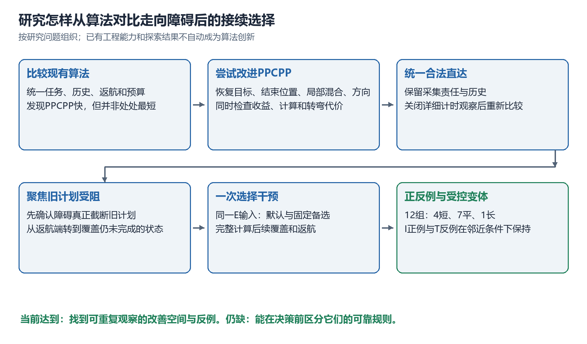
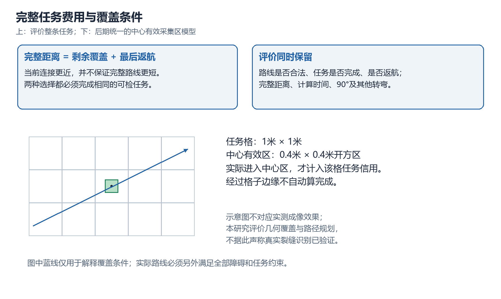
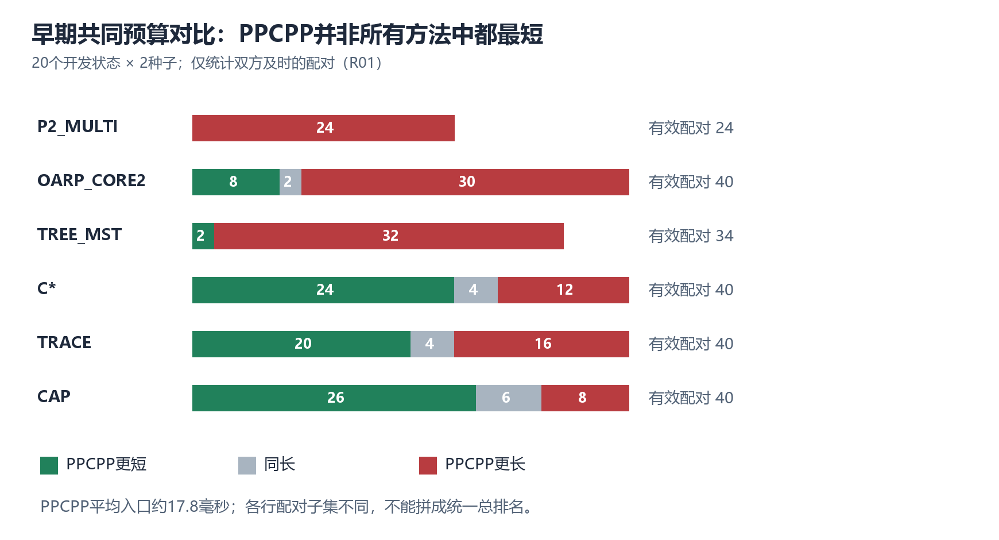
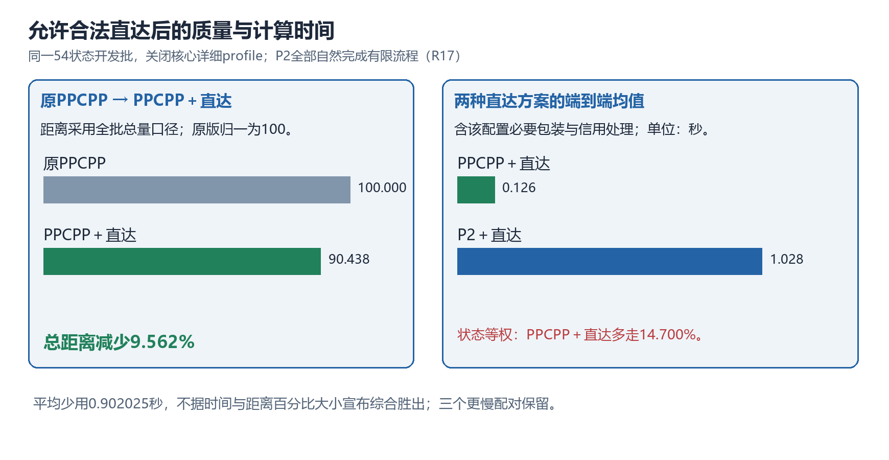
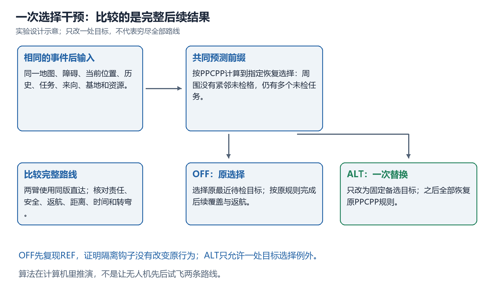
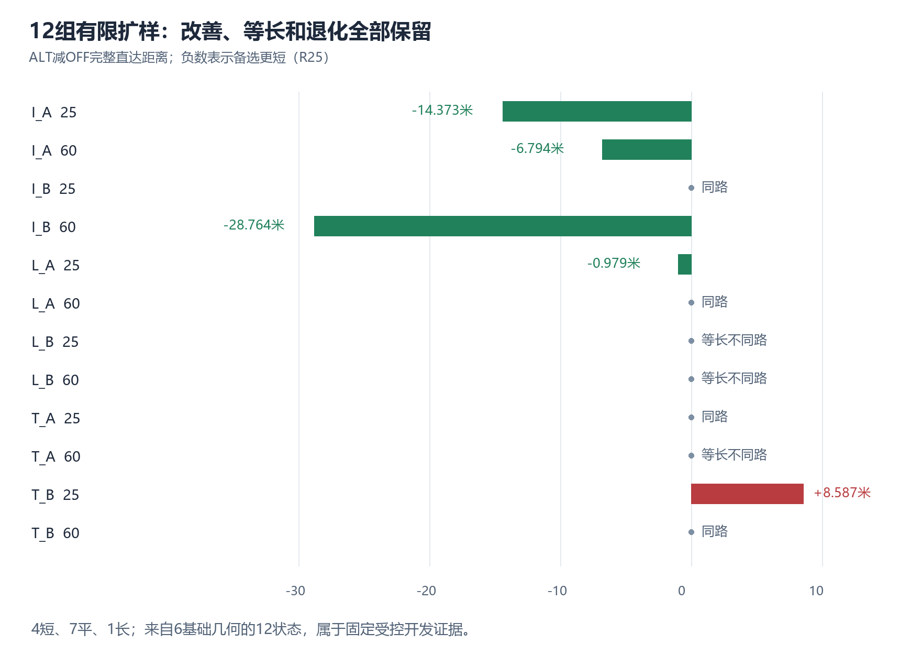
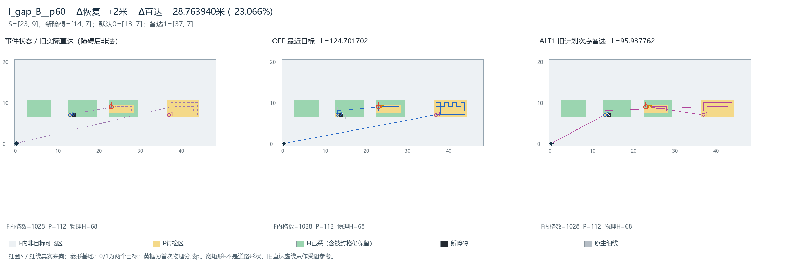
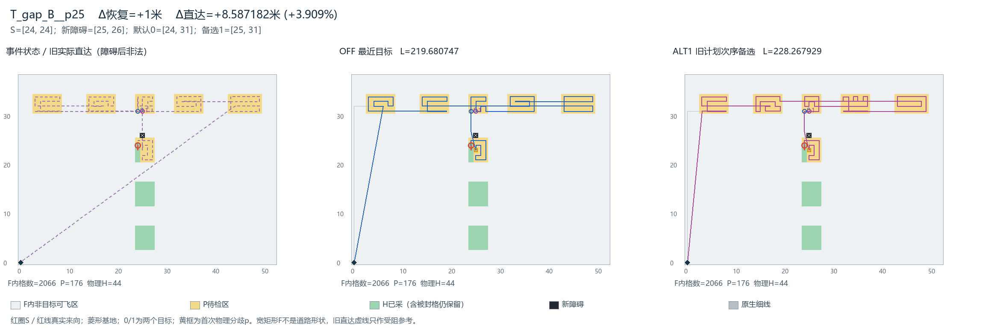
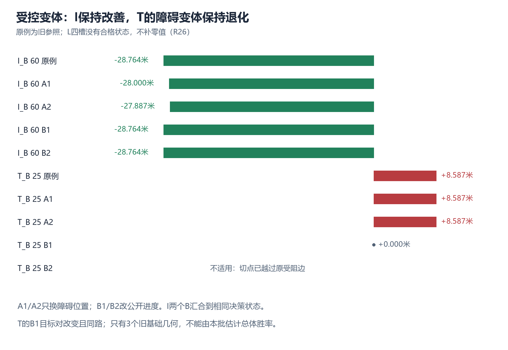

# 无人机剩余覆盖重规划研究进展汇报

## 从算法对比到障碍后接续选择的正反例

整理日期：2026年10月23日。汇报范围从PPCPP与其他方法的对比开始，到I正例及其受控变体验证结束。正文按研究问题的演进组织；同一时期并行开展的工作归入相应阶段。后续任务块结构整理不纳入本稿的已完成结论。

老师，目前我们的研究逐渐收敛到了一个具体问题：**当新障碍影响或打断原来的覆盖路线后，怎样从当前位置接着巡检，在保持计算较快的同时，让剩余覆盖和返航的总距离尽量短。**

我们先完成多种方法在共同场景中的适配与对比，再尝试改进PPCPP。过程中，有些方法在原开发数据上改善，但换一批输入后收益消失；有些能减少距离，却明显增加计算或转弯。后来统一引入合法直达，重新核查质量与时间，最后针对旧计划确实受阻的状态做单次选择干预。当前已经取得跨几何的改善实例，也保留了退化实例。I正例在所测邻近条件下保持明显收益，但我们尚未形成能提前区分正反例的判断规则。

*图1是根据研究记录整理的逻辑示意图。箭头表示前一阶段怎样引出下一阶段，不表示每个中间假设都已经得到证实。全文的重点是解释每一步为什么做，以及证据允许我们走到哪里。*

## 一、我们要规划的是“完成剩余任务并返航”

任务是在当前公开的施工待检区域中，利用已经完成的覆盖历史，从当前位置继续检查尚未完成、当前可检的任务，最后返回基地。区域可能扩展，也可能公开新障碍。本文最后几个阶段集中研究新障碍事件，新增任务方向保留为另一条研究线。

一格代表一块需要有效采集的地面面积。道路可以有很多格宽，无人机的位置并不表示机身占满一格。早期实验采用四邻接单位移动，访问任务格心即完成采集；后期采用合法任意方向直达，用统一的中心有效采集区判断整格任务是否完成。两种模型的结果分别说明，不跨模型直接混算。

后期暂定任务格为1米×1米，中心有效采集区为0.4米×0.4米的开方区，实际进入该区域才取得对应任务信用。这个规则是仿真的几何覆盖条件，不能据此声称已经完成真实缺陷识别验证。障碍格禁止飞行；未采任务被遮挡时应暂缓，不能计为已完成。已经完成的历史不会因为后来出现障碍而回滚。

评价首先要求路线合法、责任完整、资源满足并返航，然后同时报告完整距离、计算时间及转弯次数。较短的返航段不一定让全程更短，较快的计算也不自动抵消更长的飞行距离。我们没有将这些指标随意加权成一个“综合最好”的分数。

*图2上部说明总距离包含后续覆盖和返航。下部是中心采集区的定义示意，格子和路径不对应某次实际实验。直线经过格子边缘不自动算完成；进入中心有效区才按当前合同计入采集。*

在后续快照实验里，障碍在当前输入状态公开，算法一次性计算剩余整条路线。我们改变的某个选择可能位于这条预测路线的后半段。计算到未来某个位置，不等于无人机已经实际飞到那里才发现障碍。项目曾另外验证过飞行中探测与接续接口，本稿不会用接口验收替代这些快照实验的性能证据。

## 二、先比较算法，确定PPCPP的优势和不足

最初需要回答的是：在已有覆盖进度、固定返航要求和当前公开地图的共同条件下，哪类方法适合作为后续改进的基础。我们没有假定文献中较新的算法在适配后一定胜过PPCPP，而是先核清核心机制、历史输入与评价合同，再比较实际输出。

参与比较的方法具有不同定位：

|方法|项目中保留的主要机制|需要说明的适配边界|
|---|---|---|
|PPCPP|有邻接未检格时按局部评分继续；没有时选择最近待检目标恢复覆盖|独立历史适配，固定捕食者、来向及截止合同；比较的是项目明确版本|
|C*|图结构、图权及区域覆盖机制|经过历史责任和效率修正，正式引用修正后的有效版本|
|TRACE|已知地图分支中的区域树、访问次序、局部覆盖与地区衔接|当前任务初始地图已知；未声称完整复现未知环境在线探索或跨事件原树持续保留|
|CAP|文献覆盖与固定终点机制|重启和段间接续具有适配约定；不同适配版本单列|
|OARP_CORE2|划分覆盖条带并安排其顺序和方向|保留核心机制的工程适配，不是原论文连续执行框架的完整复现|
|TREE_MST|最小生成树初始化，加后续顺序优化|自建工程对照，不称为TRACE或C*|
|P2_MULTI|多初始访问顺序，加多阶段顺序搜索|自建较强工程参照，有限搜索，不是最优解|

正式采用七算法共同预算比较v0.3：20个开发状态、两个固定种子、每次20秒，共280次入口。PPCPP的40次调用全部完整、合法且及时，平均入口约0.0178秒。与对照的路程比较只使用双方均及时的同输入配对，未配对情况保留。［R01］

|对照方法|双方及时配对数|PPCPP短／平／长|PPCPP相对对照的平均距离差|
|---|---:|---|---:|
|P2_MULTI|24|0／0／24|多15.26%|
|OARP_CORE2|40|8／2／30|多5.81%|
|TREE_MST|34|2／0／32|多7.65%|
|C*|40|24／4／12|少3.00%|
|TRACE|40|20／4／16|少3.47%|
|CAP|40|26／6／8|少6.09%|

表中比例按每个配对的“PPCPP减对照，再除以对照”计算。各行有效子集不同，因此不适合直接拼成全部方法的统一总排名。20个状态也不等于40张独立地图。

我们据此选择PPCPP作为改进基础，理由是它计算快，在部分文献算法适配对照中路线也有竞争力。同时，P2等参照表明它仍有距离改善空间。研究目标逐渐从“证明某个文献方法最好”转为“保留快速生成路线的能力，改善其中值得改变的选择”。

*图3重画自R01的及时配对主表。左侧统计PPCPP更短、同长和更长的次数；每行分母不同。右侧提醒读者，速度优势和距离优势需要分别判断。图中未把未及时配对的成绩补入统计。*

## 三、检查文献方法没有赢的原因，避免把实现或场景问题混在一起

看到C*、TRACE、CAP在部分输入中没有胜过PPCPP后，我们没有直接认定原论文方法较差，而是先修正实现和适配问题，再用固定实现做受控场景诊断。文献原生问题与本研究的已知地图、历史覆盖和固定返航要求并不完全相同，但“场景不同”也需要具体证据。［R02］

这轮使用27个输入，分别改变区域间距、历史覆盖形态和连接屏障，五个方法、两个种子，共270次有效正式求解。每一组模板内尽量保持任务量、基地、当前位置等条件不变，只改变指定因素。全部有效输入有可执行的历史见证，算法不读取这些见证或未来事件。

结果表明，不同因素的解释力度不同。增大区域间距时，部分方法与PPCPP的绝对距离差保持不变，百分比变化主要来自分母变大，因此不能说距离更远就让某方法相对退化。历史覆盖由边界改为连通折线时，CAP与PPCPP的相对差在三个模板中都改变6步，前两个出现胜负反转，说明历史的空间分布确实会影响固定实现的表现。屏障高度则没有给出所有方法一致的单调规律。

这一步让我们保留了两个判断。第一，适配和输入错误必须先修正，不能用它们解释算法能力。第二，能够验证某个具体场景因素影响结果，不等于已经解释了所有文献算法的全部差距。后续改进仍需要落到可观察的决策和完整路线费用上。

## 四、尝试改进PPCPP，逐步认识到“局部直觉”需要完整总账验证

### 4.1 比较少量恢复目标，确实出现过收益

当周围没有紧邻未检格时，PPCPP要选择稍远处的一个待检目标，再连接过去继续覆盖。早期FIRST试验比较原最近目标、距基地最近目标和距基地最远目标，各自按原策略计算完整后续覆盖并返航，再取完整合法的较短路线。这里的“第一次恢复”是当前求解内部第一次需要这种连接，不是第一次起飞或第一次环境事件。［R03］

原20个道路状态中，FIRST为4短16平，总步数8872降到8800；另27个受控状态为9短18平，1315降到1285。它证明了少量恢复目标中可能存在更好的完整方案，但增加了计算，也没有保证固定候选在新输入上仍有价值。

后来调整试走时机，并用剩余任务结构选择何时触发。在六张新基础道路形成的36个快照中，PPCPP、FIRST和结构候选的总步数却全部相同，均为15335。试走真实发生，但没有更短分支获选，只增加了计算。［R04］

因此，完整试走可以作为诊断工具，却不能仅凭旧批正例直接确立主算法。我们也不能把“多试几条完整路线再选短的”重新命名为创新。

### 4.2 用精确小图检查差距，发现结束位置与覆盖顺序相互制约

为了知道差距是否真的存在，我们在小图上使用精确搜索。第一批24状态中，PPCPP有22个已经最优，另两个各多2步；总量266对最优262。随后跨几何36状态中，28个已最优，8个有差距，总量430对402，结束位置相关损失在四个非等价几何组出现。［R05、R06］

同时，指定一个离基地更近的目标作为最后采集位置，在五个适用输入中反而得到更长的完整最优路线。这排除了“最后靠基地越近越好”的直接规则：为了把那个目标留到最后，前面的覆盖可能走得更多。

基于结束位置尝试的LAST，在54个新开发状态中得到27短27平，总步数5530降到5476，约少0.98%；代价是平均计算一度约为原版14倍，90度转弯增加44次。等价距离查询优化后来把同批LAST入口均值从94.99毫秒降至13.94毫秒，路线和决策不变，但仍约为原PPCPP的2.02倍。［R07、R08］

LAST说明了改进空间，也说明收益、实现效率和转弯代价必须一起看。这条路径尚不足以成为确认的主算法。

### 4.3 局部混合和四方向也给出了不同的取舍

局部P2混合尝试只用P2优化选定窗口，其他部分保留PPCPP。324次正式入口中，事件与无障碍控制相对原PPCPP均没有距离改善；102次非空窗口的P2搜索实际完成，但没有接受更短局部路线。事件组入口均值约由4.9毫秒增至73.8毫秒，最终仍是原路线。后续正控制能把人工冗余窗口从6步改成4步，三个固定抽查窗口也确认原窗口已经最短；这只支持关闭当前固定窗口规则，不推广为所有混合方案无效。［R09、R10］

四方向组合则在同批54状态中得到22短32平，5530降至5354，减少3.18%，同时90度转弯由752增加到1071，入口均值约由6.71毫秒增至28.72毫秒。它提供了方向选择的收益，但没有同时改善所有指标。［R11］

几条尝试共同促使我们调整研究方式：先确认哪里存在实际距离差，再测试选择如何改变完整覆盖及收尾，减少依赖单个局部直觉。

## 五、回到施工事件，检查复杂障碍、区域扩展和连续执行

复杂障碍测试检验PPCPP是否在更困难的通行条件下仍然有效。固定压力批中，PPCPP的48次调用全部完整合法及时，平均约12.14毫秒；双方严格及时的24个障碍配对中，PPCPP为0短6平18长，总距离多11.84%。一个迷宫案例为316步对202步，其中覆盖完成前只差10步，最后返航却差104步。［R12］

这个案例说明收尾很重要，但不能直接把104步认定为“换一个末端就能全部省下”。覆盖顺序决定在哪里结束，末端选择也会反过来影响前面的路。

新增区域方向也进行过诊断。仅在首次新旧待检邻格竞争时改走新增格，旧开发批24个触发状态为16短8长；固定同一实现用于新开发批后，却变为2短22长、净增加108步。因此这条固定单步规则停止继续，不用旧批收益抵消新批损失。［R13］

为了检验快照比较是否遗漏历史累积，我们建立连续事件执行器，再运行六世界真实算法接口比较。最终工作量相同的四对中，PPCPP实际移动分别多12、6、6、6步；另两对任务信用不同，不能按相同工作量直接比较距离。只读定位显示，其中三对6步差恰好来自最后一次剩余规划的完整路线差，现有证据更接近剩余规划质量问题。［R14、R15］

这些工作保留了执行和审计能力，也帮助我们把主线重新收敛到“事件后的剩余路线怎样安排”。不同事件可以采用不同机制，本研究不强求新增任务和障碍事件共用同一套策略。

## 六、引入合法直达，并重新核查速度与距离

考虑无人机可以斜向飞行，我们在合法性与覆盖责任不变的条件下，对原格路中的连接和返航进行直达处理。访问顺序和必要采集锚点仍受保留规则约束。这一步是共同运动模型与工程基础，不直接作为算法创新。

为了让“经过格子”有明确含义，我们统一了中心有效采集区，并验证历史、资源、来向与信用接续。随后对54个既有开发快照、三个种子，比较原PPCPP、PPCPP＋直达、P2＋同版直达。它们共享9张基础地图，不能当成54张独立实际地图。

期间发现详细计时观察本身明显拖慢求解。六状态受控检查中，在自然完成且决策工作记录一致的配对上，开启与关闭详细观察的原生耗时比中位数约为PPCPP的6.01倍、P2的18.30倍；也有P2因观察开销而触及预算。于是关闭核心详细profile，重新运行全54状态，而不是按这个倍率缩放旧时间。［R16］

最终OFF全量批完成324次正式入口。P2全部自然结束既定有限流程，未强行压进与PPCPP一样短的实际运行时间。结果如下。［R17］

|比较内容|开发批结果|应怎样理解|
|---|---|---|
|原PPCPP到PPCPP＋直达|总距离减少9.562%；状态等权平均减少9.960%|直达具有明确工程收益，两种百分比分母不同|
|PPCPP＋直达对P2＋直达|按状态等权平均多走14.700%|较快方案仍有路线质量差距|
|共同端到端均值|PPCPP＋直达0.126426秒；P2＋直达1.028451秒|平均配对少用0.902025秒；另有3个更慢配对保留|
|任务及返航|全部完成当前可检责任并返航|不能把暂缓任务计为完成|

*图4根据R17重画。左侧是同一批原PPCPP直达前后总距离比例；右侧是两种直达方案的端到端时间均值。相对P2多走14.700%采用状态等权口径，不能与左侧总量比例混为同一计算。时间包括该配置必要包装和执行记账，不是纯CPU时间。*

本阶段确定了一个可接受的研究定位：以PPCPP＋直达作为快速基础方案，P2保留为充分运行有限流程的外部质量参照。研究改进主要比较是否优于这个基础方案，并完整报告时间和转弯代价；不把追平P2距离作为每一项诊断的通过条件。

## 七、先证明旧计划确实受阻，再找值得改变的选择

我们最初检查事件后的路线差异时，发现有些障碍并未截断保存的旧剩余路线。这种输入可以做事件后质量比较，却不足以回答“旧计划被打断后怎样接续”。因此后续增加资格要求：旧计划必须真实碰到新障碍，当前未采责任不减少，剩余任务和基地仍可达。

第一批六个真实受阻案例都选到返航端的通路格。PPCPP重新规划后的采集顺序没有变化，平均增加约0.402米；保留旧合法片段并修复失效连接的R，经同版直达后与PPCPP同路。这个结果只说明该批变化集中在返航，不能据此判断覆盖中途无需重排。［R18］

因此我们进一步限定：旧路线受阻时仍至少两个目标未完成。为避免删任务造成假改善，只允许封堵已采目标格或非目标通行格。原扫描中只取得两个不同尺度的Z例，其余不少状态没有符合身份的候选。没有候选是选例条件限制，不能解释为PPCPP没有改善空间。［R19］

这两个覆盖阶段受阻案例中，障碍后的PPCPP都改变了恢复目标和后续采集次序，但完整效果相反。大Z的直达路线增加1.821854米，中Z反而减少0.511215米。R在大Z更短，在中Z却更长。多项行为同时变化，尚不能把差距归因于某次选择。［R20］

## 八、用单次干预定位：目标不同，可能同路，也可能改变完整代价

为减少混杂，我们在同一个障碍后输入中，只替换一次指定恢复目标，后续仍执行原PPCPP规则，并用同版直达。这里的目标是“下一处要连接过去的待检格”，不是当前起点或基地；途中也会按规则完成其他任务。

默认臂关闭干预，必须复现原结果；干预臂只允许一条例外，目标身份、安全、责任、资源和后续规则仍独立审核。两例、三个种子，共12次核心、12次直达。［R21］

大Z中，较远目标的连接路径恰好等于原连接再加上原局部规则本来就会走的一格。换目标只是合并了两条决策记录，实际路线完全相同，收益为0。中Z中，干预让无人机经过近目标后继续一格，避开原local规则的另一个选择，原生路线104降至102步，直达95.927874降至94.206631米，少1.721243米，但90度转弯多2次。

*图5是实验设计示意。两臂具有同一个障碍后输入和共同规划前缀，只改变一处目标。图中的“计算”都是预测路线的求解，不是让无人机先后实际试飞两条路线。整条路线算完不等于穷举了全部可能路线。*

随后补齐无新增障碍对照，检查这种优势是否原本就存在。大Z中旧目标在无事件N下短2.585786米，事件E下两目标同路；中Z中旧目标在N下已短1.176439米，在E下优势增至1.721243米。［R22］

中Z说明局部距离排序与完整任务排序可以不同：无新增障碍时，原算法选择的目标连接3米、另一个4米；障碍后前者需要5米、另一个仍4米，原算法因而改选后者，但前者的完整路线仍更短。这里不能说收益是事件专属，也不能说问题与事件无关。它支持的是该快照中一次具体选择存在可避免的距离损失。

这一步还明确了证据范围：我们尚未检验所有邻格选择、所有恢复位置或多次选择组合，当前只测试一个限定位置的目标替换。

## 九、先登记假设，再扩大正反案例

根据上述线索，我们登记主假设H1：新障碍确实阻断旧计划后，最近恢复目标虽然减少当前连接距离，却可能使剩余覆盖和返航更长，而且这种现象可能在不同几何中重复。

机制解释H2更具体：某些选择可能让无人机在恢复后转向，留下以后需要重新接近的任务，增加往返。但我们不把它预先当成正确解释；末采与返航变化，以及直达处理后的几何变化，都作为竞争解释保留。［R23］

扩样采用六张新开发图，I、L、T各两张，每图25%和60%两个事件状态，共12槽。这里的I/L/T是待检块分布，可飞域是宽矩形。它提供受控机制样本，不代表狭窄道路或真实密集施工环境。每图一次历史准备；真实旧直达计划必须受阻，全部未采任务与基地可达，不能通过删除未采任务凑数。［R24］

每个合格状态都运行三个处理臂：原版REF、关闭替换OFF、仅一次替换ALT。OFF须与REF等价；备选目标预先规定为旧计划锚点次序中第一个不同于默认且仍未采的目标，不依赖试完路线后的收益。第一次适用恢复没有候选就结束该状态，不去后面寻找更有利位置。

全批实际42次核心加42次直达，包括六次历史准备和12组REF/OFF/ALT；不是84个独立场景。所有12组比较均完成，结果为4短、7平、1长。严格正例分布于I_gap_A两进度、I_gap_B一个进度和L_gap_A一个进度，即3个基础几何、跨I/L两族，达到预登记的有限讨论门槛。最坏反例T_gap_B多8.587米，约3.91%。［R25］

*图6展示全部12组ALT减OFF的完整直达距离，负数表示替代方案更短。零值中有4组物理同路、3组不同路等长。所有备选的当前连接距离都更远；图中收益和退化共同说明，不能一律选备选，也不能只用最近连接距离评价完整任务。*

H2在这批没有得到确认。四组同路没有物理分歧，其余八组在固定首次分歧处都没有符合原定义的遗留邻格，指标没有适用对象。这个结果不能写成“没有往返”，也不能事后扩大邻域来宣布H2通过。

费用分账同样反对统一解释：I_gap_A的60%状态覆盖费用不变、返航少6步；I_gap_B同时减少覆盖和返航；L_gap_A的25%状态覆盖少32步、返航多34步，原生反而多2步，经直达才略短。H1所说的改善空间已经重复出现，改善机制仍需逐例辨别。

## 十、I正例说明了什么，以及T反例为什么必须同时展示

### 10.1 I正例：当前多走2米，完整直达少28.76米

I_gap_B的60%进度快照中，当前位置为[23,9]，已采68个、初始剩余44个任务，新障碍为[14,7]。原PPCPP在指定恢复决策选择[13,7]，固定备选为[37,7]。备选恢复连接多2米。两臂当前状态、任务、历史、几何、后续规则和直达处理相同，仅该次目标替换。［R25］

|项目|原PPCPP默认选择|一次备选替换|变化|
|---|---:|---:|---:|
|完整原生路线|132步|104步|少28步|
|从共同物理分歧处到完成覆盖|按已验C计量|按已验C计量|少4步|
|原生末采后返航|44步|20步|少24步|
|完整直达路线|124.701702米|95.937762米|少28.763940米，约23.07%|

*图7直接复制R25原图。左图是事件状态和已失效的旧直达计划，中图蓝线是默认选择，右图紫线是备选替换。绿色表示历史已采，黄色表示待检，黑格表示新障碍，灰色宽域是非目标但可飞区域；菱形为基地，红圈为事件快照当前位置。读图重点是两条完整后续路线与收尾的变化。图中0/1只是默认与备选目标标签，不能当作两个起点。*

I例证明的是：这个障碍后状态中，较远的恢复目标能引出更省的完整路线。它不证明“优先较远目标”是一条可靠规则，也不是已经实现的在线优化算法。报告中的23.07%是该例的距离改善，不能当作未来算法在所有地图上的性能。

### 10.2 T反例：返航少4米，完整路线仍更长

T_gap_B的25%状态中，默认目标为[24,31]，备选为[25,31]，备选连接只多1米。然而从共同分歧处到完成覆盖多10步，返航虽然少4步，原生仍净增6步。直达219.680747增至228.267929米，多8.587182米。［R25］

*图8同样来自R25，与图7使用相同颜色和符号。两种目标很近，后续安排却可能影响很长一段路线。图与费用账需要一起看，不能因为某条返航线更短就认定整个方案更好。*

I和T共同给出设计约束：判断下一处去哪里，必须考虑完整后续覆盖与返航；只看眼前连接、只看返航，或一律遵从旧计划次序，都可能作出不利选择。现有固定备选仍是诊断探针，不是已经确认的改进策略。

## 十一、复刻相似条件，检验正反现象是否保持

为了避免只在一个特定障碍位置找到正例，我们围绕I正例、T反例和一个L等长例，每例登记四个变体：两个移动障碍位置，另两个改变事件公开进度。所有变体先构造、检查资格并冻结，再运行响应，不根据收益换图或换目标。［R26］

移动障碍时，保持当前位置、历史和任务不变，要求仍严格阻断同一条旧直达边。改变进度时，沿同一条已保存历史采用较早或较晚的切点，障碍固定；位置、来向和历史会随进度一起变化，这是事件时机因素，不是只改变一个输入字段。每个新E都在自身相同状态内比较OFF与ALT，不能把不同剩余任务量的绝对路程直接相减。

12槽最终取得7个合格新状态、5个不适用，实际21次核心加21次直达。I的四个变体均保持更短：

|I正例及变体|操作|ALT减OFF直达距离|
|---|---|---:|
|原例|障碍[14,7]、60%进度|-28.763940米|
|A1|同一旧连接上换为障碍[15,7]|-28.000008米|
|A2|换为障碍[16,7]|-27.887046米|
|B1|固定障碍，50%进度公开|-28.763940米|
|B2|固定障碍，70%进度公开|-28.763940米|

*图9重画自R26。I组负值表示改善，T组正值表示退化。原例是旧参照，其余是新增比较。I的两个进度变体最终汇合到相同触发状态和两臂原生尾部，因此相同收益不能计为新的独立决策模式。T的较早公开变体换了目标对，不能把0值称为同一个选择的优劣反转。L未取得合格变体，图中不补0。*

I的障碍位置变体仍保持约27.89至28.00米收益，说明改善并不只出现在原障碍坐标。进度变体的剩余责任不同，但到指定决策前汇合到同一个current、previous、pending和目标对，收益精确相同。这是局部模式保持，不能把四个变体说成四张独立正例地图。

T的两个障碍位置变体仍退化8.587182米；较早15%公开时，第一次适用恢复换成了另一对目标，两臂实际同路，结果为0。35%切点已越过原受阻边，因此不适用。L的两个位置槽没有符合限制的新障碍，较早进度会遮挡未采任务，较晚进度已越过受阻边，四槽均未进入比较。缺资格不能记成算法零收益。

这一轮把观察推进到了“正反现象在所测邻近条件下保持”，同时说明了变化可能来自决策问题本身改变。我们仍未取得统一解释，更没有得到一个能在规划之前准确选择正例、避开反例的规则。

## 十二、截至本稿，结论和下一步分别是什么

我们已经建立了当前模型中的多算法比较基础，并通过修正实现、核查历史与统一计时，保留了可追溯的开发证据。PPCPP计算快，仍存在具体路线改善空间；合法直达带来可实现的距离收益，但不是本项目已确认的创新。若要进一步改进，需要识别事件后哪些选择值得改变，同时考虑覆盖、返航、转弯和额外计算。

当前最直接的发现是：新障碍确实影响旧计划的状态下，原最近恢复目标有时会错过更短的完整路线；这种情况已经在三个基础几何、两个布局族中出现。I正例的若干邻近变体保持较大收益，T反例的障碍变体也保持退化。二者都应成为后续设计的依据。

目前还不能声称已经提出可靠的新算法，也不能把全部改善归因于减少往返。有限前瞻、固定评分、保留旧目标或任何在线判断器，都尚未由这些结果自动成立。下一步应从已保存正反路线中提取任务次序与收尾差别，区分决策时可获得的信息和事后才知道的结果，再决定具体机制，并用另一批输入验证固定后的方案。

汇报希望请老师讨论的重点是：这样的“障碍后接续选择”是否足够聚焦；如何把已观察到的完整费用取舍转化为具有明确依据、与已有方法有区别的低开销判断；以及后续怎样从宽矩形内分段目标的机制试验，迁移到更贴近施工道路的开发场景。

## 附录A 主要尝试与取舍一览

下表补充正文中归组介绍的尝试，防止只保留正结果。不同批次分母不同，数字不能跨批相加形成总胜率。

|尝试|为什么做|代表性结果|保留的认识|
|恢复目标完整试走FIRST|比较少量选择后的完整总账|原20状态4短16平；新36快照全部等长|有改善可能，但固定候选不保证新输入收益|
|恢复时机与结构候选|减少无价值试走、选择更有用时机|新矩阵三方法总步数均15335|触发效率与路线收益要分别验证|
|精确小图诊断|确认PPCPP差距在哪里|24状态22最优；跨几何36状态28最优|个别差距真实存在，不能假定所有输入都有空间|
|LAST|联合考虑覆盖与结束位置|54状态总步数少0.98%，计算和部分转弯增加|收尾有价值，但简单靠基地结束不可靠|
|距离查询等价提速|降低LAST实现开销|94.99至13.94毫秒，路线/决策不变|实现提速不等于新增路线机制|
|局部P2混合|只优化部分窗口|固定324入口无完整路线收益|事件附近窗口未必有可改空间|
|四方向组合|减轻固定扫描方向影响|总步数少3.18%，90度转弯多319次|方向收益有代价，尚未确认主算法|
|复杂障碍压力|寻找场景中特定弱点|严格及时障碍配对0短6平18长|速度强，完整路线和收尾仍有不足|
|新旧任务首次竞争单步干预|测试新增区域应否提前进入|旧触发批16短8长，新批2短22长|局部直觉需要独立开发验证|
|连续事件执行|检查不同实际历史怎样影响后续响应|六世界12会话成功，部分任务量不同|必须按实际执行和同任务责任比较|
|PPCPP＋合法直达|利用无人机可斜向连接|原版总距离少9.562%|成为共同快速基础，覆盖条件需统一|
|详细计时观察核查|避免测量扰动算法表现|部分同工作量耗时比约6.01/18.30|关闭详细profile重跑，不能用倍率修旧表|
|旧计划真实受阻比较|从关联差距转到实际事件影响|首六例只影响返航；后两Z改变覆盖顺序|资格位置决定能回答什么问题|
|两Z单次目标干预|定位一次选择的效果|大Z同路0收益，中Z直达少1.721米|目标标签变化不等于物理行动变化|
|固定假设有限扩样|检查局部—整体取舍是否重复|12组4短7平1长，H1有限门槛通过|改善有重复实例，H2仍未确认|
|正反例受控变体|检验相似但不同条件|I四变体仍短，T两障碍变体仍长|有局部保持性，仍需可提前判断的依据|

## 附录B 证据入口与口径说明

正文数字来自以下有效版本的原报告与保存结果。本稿没有重新求解算法，没有将历史失败版本混入有效成绩。报告次数、调用次数、状态数、几何数、种子数是不同概念；门槛和准备也不能算作额外的独立性能样本。

来源编号与完整路径、SHA256见同目录《证据来源与核对清单.md》和source_manifest.json。图片分为说明模型的示意图、由保存统计重画的图，以及直接复制的实际路线图，图注逐一标明。

写作采用Scientific Writing的研究论证组织原则与Plain Writing的通俗表达原则。技能只辅助组织和表达，具体研究事实仍以本地报告为依据。没有安装技能或发送项目实验资料到外部服务。
