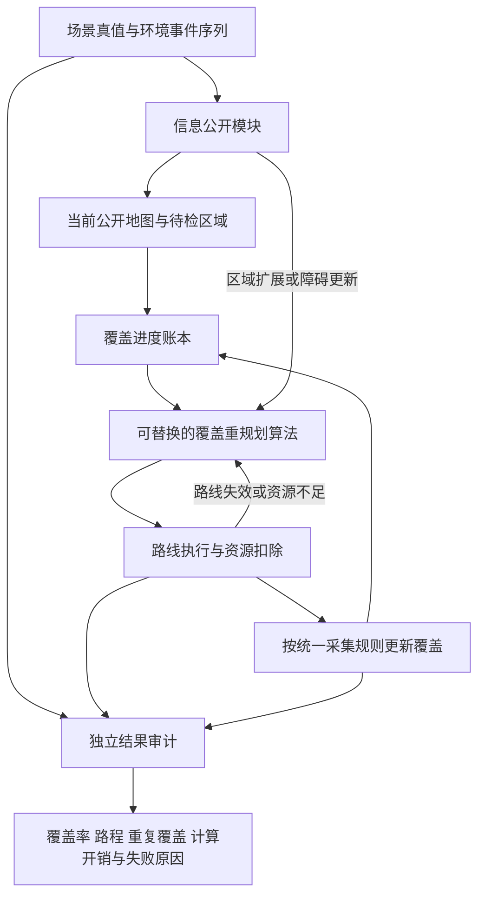

# 剩余覆盖路径重规划研究系统：详细说明

编写日期：2026-10-09。状态：研究设计稿，尚不代表以下模块均已实现。

本文说明我们为了研究算法，需要完整实现和验证的仿真系统。它不是研究所整个无人机项目的系统建设方案。论文主题见《02_论文主题与具体研究问题.md》，文献与算法选择见《03_相关文献与基线算法建议.md》。

## 1. 系统究竟研究什么

单架无人机正在对施工待检路面执行覆盖巡检。巡检过程中，可能发生两类变化：

1. 待检施工区域扩展，扩展方向可能沿原道路直行，也可能形成拐角。
2. 出现或者发现新的障碍物，使原路线的部分连接或覆盖动作失效。

系统需要根据已经完成的覆盖、当前位置和更新后的环境，重新安排剩余覆盖路线，尽量少走路，同时完成相同的巡检要求。

**主要研究对象是环境变化后的剩余覆盖路线，不是飞到新增边界的响应速度。** 新路段加入之后，不预设无人机必须立刻放弃原来的路线赶过去。

### 1.1 已确认的范围

| 内容 | 本研究的处理 |
|---|---|
| 无人机数量 | 单架 |
| 作业目标 | 完成已发布待检路面的覆盖 |
| 环境变化 | 待检区域扩展、新障碍出现或被发现 |
| 历史信息 | 保留已完成覆盖进度和当前执行位置 |
| 主要优化量 | 完成剩余覆盖所需的移动步数或路径长度 |
| 约束 | 不穿越已知障碍、不越过规定可飞边界、考虑资源与返航 |
| 视觉识别 | 不研究；仿真直接提供按规则公开的环境信息 |

### 1.2 不纳入这一篇论文主系统的内容

不要求实现YOLO、DINOv2、真实图像处理、真实飞控、三维轨迹跟踪、多无人机协同、外卖式复杂调度、整改复检点任务、风险等级和紧急截止期。也不研究连续运动障碍的预测与跟踪控制。

之前讨论的图像质量失败重检、复检通知和电池驱动观测，可以保留接口，但不能因此扩大本轮必须完成的算法和实验范围。主实验先采用确定性的几何覆盖条件。

## 2. 必须区分的四件事

### 2.1 待检路面与可飞空间

- 待检路面决定“哪些地方需要完成巡检”。
- 可飞空间决定“无人机允许从哪里经过”。

完成检查的路面上方一般仍然可以通行，不能把已覆盖区域当成障碍。待检区域扩展时，如果电子围栏也扩展，需要分别更新两者，而不是假定它们永远相同。

### 2.2 目标区域真的增加与固定环境逐渐被看见

我们主要研究的是目标集合真的增加：原来不属于本轮巡检的路段，现在被发布为待检区域。

许多未知环境覆盖论文研究的是固定地图逐渐被传感器发现。二者可以借鉴算法，但不能直接等同。规划器不应在事件发生前知道将来新增的路面。

### 2.3 到达一个位置与完成覆盖

无人机经过某个位置，不必然意味着附近所有路面都完成检查。必须由统一的采集覆盖规则判断。

本论文先研究名义几何覆盖：在固定巡检高度和统一采集尺度下，某次有效采集覆盖哪些地面单元。它不证明真实裂缝已经被识别。

### 2.4 障碍物与路面缺陷

障碍物影响通行或采集条件；路面缺陷是巡检结果。主实验无需生成裂缝类别，也无需用缺陷数量决定路线。不能把“未知缺陷位置”误当成“覆盖任务位置未知”。

## 3. 系统整体流程



这里的箭头是数据与执行关系。信息公开模块不属于待比较的算法，独立审计模块也不能向规划器泄露真值。

## 4. 场景和状态的数学定义

建议使用二维平面模型，以固定巡检高度下的可飞投影研究路线。暂不把真实三维飞行控制混入覆盖算法。

| 符号 | 含义 |
|---|---|
| `R(t)` | 时刻t已经发布的待检路面集合 |
| `D(t)` | 已公开的允许飞行范围或电子围栏 |
| `O(t)` | 已公开的飞行障碍集合，含统一安全膨胀 |
| `F(t)` | 允许通行空间，通常为D(t)减去O(t) |
| `C(t)` | 已经完成有效几何覆盖的地面集合 |
| `U(t)` | 剩余待检集合，即R(t)减去C(t) |
| `x(t)` | 无人机当前位置 |
| `e(t)` | 剩余资源 |
| `P(t)` | 当前尚未执行完的路线 |

覆盖账本按地面坐标管理。地图扩展时不得重新编号导致历史覆盖错位，建议固定地图原点和栅格尺度，用稀疏坐标或可扩展数组保存状态。

### 4.1 区域扩展后的更新

```text
新待检区域 = 原待检区域 ∪ 本次发布的新增区域
已覆盖区域 = 保留原来的覆盖记录
剩余待检区域 = 新待检区域 − 已覆盖区域
```

新增区域与原区域重叠的部分不能重复计入新增工作量。对于真正新增、以前不允许采集的目标，不事后追认过去的偶然飞越为完成巡检。

### 4.2 障碍出现后的更新

首先修改可飞地图，使穿越新障碍的路线失效，再判断原来的覆盖动作是否仍可完成。

已经有效覆盖的地面不因后来出现障碍而自动退回未完成状态；未完成地面也不能因为被障碍遮住，就从目标分母中删除。

如果某个目标暂时无法合法到达或采集，应保留为未完成，并记录原因。算法不能用“删掉难任务”换取100%覆盖率。

### 4.3 二维障碍的含义

主实验中的障碍代表固定巡检高度下禁止进入的投影区域，不自动代表所有地面机械都形成贯穿整个空域的墙。障碍高度、越顶飞行和三维遮挡暂不研究。

## 5. 两类事件如何进入系统

### 5.1 待检区域扩展事件

每个事件至少包含：事件编号、发生时间、公开时间、新增路面几何、围栏变化（若有）。

必做两类扩展：直线延伸、拐角延伸。第一阶段采用与原区域相连的扩展；不强制加入孤立新工地、任意道路网络等额外问题。

算法在公开时刻获得新增几何后，从当前位置重新规划。它可以继续完成原附近路面，也可以先处理新增区域，由路线代价决定。

### 5.2 新障碍事件

每个事件至少包含：事件编号、发生时间、公开时间、障碍投影与安全膨胀参数。

主实验采用分段静态障碍：障碍加入后保持不动。重点是一次地图变化如何影响剩余路线，而不是预测移动目标。

至少覆盖三种作用方式：阻断当前连接、切分剩余覆盖条带、改变不同剩余区域之间的绕行关系。

### 5.3 信息公开协议：第一版建议

为了隔离规划算法，**主实验先采用公共地图更新协议**：到达事件公开时刻，所有算法同时获得同一份新增区域或障碍几何。这是理想化的信息输入，不宣称来自已经实现的相机识别。

实际障碍出现时间可以早于公开时间。若要研究这段延迟，需要另设感知协议；第一版不允许无人机在未公开障碍存在时继续穿越真实障碍，因此建议令主实验障碍发生与公开同步。

先前担心的“摄像头只能看见障碍的一部分”属于信息获取问题。后续可增加有限视野、局部占据更新实验；不能在主实验里一边声称局部观测，一边把完整障碍轮廓直接交给某个算法。

公共地图更新已经足够验证剩余路径重规划，不要求现在实现障碍类型识别、深度估计或障碍高度推断。

## 6. 采集模型：缩小到可以分析和实现

### 6.1 第一版采用的具体抽象（建议，待实现前冻结）

在固定高度、固定姿态下，每个合法采集位置对应统一大小的地面有效覆盖集合`V(x)`。可以用矩形足迹栅格化表示。

路线执行器按统一采样间距触发采集；只有合法采集位置产生的足迹才能进入覆盖账本。所有算法使用相同的足迹尺寸、间距和边界裁剪规则。

```text
新增有效覆盖 = V(x) ∩ 当前已发布待检路面
累计覆盖 = 既有累计覆盖 ∪ 新增有效覆盖
```

第一版假设满足采集条件时采集成功，不加入随机模糊、曝光或缺陷识别失败。后续若引入质量失败，则失败不能标记覆盖完成，但这不是当前必须实现的内容。

### 6.2 足迹模型要避免的错误

1. 不以无人机中心落在路面上作为全部覆盖的充分条件。
2. 足迹跨出道路边界的部分不计入有效巡检面积。
3. 相邻足迹重叠只计一次完成面积，但记录重复覆盖。
4. 所有方法在相同道路、足迹和采样间距下比较。
5. 对角移动、转弯插值和采样规则统一，避免某个方法跳过中间路径却获得覆盖。

作为最早的单元验证，可以先用“一位置覆盖一目标格”的退化模型检查路线和账本；正式实验应交代它与有限足迹模型的差别，不能把访问格点直接说成真实航拍效果。

## 7. 路线执行器与重规划触发

### 7.1 第一版动作集合

- 移动：按固定网格执行相邻位置移动。
- 采集：由统一执行器按采样规则触发。
- 地图更新：接收新的公开环境信息。
- 返航：沿合法路径返回指定起降点。
- 停止并报告：覆盖完成、资源不足、不可达或算法失败。

第一版建议使用四邻域、单位步长。后续改为八邻域时，对角长度应为相应几何距离，并禁止穿越障碍角点；不能与四邻域结果直接按步数混比。

### 7.2 触发条件

区域扩展或障碍公开后立即重新评估剩余路线，不等到原路线全部执行完。事件可以发生在移动过程中，仿真执行器必须明确当前位置的截断规则；网格版建议在下一合法离散位置处理事件，并记录最多一个移动步的处理延迟。

重规划未必要求重建所有路线。保留原顺序、局部修补或者全部重算都由被比较的算法决定。

资源不足可能触发返航，属于必须处理的可行性约束；不因此增加一套复杂优先级调度。

### 7.3 接口建议

```text
输入 PlanningSnapshot：
  当前公开地图与版本号
  当前已发布待检路面
  已完成覆盖集合与剩余集合
  无人机当前位置、资源、起降点
  本次公开事件
  原路线剩余部分（允许算法利用，也允许舍弃）

输出 PlanResult：
  后续合法路线与采集安排
  预估路程、资源和返航可行性
  未能完成的目标及原因
  计算时间与算法内部诊断信息
```

规划器不能读取场景真值、未来事件列表或者未来障碍位置。可使用内部缓存，但地图更新后必须维护版本并使失效的连接代价缓存作废。

## 8. 资源与时间模型

### 8.1 第一版资源模型

先采用透明的资源代理模型：

```text
资源消耗 = 移动距离 × 单位距离消耗
         + 采集次数 × 单次采集消耗
         + 地图观测次数 × 单次观测消耗
         + 已声明的等待或其他固定消耗
```

所有系数由配置提供，不现在猜真实无人机数值。需要物理校准时，再用具体公开机型的官方续航、速度等参数说明换算条件；厂家极限续航不能直接当施工场景实际可用续航。

主实验先采用足以完成任务的预算研究路径效率，再单独设置资源紧约束实验。无人机必须保留返航资源，不能靠飞不回来的短路线获胜。

第一版不研究充电、换电和多架次联合优化。任务无法在预算内完成时，保留未完成量并报告资源失败，不悄悄重置电量。

### 8.2 观测与时间

按照此前约定，俯拍观测的上升、拍摄和下降计入资源消耗，暂不计入抽象作业时间。论文必须明确这一简化，因此不直接声称仿真时间等于真实飞行完成时间。

“10分钟为一个仿真时间单位”是计量换算，不表示每10分钟才允许移动或重规划。内部事件可以发生在小数时刻。

观测周期可依据初始电池预算选定，然后在同组比较中固定。若各算法因为耗电不同而自行改变观测周期，获得的信息就不同，不适合作为首轮公平对照。

算法计算耗时单独测量，不因“观测动作不计时间”而被忽略。主目标仍为路径代价，不强制第一版实现飞行与求解器并发调度。

## 9. 如何判定完成、失败与不可行

一次覆盖完成必须满足：所有规定目标均达到统一覆盖标准、无碰撞或越界、资源合法，并按实验约定完成返航。

未完成时至少区分：

| 状态 | 含义 |
|---|---|
| 覆盖遗漏 | 仍有可覆盖目标，算法却停止 |
| 路线非法 | 穿越障碍、越界或不合法跳跃 |
| 资源失败 | 无法在预算内完成并返航 |
| 环境不可行 | 新障碍导致规定目标不存在合法覆盖方案 |
| 求解失败 | 超时、异常或找不到本应存在的路线 |

环境不可行不能简单算作算法路径较差，也不能从结果里无声删除。先预检生成可行主测试集，再把不可行案例作为独立压力测试报告。

### 9.1 动态实验的结束条件

事件流必须有限。建议配置共同的事件发布窗口；窗口结束后由仿真向所有算法公开“本轮不再新增事件”，随后清空剩余覆盖并返航。

若某算法提前完成当前目标，仍需按照统一规则等待或监测后续事件，记录等待资源。不能把它在第一轮完成时直接退出，却要求其他算法承担后续扩展。另一种更简单的实验是从同一个事件后检查点比较一次剩余重规划，两种实验分开报告。

## 10. 怎样比较才可信

### 10.1 两种互补实验

**同一检查点实验：** 固定同一个当前位置、覆盖账本、资源与事件后地图，让各算法重规划。能直接回答某次更新后谁更省路。

**完整在线实验：** 从相同初始条件出发，按照同一时刻表发布事件。不同算法在事件到来时可能处于不同位置，这是前序决策的真实后果，不强行把它们拉回同一位置。

两种结果不能混在一起解释。按“算法走到某个步数才触发事件”的实验，会改变事件的实际时间，应另外命名，不冒充共同时间事件流。

### 10.2 指标

| 层级 | 指标 | 解释 |
|---|---|---|
| 首先核查 | 完成率、合法性、返航成功率 | 确定比较的是同等完成要求 |
| 主指标 | 总移动长度；同检查点下剩余移动长度 | 直接衡量作业代价 |
| 辅助指标 | 重复覆盖、重复通行、转弯数量 | 解释代价来源，不能混为同一概念 |
| 计算指标 | 每次规划耗时、中位数、尾部耗时、超时率 | 判断算法能否及时更新 |
| 资源指标 | 总资源、剩余资源、预算失败率 | 检查约束可行性 |

同一分辨率、单位步长下可用步数表示长度；跨分辨率时必须换算为距离。若资源只是距离乘常数，不能把省距离和省资源包装成两个独立创新成果。

“额外代价”必须给出参照：主实验优先比较相同任务下相对于指定基线的长度差。若另外计算相对于静态场景的增量，要说明新增区域本身增加了必要工作量，不能把这部分全部算成算法浪费。

### 10.3 最小场景矩阵

1. 无变化：检查算法是否破坏简单牛耕式的基本效率。
2. 仅直线扩展：改变扩展长度与发布时机。
3. 仅拐角扩展：改变转角布局与发布时机。
4. 仅新障碍：改变位置、规模与对连接关系的影响。
5. 扩展与障碍共同发生：先用少量事件，再增加次数。

每类至少覆盖早期、中期、后期更新，以及事件位于无人机附近或远处的情况。参数范围属于模型压力范围，尚不能称为现场统计分布。

使用固定场景种子、独立开发集和最终测试集；输出逐例结果、失败案例和分布，不能只挑平均效果最好的几张图。算法运行时长应使用同一机器、明确求解预算并控制随机性。

## 11. 独立审计与保存内容

审计器根据实际执行轨迹重新计算覆盖、长度、碰撞与资源，不直接相信规划器自报的完成率。

每次实验保存：场景配置、初始地图、事件时刻表、随机种子、算法版本与参数、逐步位置、公开地图版本、覆盖增量、资源变化、重规划输入输出、失败原因和汇总指标。

建议目录：

```text
coverage_replanning/
  scenarios/         场景与事件配置
  simulator/         信息公开、执行、覆盖与资源
  planners/          标准接口与各算法适配
  audit/             独立合法性及指标重算
  experiments/       固定协议与批量运行
  results/           逐例原始记录与汇总
  docs/              模型、算法映射、差异说明
```

这是建议的逻辑目录，不要求现在复制旧项目或重建全部代码。

## 12. 与现有实现如何衔接

依据[2026-10-08严格审核](../项目整理审计_20260918/算法复现与场景严格审核_20261008.md)：A*、基础搜索、小规模TSP可以作为工具；既有动态调度工程不能直接当作本论文已经完成的系统。

独立`cstar_strict`接近C*论文核心机制的离散复现，但仍不是论文全部实验完整复现，而且当前静态占据发生矛盾更新会报错。要用于本问题，必须单独设计动态适配并说明修改，不能把地图加入障碍后仍称为原算法直接运行。

现有标称Yang增量覆盖的代码实际使用BFS回退，不能继续称为已经复现D*。旧障碍补覆盖实验能验证局部机制，不能证明新的重规划算法优于强基线。

## 13. 建议实施顺序与验收

| 阶段 | 完成内容 | 验收证据 |
|---|---|---|
| A：冻结问题 | 地图、覆盖、事件、资源、完成条件 | 一份无歧义配置；手算例子与程序一致 |
| B：最小闭环 | 静态覆盖、一次扩展、一次障碍、返航 | 动画和独立审计可重复，无未来信息泄露 |
| C：工程基线 | 局部修补、全部剩余重算 | 相同输入和采集规则；可行场景不漏覆盖 |
| D：文献算法 | 选定近年强方法，先核对原机制再适配 | 原文步骤映射、差异表、原场景验证与本场景测试 |
| E：寻找改进 | 从明确失败案例提出一个具体方法 | 不是仅比弱基线；有消融和独立测试集 |
| F：论文实验 | 完整场景矩阵、计算预算、失败分析 | 原始结果可审计，结论不超过模型证据 |

不需要先完成整个真实系统才能推进研究。下一步应先冻结最小闭环的定义，同时精读最接近的论文；不要先给尚未实现的方法起创新名称。

## 14. 实现前仍需冻结的少量参数

以下是参数选择，不是增加新的研究方向：栅格尺度、采集足迹与采样间距、道路宽度范围、四邻域移动速度换算、事件公开规则、资源预算与返航余量、有限事件窗口和求解时间预算。

这些数值目前没有现场证据。先给出清晰的标准化仿真取值并做敏感性实验，后续有可靠公开资料再物理标定，不编造施工团队的真实需求数据。
