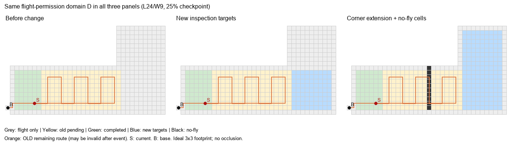

# 固定飞行域诊断结果与研究推进判断

日期：2026-10-10。依据14号v0.2实验规范生成并执行。探索性诊断，不是最终论文实验，不保证创新或发表。

## 1. 这轮推进了什么

我们把此前混在一起的三个量分开了：待检地面T、获准飞行空间D、当前禁入障碍B；无人机在F=D−B里运动，通过固定足迹覆盖T。

本轮让D在事件前后固定，仅增加T或B，避免目标扩展时暗中增加绕行空间。这是隔离变量的诊断假设，不是声称真实施工中飞行围栏一定提前已知。论文最终应把D作为明确输入；如果实际需求是围栏也随施工扩展，必须另定义事件更新并测试，不能用本轮结果替代。

没有增加视觉、复杂调度或新算法。使用现有P1顺序修补、P2全量剩余重算进行检查。

## 2. 用一张图解释空间关系

三张图使用相同的L形合法飞行空间：灰色为可飞但当前非待检目标，黄色为旧待检地面，绿色为已完成部分，蓝色为新发布目标，黑色为新增飞行禁入格。橙线是旧剩余路线，不是事件后的新规划路线；右图中它已经穿过新禁入格，不能继续照飞。S为当前位置，B为基地。

为了可审计，生成器用预设的可飞场地布局容纳两种可能的扩展，场地形状在事件前公开；它与可能出现的目标形状并非统计独立。算法知道D，但不知道未来何时或哪种目标发布，不得到场景元数据。不能将这种已知场地先验包装成未知环境探索。

## 3. 新诊断集

2种路面尺寸（18×6、24×9）×2种公开飞行域（宽矩形、狭长L形）×2个覆盖进度（25%、75%）×8类事件，共64个快照。

事件包括无变化、直线扩展、拐角扩展、近处局部障碍、远处局部障碍、通道障碍，以及扩展与通道障碍同时发生两类组合。

全部场景按运行前规范生成，没有按算法胜负筛选。障碍放置避免当前点和基地，不删除任何待检目标。近远按旧后缀的索引比例定义，不代表真实空间距离或施工概率。

26项测试通过。保存文件独立核验覆盖64个输入、8组共同历史一致性及128条输出路线，未发现非法移动、漏覆盖、返航遗漏、预算超限或事件间飞行域暗变。

全部64个快照在当前理想模型下可行；这不是“障碍都不会导致不可行”的一般结论。此前的不可行测试仍保留，这批诊断集未增加新的不可行控制案例。

## 4. 路线结果

| 事件（每类8例） | P1更短 | 相同 | P2更短 |
| --- | ---: | ---: | ---: |
| 无变化 | 0 | 8 | 0 |
| 直线扩展 | 0 | 2 | 6 |
| 拐角扩展 | 0 | 2 | 6 |
| 近处局部障碍 | 0 | 6 | 2 |
| 远处局部障碍 | 0 | 6 | 2 |
| 通道障碍 | 0 | 6 | 2 |
| 直线扩展+通道障碍 | 0 | 2 | 6 |
| 拐角扩展+通道障碍 | 0 | 2 | 6 |
| 合计 | 0 | 34 | 30 |

P1合计4540步，P2合计4308步，少232步，约5.11%。这是本批规则场景的合计描述，不是现场平均节省量或统计显著性结论。P2不保证最优，差异也不能单独归因于重排、采集位置重建或方向选择。

例如，宽场地24×9、25%进度下的直线扩展：P1为113步、P2为97步；相同尺寸进度的拐角扩展：P1为149步、P2为133步。它们展示旧顺序限制可能留下改进空间，但不能证明某一新算法机制。

各快照每种算法只执行一次。所有求解均在5秒保护上限内完成，最大记录耗时约0.50秒。此次不据单次计时排名，也没有真实飞行安全截止时间，因此不宣称实时保证。

## 5. 对场景结构的审查

- 64例中56例只有一个剩余目标连通块，8例有两个；多块实例均来自18×6、75%进度时的区域扩展（含组合）。当前仍不足以重点验证分解树方法。
- 40个含障碍事件中，34例确实让旧后缀经过非法格；另6例是环境有变化但不使旧后缀碰撞的情形。后者保留作为正常低影响事件，不删掉来放大重规划收益。
- 新增障碍改变通行连接，不必改变目标地面的连通性。不能为了得到多个覆盖子区就把障碍下目标从T中删除。
- 两种D下初始规划及历史可能不同。通道障碍也按各自D的整列生成，障碍长度不相同。因此不能拿宽场地与走廊的步数差归因于“场地窄更好/更差”，它们不是严格的单因素对照。
- 多个场景共享路面与共同初始历史，不是64个独立随机样本；宽场地与走廊中的部分结果相同，不增加独立证据强度。

## 6. 独立判断

| 判断 | 确定性 | 依据与限制 |
| --- | --- | --- |
| 状态与事件模型比原先更清楚、可核查 | 高 | D/T/B分离、历史重放及保存输入审计均通过 |
| P2值得保留为强基线 | 高（限本批） | 30例更短、34例同长；与前轮趋势一致 |
| P1可保留为简单修补对照 | 高 | 实现透明，能代表保留旧顺序的策略；不应故意削弱其插入规则 |
| 当前有必要依靠复杂局部更新节省计算 | 低 | 小规模全量重算尚未表现出计算困难，也没有物理时限标定 |
| 当前应以分解树或整段复用作为创新主线 | 低 | 多块不足，前轮统一条件对照未显示明确收益 |
| 已证明施工现场可节省约5%的能耗 | 不能成立 | 无实机、无物理能耗模型、无现场事件统计 |

研究主题仍可以推进，但不能把“全量重算胜过修补”直接当论文创新；它当前是寻找改进位置的参照证据。

## 7. 接下来按什么顺序推进

**停止无目的扩大自造原型数量，下一步先量清P2离更好路线还有多少空间。**

1. 在小规模固定采集位置上加入精确访问排序参照，分开记录排序代理代价与实际覆盖路线代价。该精确参照只能说明固定采集位置问题的最优值，不能冒称整个面积覆盖问题最优。
2. 对少量代表快照固定采集位置只改顺序，以及固定排序规则只改采集位置/扫描方向。重点查清此前P1/P2差异来自哪里，避免把表示名称当创新。
3. 根据瓶颈决定一项最相关文献方法的规范适配及正式对照。若合理简单方法已接近小实例参照且计算足够快，不强行做“限时局部更新”；若剩余浪费主要来自条带方向/位置，才聚焦相应改进。
4. 方法与规则固定后，再做多事件、较大规模和独立留出集。当前不提前指定赢家、不承诺提升幅度。

固定D只是一项明确的诊断设置，尚不能代表所有施工围栏变化。算法实验模型已能审计，但最终场景语义和论文贡献仍需继续检验，不能因为程序跑通就宣布问题已解决。

## 8. 文件与复跑

- [模型与生成规则](14_算法实验模型与诊断场景规范_20261010.md)
- [逐例结果](../算法小型验证_20261010/results/run_11_fixed_domain_v2/结果报告.md)
- [原始统计](../算法小型验证_20261010/results/run_11_fixed_domain_v2/summary.json)
- [保存文件核验](../算法小型验证_20261010/results/run_11_fixed_domain_v2/saved_file_verification.json)
- [生成器](../算法小型验证_20261010/scenarios_v2.py)

在代码目录执行 `python -m unittest test_validation test_mechanisms test_scenarios_v2 -v`；再执行 `python run_v2.py --output results/新的目录名`，输出目录不得存在。核验保存数据用 `python verify_v2.py results/新的目录名`。示意图用 `python render_v2_model.py results/新的目录名` 生成，需要Pillow。

执行时源码与14号规范已归档在source_snapshot；独立复核及绘图工具是在运行后新增，不改变已运行的求解代码或路径结果。
