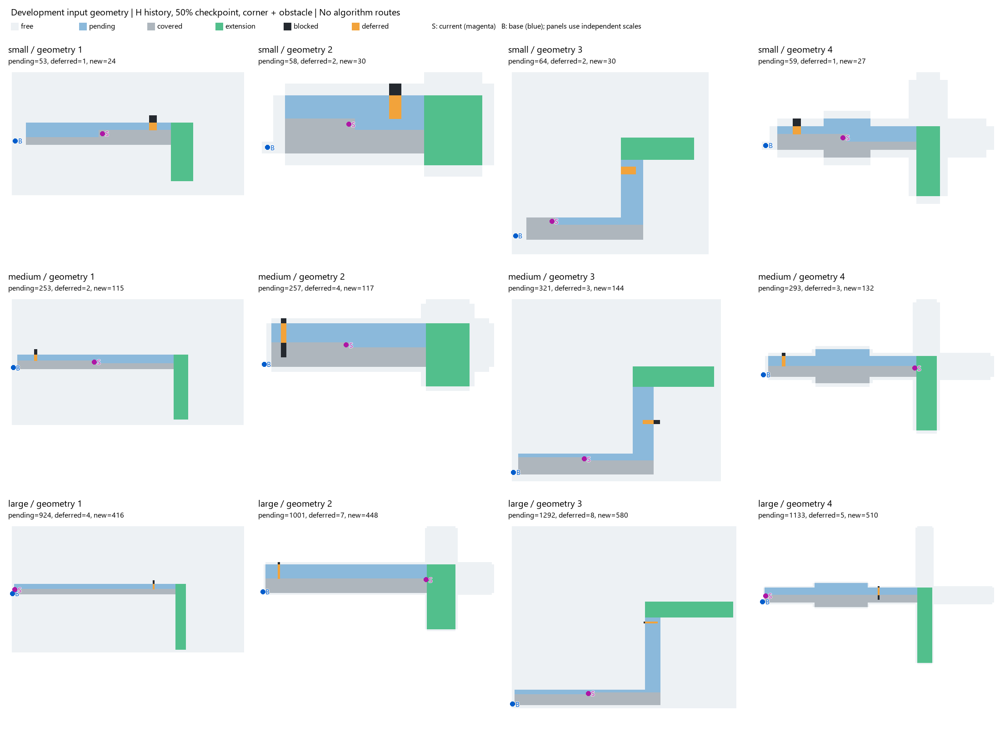

# 开发场景生成与独立核验记录

日期：2026-10-14。状态：**开发输入已生成并核验；没有调用三种规划器，没有正式性能比较。**

## 1. 本轮完成了什么

按第45份v0.1规范实现独立几何生成器，使用Codex附带Python与标准库准备输入。现有三基线v2、原实验数据、原始参数表均未修改。

- 开发基础地图12张，小/中/大各4张。
- 每地图H/V两种历史，25/50/75%三个进度，六种事件，共432个快照。
- 432个快照全部通过生成端检查，无生成失败；失败记录接口仍保留。
- 从保存文件重新读取，独立DFS、路线和账本检查通过432/432。
- 每基础地图另选首个快照的几何见证路线，调用冻结v2的历史audit复核，共12/12通过。它们是输入见证，不是P2/OARP/MST求解结果。
- 新生成器16项测试通过。包括27格小图全点对最短路对照，以及另一小图与冻结Geometry的同长路径逐条一致性；后者只调用标准库几何代码，没有加载求解器。
- 在新的空输出目录从头生成第二份432状态，16个确定性产物（快照、见证、账本、协议及12张基础地图文件）的SHA256逐一相同。耗时记录不要求字节一致。
- 留出测试几何未生成，三算法本机原生依赖仍未验证。

单元测试不是任意地图正确性证明；独立核验共享同一问题定义，但不调用生成器的路径/覆盖例程。旧audit只对12条见证复核，不应写成“432条全部由旧audit复核”。

## 2. 实现位置与职责

算法目录新增四个文件：

- `scale_scene_generator_20261014.py`：坐标、扩展、固定域、H/V历史、障碍候选、快照与资源见证。CLI只允许开发数据，不提供holdout开关。
- `test_scale_scene_generator_20261014.py`：16项单元与契约测试，不运行规划器。
- `verify_scale_inputs_20261014.py`：独立读取产物，检查哈希、初始前缀/后缀、阈值首次达到、遮挡、连通、见证与事件复用。
- `render_scale_inputs_20261014.py`：只画已保存场景，不求路线；使用Pillow。

输入保存在算法目录的`scale_inputs/development_v0.1_20261014/`，干净重放另存`development_v0.1_20261014_clean_replay/`，核验与图示保存在`development_v0.1_20261014_verification/`。未放入正式results，避免把准备数据混成正式实验。

`snapshots.jsonl`每行采用现有序列化字段，可由历史deserialize读取；后续运行器应只给规划器snapshot和initial_targets，不传整个多事件分配表。`witnesses.jsonl`单独保存，不得免费交给任何方法作额外候选。缓存也不向求解器传递。

## 3. 实际工作量范围

下表是每档144个开发快照的最小/最大值，不是算法性能。

|档位|可通行格数|已发布目标格数|尚待完成可检目标格数|暂缓格数|
|---|---:|---:|---:|---:|
|小|138—675|60—102|11—84|0—4|
|中|589—3735|280—504|64—414|0—9|
|大|2377—18400|1024—2020|249—1660|0—16|

L/W档位不是精确难度标尺。开放域包含较多非目标自由格，既有L形也比直路有更多任务；后续要按实际|F|、|U|报告，不能只报“大图”。

初次生成约6.27秒、干净重放约6.93秒，均为本机输入构造墙钟，不是三算法计算耗时，也不是现实无人机时限依据。

## 4. 确认并保留的限制

1. **18个拐角快照触发最小尺寸**：小图12、中图6，来自9组历史的拐角/拐角＋障碍配对。实际新增比例高于名义值，不当作18张独立地图，也不把名义比例用于精确等面积对照。列表在`clipped_corner_states.json`。这是预先声明的取整/最小弯接规则，不是求解后删图。
2. 测试方向反射功能用合成开发参数做了检查，未据此生成任何预定holdout图。
3. 每图所有事件共用同一公开飞行域，未按实际扩展方向裁域。飞行域含潜在可通行分支，未声称模型完全隐藏未来可通行空间；隐藏的是未来目标发布与障碍事件。
4. 关联状态共用历史，不构成432张独立地图。每档只有4张开发基础图，不能从这里估计普遍效果。
5. 没有初始内部障碍，当前新障碍全部在事件时发布；还未覆盖多轮连续事件、障碍移除或真实施工采样。
6. 候选形状、扩展比例、方向等有绑定；首批矩阵不能分离各因素的独立因果作用。
7. 几何seed字段对固定坐标是追溯标识，不代表随机抽图；障碍实际顺序由第45份规定的SHA256字符串排序决定，非在线试错。

暂不为改善18个尺寸截断快照而改原参数。若研究需要严格等新增面积，另建生成协议版本并重建受影响输入，不能覆盖本批。

## 5. 场景图检查

图示按固定规则选择全部12张开发图的H历史、50%进度、拐角＋障碍快照，不按算法结果选图。各面板独立缩放；灰底为可通行域，蓝色为旧待检目标，灰色已检，绿色新增目标，黑色障碍，橙色暂缓，S当前位置、B基地。



已查看生成PNG，图中未画任何候选算法路线；“看起来可走”不替代数值核验。绘图选择清单另存`scene_atlas_selection.json`。

## 6. 精确重放步骤

在算法目录，使用任意新的不存在输出目录，例如：

```powershell
$py = 'C:/Users/Administrator/.cache/codex-runtimes/codex-primary-runtime/dependencies/python/python.exe'
$algo = 'E:/无人机研究项目_接续包_20261014/研究方案_剩余覆盖重规划_20261009/算法小型验证_20261010'
Set-Location -LiteralPath $algo
& $py -m unittest -v test_scale_scene_generator_20261014
& $py scale_scene_generator_20261014.py --out scale_inputs/replay_new_directory
& $py verify_scale_inputs_20261014.py --input scale_inputs/replay_new_directory --out scale_inputs/replay_new_verification
```

所有输出目录拒绝覆盖。原输入`sha256.json`含输入产物与生成源码哈希；核验目录含summary、测试日志、重放比较、逐状态工作量、截断列表和核验产物哈希。

## 7. 下一步

先验证便携冻结入口和原生依赖，再用开发子集验证三方法运行器的完整记录与预算口径。新增文献候选的审查见第47份；尚未冻结扩展方法集合。只有运行器、方法集合与预算协议稳定后才能生成/封存测试输入并开正式比较。
