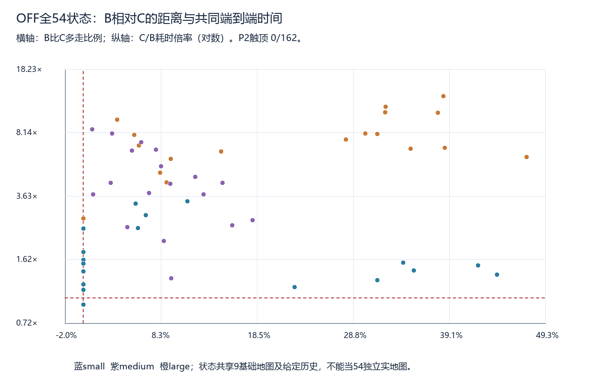
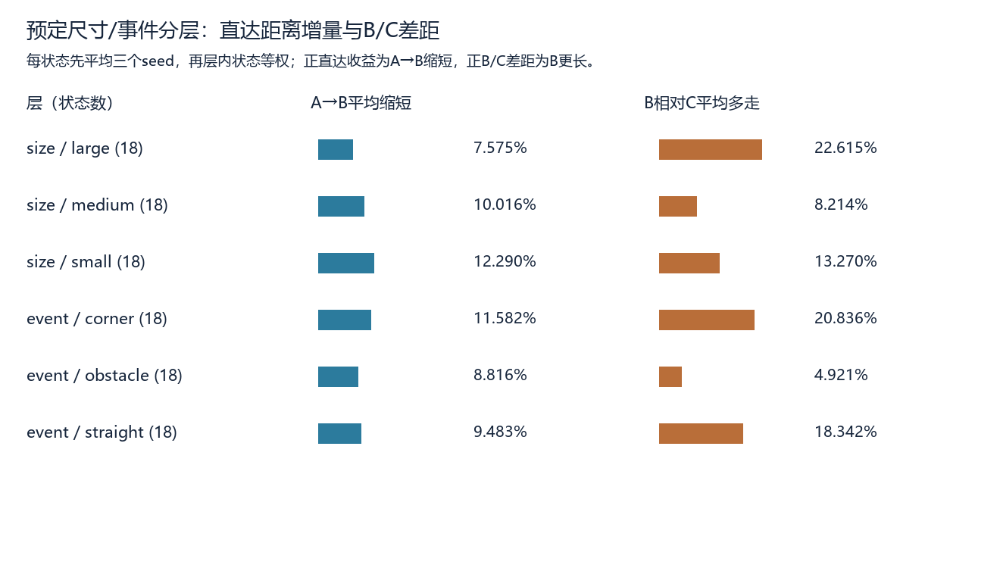
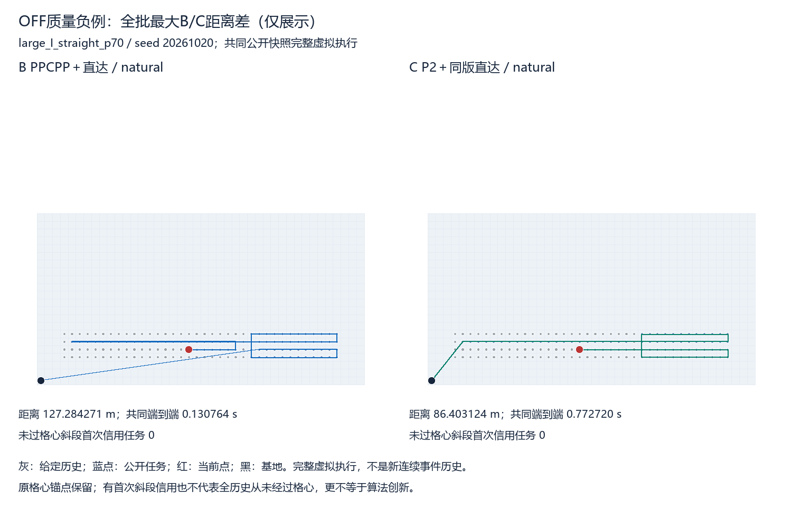
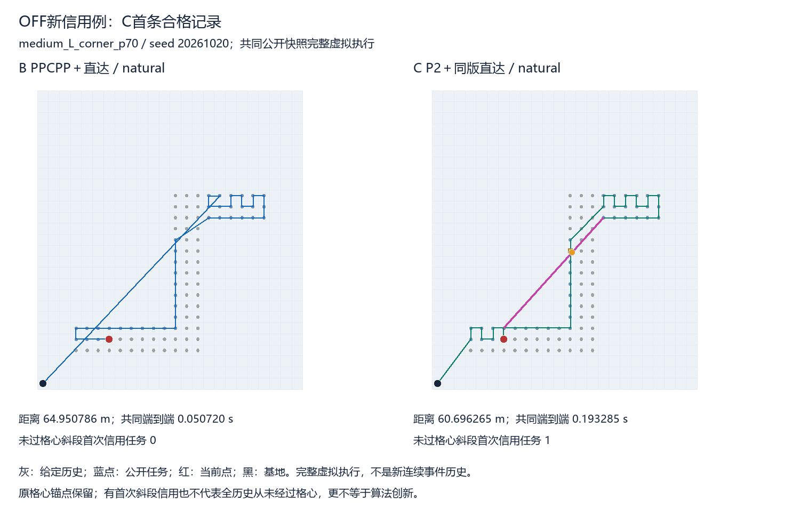
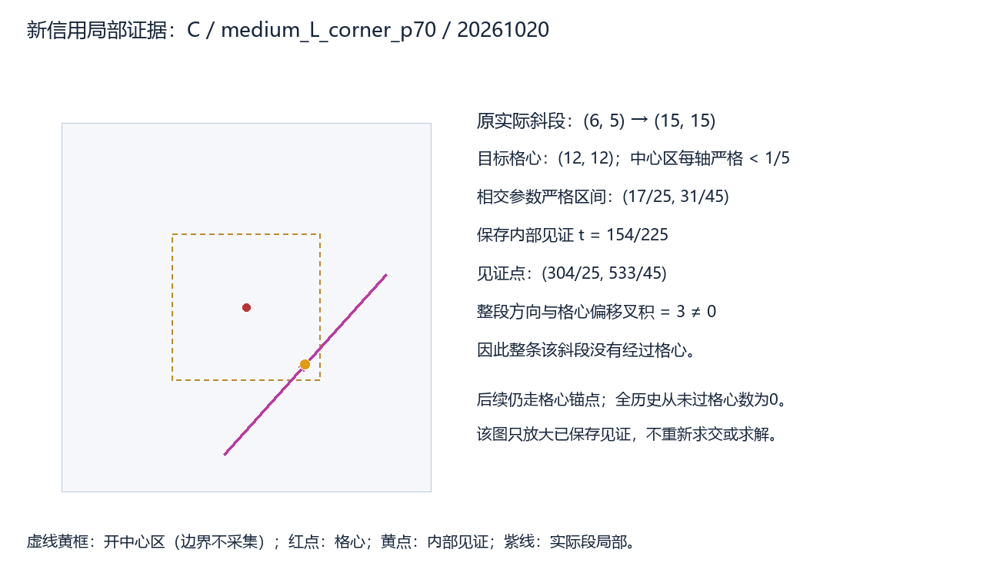

> 阅读副本，整理于2026-10-25。结论保留原报告当时的状态，不代表新增验收。权威原件：[00_通俗全量开发比较报告.md](../../../中心区OFF全量质量时间开发比较_v0.1_20261022/00_通俗全量开发比较报告.md)。本副本仅调整本地链接。

# 关闭核心详细profile配置：全量开发比较

本轮8纯门槛首轮通过、准备修复0；**324正式新入口**（PPCPP/P2各162），真实技术/热身0，A/B及C0/C共享核心形成648视图。全部路线通过独立合法性/资源/信用审核，完成当前可检责任并返航，失败/未运行0。到上限停止，不自动追加重复或其他批。

本批准确名称是**关闭核心详细profile配置**，仍包含必要保护、观察、包装和审核，不是零观测或纯算法时间。直接复用已验OFF原函数，只有产物目录重绑定；未改评分、搜索、信用、直达、格心锚点、预算或事件机制。

这是**给定相同外部初始历史的事件后快照比较**：54状态、原3seed、共享9基础地图和历史，输入字节与旧批相同。H有旧公开/自由格心前缀证据，当前collect_here幂等；没有以新区规则重放扩大H，不声称新连续事件收益或54独立真实地图。

## 三个主要问题

1. **相对原PPCPP，直达改善多少？** A→B总距离缩短9.562%，同seed配对后状态等权平均缩短9.960%；162配对缩短/相等/更长为[162, 0, 0]。
2. **相对P2＋同版直达，距离—时间权衡怎样？** 全批B/C总距离比差19.285%，状态等权多走14.700%，平均配对多走14.973019米，少用0.902025秒共同端到端；状态等权时间节省比例63.928%。B更长/相等/更短[133, 27, 2]，B更慢3组，均保留，不拿两个百分比大小证明综合胜出。
3. **新区判据是否实际利用？** 关键指标是实际执行斜段取得首次信用且整段不含目标格心，不能用偏离格心的见证点替代。B为0格次/0状态；C为8格次/3状态（格次含seed重复）。原名义锚点保留；全实际历史从未经过格心的任务数见下表，不因首次信用提前而冒称已释放锚点。

|视图|不含格心斜段首次信用格次|状态数/54|状态seed数/162|全历史从未过格心格次|
|---|---:|---:|---:|---:|
|A|0|0|0|0|
|B|0|0|0|0|
|C0|0|0|0|0|
|C|8|3|8|0|

已有C例图及保存交区间/内部见证局部放大；不能将C的例子算作B的收益。

## 完成状态与计时

PPCPP和P2全批均完成既定有限流程自然结束；这不等于全局最优或无限搜索收敛。

P2触顶0/162；双方成功自然完成子集162/162配对、54/54状态，排除0组。其状态等权B/C距离差14.700%、总距离差19.285%，平均少用0.902025秒。全部排除ID及自然且及时子集另存，不能用条件子集代全批。

|视图|共同端到端均值s|中位数s|P95s|最大s|预算触顶（共享核心）|原生迟到|post迟到|
|---|---:|---:|---:|---:|---:|---:|---:|
|A|0.035647|0.015822|0.130029|0.222755|0|0|0|
|B|0.126426|0.046985|0.446975|0.835813|0|0|0|
|C0|0.949984|0.159553|4.606011|9.328489|0|0|0|
|C|1.028451|0.188953|4.869354|9.693810|0|0|0|

原生20秒保护不提高；直达18秒软停止新候选、4096候选、20秒仅迟到标记，**不是强制20秒中断**；父进程150秒兜底涵盖导入/执行/审核。所有迟到标志均保留。核心有限完成即返回，不空等。

原入口已保存的子阶段也按每核心唯一入口统计在《已保存原生与直达子阶段费用统计.json》：PPCPP的p0/final_audit/encoding、P2的encoding，以及直达parse/preprocess/source_validation、candidate、main_validation_metrics和两次证据flush总和均列均值/中位数/P95/最大值。直达内部响应encoding计时发生在响应字符串序列化之后，原响应没有保存该独立值；其费用包含在engine入口总时，分项明确null/不可观测，不填0、不新增插桩重跑。其他必要编码同样保留在既定包装内，未保存的细分不事后虚构。

主时间包含同一次原生入口、轻量唯一分派、返回后实际加载源码hash、原/直达路线的必要新区虚拟信用执行/指标/编码与直达。开始前hash及冷导入在外，native_raw/post_raw两次实测证据flush扣除，主必要编码保留；独立审核、完整落盘、进程创建在主计时外，worker/父墙钟、冷导入/审核/flush另列。A/B或C0/C共享核心不能重复求和。原生、raw包装、post engine、post增量、post必要包装和共同端到端的均值/中位数/P95/最大值见summary/CSV，其他费用见逐入口来源与总账。P95为nearest-rank，不事后变阈值。

核心细查询为null/不可观测，不能从空值填0；入口层、主执行、post及独立审核计数分别保留。B.load_native的无任务导入监视和来源校验仍存在，OFF只关闭核心详细profile。四项线程变量1、每入口新进程串行、无跨输入缓存；后台负载和文件冷热不保证消除，本批不是所有部署方式的固有速度。

## 与旧ON逐项对照

|核心|同输入seed入口数|原路线相同|直达路线相同|双方自然且决策相同/双方自然|旧ON触顶→新OFF自然|
|---|---:|---:|---:|---:|---:|
|PPCPP|162|162|162|162/162|0|
|P2_MULTI|162|157|157|126/126|36|

逐项输入/原路线/直达/终止/规范化决策比较保存，规范化仅去预登记时钟字段，保留奖励trace、阶段状态、passes/swaps与改进记录。双方自然完成却出现未解释确定性记录差异会停批；本轮未触发该条件。预算状态变化导致的可用记录差异单列，不能因OFF路线变化就称算法改进。

PPCPP全部162份路线及自然完成决策相同；P2有5份原/直达路线改变，全部来自旧ON触顶、新OFF自然完成。下表只列这些预先允许的预算行为变化，单位为原四邻接步数及直达后米；5份不是算法优化实验，也不据跨批时间差精确归因。全部324份可用工作摘要（stage/status/passes/swaps/improvements/source）见旧ON_OFF可用决策工作量摘要.json。

|状态|seed|旧ON原步数|新OFF原步数|旧ON直达m|新OFF直达m|
|---|---:|---:|---:|---:|---:|
|large_L_corner_p30|20261021|197|195|192.812559|191.828427|
|large_L_straight_p30|20261020|199|193|194.478709|190.236068|
|large_Z_corner_p30|20261020|286|262|278.990550|260.000000|
|large_Z_corner_p30|20261021|286|262|278.990550|260.000000|
|large_Z_corner_p30|20261022|286|262|278.990550|260.000000|

旧ON报告原文/距离/信用/合法性和原始数据保留；新增《旧ON报告时间结论限定说明.md》，明确旧时间及触顶/预算下质量属于含详细profile配置。本轮新数据作为当前关闭核心详细profile配置下的全量开发时间参照。新旧不是同轮随机受控对照，不能把跨批耗时差精确全归因profile；没有使用受控六large状态倍率修正任何旧表，也不将旧格心模型数字作模型变化因果。

## 指标口径、图与证据

全部648视图的输入任务/初始已采/可检剩余/暂缓/新增/未完成、覆盖分母、返航终点/资源和完整合法性收据保留。可检覆盖100%不表示遮挡暂缓也完成；公开覆盖分母保留暂缓。总距离欧氏，未完成短路线不作优势。

起点至首次信用、采集间、末次信用后返航采用固定内部见证约定：首次相交实际段严格区间的中点，精确根式与认证区间保留；不冒称唯一物理首次进入时刻。无新增路线另列。触达/重复触达按每段每任务及显式初态动作事件记，依赖折线分段，不是额外飞行成本；无新增信用段长度是整段标签，不是逐点非采集距离。共线正向分段不制造转弯，90/180/其他角度统一统计，采集/等待不算转弯。












按原尺寸/事件分层，先同状态三seed平均再层内状态等权；总距离比与状态等权比并列，不挑最佳层。负例按全批最大B/C距离差固定选择，仅展示不改样本。完整执行路径与信用事件/精确见证、原生返回和直达原文/独立回执、attempt/失败未运行账与源码/输入hash全部保留。

8纯门槛与控制72旧证据只读hash引用分开，不混正式分母。每份独立审核在主计时外实际运行并计费；最终verify只核绑定/已有独立回执，新增核心/后处理/几何0。报告/绘图只读保存数据，不重新求解或区域审核。完成封存、更新根进度后停止交审，不新增留出、地图、seed、预算、连续事件或机制批，不推送。

报告导出v0.2补齐原返回已保存的子阶段费用统计、跨批工作摘要及5份路线变化表；未单独保存的编码细分明确不可观测。首版全部报告/统计/图/脚本保留report_export_v0.1。所有主指标和时间观测逐项与首版相同，未改实验源码/输入/结果/计时/审核，新增核心/后处理/几何0。

稿件与目录沿用20261022命名；封存时已跨America/New_York午夜，实际封存日期为2026-10-23，UTC时间记录在final_receipt.json。
