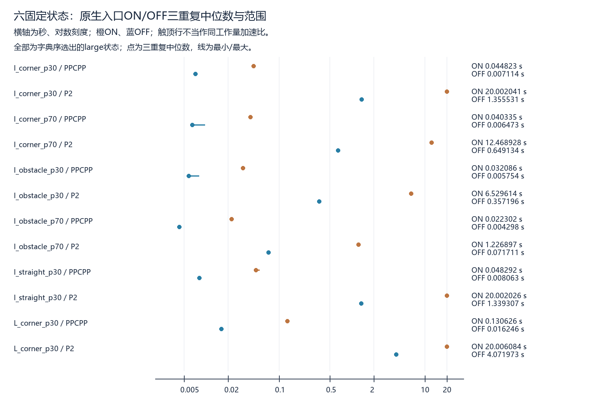

> 阅读副本，整理于2026-10-25。结论保留原报告当时的状态，不代表新增验收。权威原件：[00_通俗计时核查报告.md](../../../中心区计时插桩影响核查_v0.1_20261022/00_通俗计时核查报告.md)。本副本仅调整本地链接。

# 计时插桩影响受控核查

本轮完成 72/72次受控入口，消耗槽位72，真实技术/热身0；8纯案例首轮通过、准备修复0。每入口同时保留原返回和同版直达，成功返回均独立审核、覆盖当前可检责任并返航。旧324批和全部历史文件未修改。失败：None；未运行0。完成后停止，不自动扩大批次。

## 三个问题的回答

**详细观察是否明显扰动时间？** 同状态/原seed/重复中，两边自然完成、去除时钟后完整原生返回及可用决策记录相同的PPCPP配对18组，ON/OFF原生耗时比中位数/范围为6.011269 [3.990846, 8.215337]，全部ON更慢=True。P2相应配对9组，比值为18.303591 [17.098963, 19.273502]，全部ON更慢=True。这是本机这些固定配置和可用记录支持的观测开销证据；OFF逐函数/图查询数没有观测，不能宣称这些细节也被实测为相等。各状态三重复中位数与完整范围见下表，不挑最快值。

本轮答案是：**详细profile在这六固定状态上明显扰动了原生耗时**。合格配对的完整记录相同，原生比值范围分别约3.99–8.22和17.10–19.27，且全部ON更慢；这里的比值仅属于合格配对，不把9组预算行为变化的20秒比值混入。

**P2截止结果是否改变？** P2共18组配对，ON自然完成9，OFF自然完成18；ON触顶/OFF自然完成9组，OFF触顶/ON自然完成0组，双触顶0组。预算状态不同的耗时比被留空，不能解释成同工作量加速。原路径相同18/18，直达路径相同18/18；差异按原截止/自然状态、阶段/passes/swaps/source/改进记录逐项保存，不把OFF路线变化当算法改进。两边自然完成而决策不一致或相同原路径无post时间截断却产生不同post路线会立即停批；本轮实质异常见原始failure及所有迟到触顶异常与未运行.json。

**旧报告哪些时间结论需限定、是否值得另议干净计时全批？** 上批仍是含详细profile的配置测量，原距离/合法性/信用证据保留；时间倍率、平均节省秒数、P2触顶率及相应预算下的距离质量只能按该配置解释，不能当无插桩算法固有耗时或用来给全54状态校正。**值得负责人另议干净计时全批协议**：本轮同时看到稳定同记录工作量开销和9组P2截止状态变化；本轮不启动该全批、不改旧表。关闭详细观察不构成新覆盖算法，不据此宣称创新。

本轮全部36组配对原路径及直达路径都相同，未观察到路线缩短。P2的9组ON触顶/OFF自然完成依然不能算同工作量：即使best路线相同，ON阶段/迭代记录已被截止截断，OFF走完既定有限流程；逐组ON_recorded_work/OFF_recorded_work保存stage/status/passes/swaps和改进记录，不以路径相同代替工作量相同。

## 受控表（秒，比值行无单位）

每格为三重复中位数 [最小, 最大]；同记录工作量比值只基于两边自然完成且完整规范化raw一致的配对。全部六状态由字典序规则选出，恰好都为large；不是跨尺寸代表样本。

|状态|核心|ON原生秒|OFF原生秒|自然完成ON；OFF|同记录工作量配对|合格配对原生ON/OFF比|
|---|---|---:|---:|---|---:|---:|
|large_I_corner_p30|PPCPP|0.044823 [0.044415, 0.045313]|0.007114 [0.006958, 0.007283]|3/3；3/3|3/3|6.300558 [6.098477, 6.512655]|
|large_I_corner_p30|P2_MULTI|20.002041 [20.002023, 20.002091]|1.355531 [1.344000, 1.379065]|0/3；3/3|0/3|—|
|large_I_corner_p70|PPCPP|0.040335 [0.038585, 0.040774]|0.006473 [0.006262, 0.009671]|3/3；3/3|3/3|5.960976 [4.170858, 6.511594]|
|large_I_corner_p70|P2_MULTI|12.468928 [12.363509, 12.494890]|0.649134 [0.646947, 0.661859]|3/3；3/3|3/3|19.248562 [18.679988, 19.273502]|
|large_I_obstacle_p30|PPCPP|0.032086 [0.032045, 0.032087]|0.005754 [0.005654, 0.008030]|3/3；3/3|3/3|5.576036 [3.990846, 5.675121]|
|large_I_obstacle_p30|P2_MULTI|6.529614 [6.483661, 6.537968]|0.357196 [0.353992, 0.364509]|3/3；3/3|3/3|18.303591 [17.787384, 18.445653]|
|large_I_obstacle_p70|PPCPP|0.022302 [0.021933, 0.023084]|0.004298 [0.004247, 0.004437]|3/3；3/3|3/3|5.188707 [4.943250, 5.434912]|
|large_I_obstacle_p70|P2_MULTI|1.226897 [1.226189, 1.267903]|0.071711 [0.071580, 0.072171]|3/3；3/3|3/3|17.140098 [17.098963, 17.568164]|
|large_I_straight_p30|PPCPP|0.048292 [0.047754, 0.054133]|0.008063 [0.007878, 0.008157]|3/3；3/3|3/3|6.061563 [5.920120, 6.713871]|
|large_I_straight_p30|P2_MULTI|20.002026 [20.002011, 20.002039]|1.339307 [1.324073, 1.374608]|0/3；3/3|0/3|—|
|large_L_corner_p30|PPCPP|0.130626 [0.126025, 0.134921]|0.016246 [0.016118, 0.016423]|3/3；3/3|3/3|8.104273 [7.757097, 8.215337]|
|large_L_corner_p30|P2_MULTI|20.006084 [20.006020, 20.006122]|4.071973 [4.029861, 4.277285]|0/3；3/3|0/3|—|



## 公平性、计时和结论边界

ON直接调用上批NativeObserver原类/profile原函数；OFF仅关闭核心详细profile。原核心合同、20秒截止、几何/候选审核、PPCPP分支及P2有限多初值/2-opt搜索不变，中心区service和直达engine/审核同一对象同hash。源码阶段A证明原生内部不调用中心区服务，实际中心区评估在原生返回后。不能用旧包与新包耗时相减预设插桩或中心区因果；本轮ON/OFF共用全部包装，构成有限受控差异。

原观察器附带的一次核心调用断言在OFF由两配置共同的轻量独占入口令牌替代，拒绝重复分派并在异常后移除profile，不重写原生/直达时钟。ON内部细计数保留，OFF明确null/不可观测，只有入口层账可直接计数；主执行、后处理、独立信用审核查询仍分别保存。冷导入的无任务profile监视两配置都保留在主时间外，因此OFF不是关闭所有保护或所有观察器。

主时间包含原生（含ON profile和两边相同分派）、返回后实际加载源码hash、必要原路径/新折线虚拟信用和编码、直达；开始前hash/冷导入在外。原证据两次实测flush从主时扣除，独立审核、完整落盘、进程创建在外但另记墙钟。直达18秒软截止/4096候选；原total20秒只标记迟到，不是强制中断，父进程150秒兜底。没有提高原生20秒或放松审核。原生、post engine、post增量、raw/post必要包装、共同端到端、审核、flush、worker/父墙钟的逐入口与三重复完整统计均已保存；必要包装是现有边界的可复核差值，不把hash等费用凭空删除。

线程口径的只读补充见03_阶段A线程口径只读补充.md：旧格心质量时间run只显式设OMP/OPENBLAS/MKL三项1，NUMEXPR继承未明；阶段A“相同原则”不表示四项逐字一致。本轮ON/OFF四项均明确为1，没有该组间差异。

同工作量判据是同完整有限流程自然完成且规范化raw全部相同；删除的只有预登记时钟字段，passes/swaps/阶段终止/路线/奖励trace等全部保留。OFF没有细查询观察，摘要一致不能替代无限粒度的执行证明。预算截断返回可能在时间检查边界产生路线或已完成工作量差异，必须结合预算状态解释；双触顶不能估完整成本。重复只描述本机波动，有限六状态不能外推全54、更不能将旧时间除平均倍率；系统后台负载未保证清零。

## 证据入口

01_阶段A源码与计时边界审查.md、02_保护等价与完整预登记.md、selection/plan/environment/source_guards和worker_diff.patch保存真实前协议。prechecks/active_freeze/attempts/status、outputs的原返回/post/完整虚拟信用事件/独立回执逐入口保存。全部受控入口阶段计时与结果.csv、ON_OFF配对表.csv、同状态seed重复ON_OFF完整配对.json、三重复中位数范围与配置比较.json保持分母。入口与查询总账.json分别记ON细查询、OFF不可观测、实际主/post/独立查询及纯门槛；所有异常/迟到/未运行保留。

最终verify只核绑定、保存输出及已有独立回执，新增核心/后处理/几何0。报告生成只读保存数据，不再求解/求交。阶段A和纯门槛不混作真实实验，受控重复不混入旧正式324批；留出、地图、seed、机制均未扩充。封存更新根进度后停止交负责人审核。

报告导出v0.2只改展示与解释：首版线性轴使PPCPP短时间范围难辨，改为明确标注的对数轴，并从已有返回补充工作量摘要及本轮明确判断。首版全部导出和脚本保留report_export_v0.1；未改任何实验源码/返回/计时/审核，新增核心/后处理/区域查询0。
