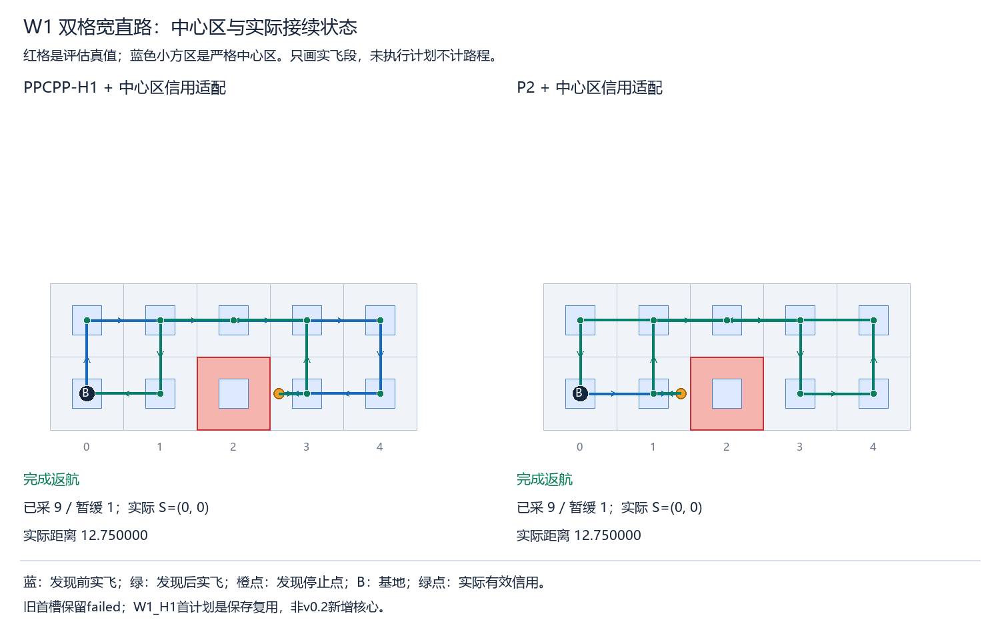
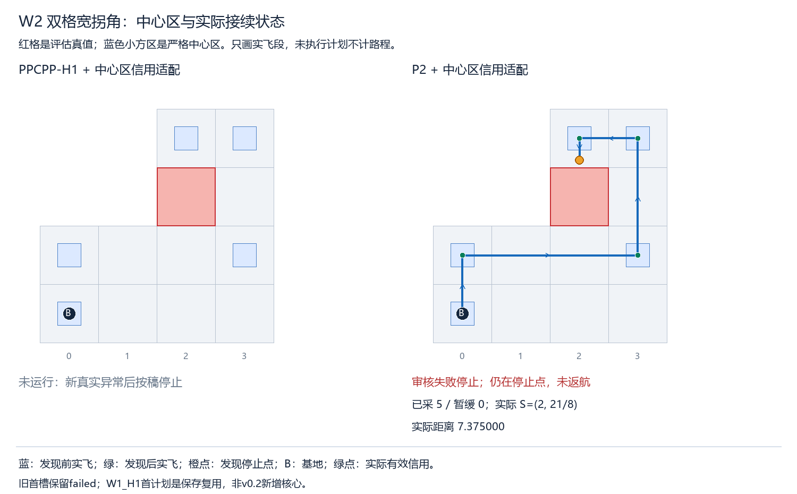
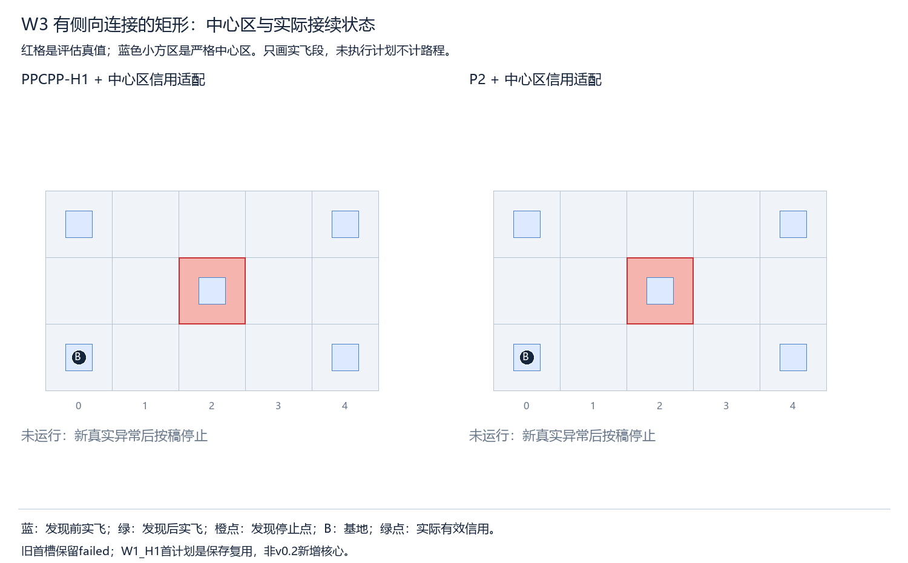

> 阅读副本，整理于2026-10-25。结论保留原报告当时的状态，不代表新增验收。权威原件：[00_通俗接续与中止报告.md](../../../中心有效采集区统一接入最小验收_v0.2_20261022/00_通俗接续与中止报告.md)。本副本仅调整本地链接。

# 中心区观察器v0.2：两会话完成，新零查询计数错误后停止

本轮按接续稿完成观察器作用域修复、六项零核心组合预检和旧首槽保存复核。正式接续的 W1_H1、W1_P2 完成可检任务并返航；W2_P2 发现后第二份计划在独立计数守恒审核处遇到新的零值字段错误，立即停止。W2_H1、W3_H1、W3_P2未运行。本版未通过全部有限闭环验收，没有修补正式源码或补跑。

## 三栏结果与来源

|来源|结果|算法调用口径|
|---|---|---|
|v0.1原失败|W1_H1首槽仍failed，完整返回/135混账及原计数缺失保留|旧H1核心1、直达1，未重跑|
|保存结果复核复用|完整输入、初态/配置、路线/见证/资源全部审核通过，标reused_saved_reaudited|新增核心/选择器/直达/图搜索0；旧计数派生分类非原trace|
|v0.2新增执行|2会话完成，1会话失败，3未运行|新增核心5：H1 1、P2 4；新增直达5；跨版本核心6/上限12|

旧首槽135原值仍在来源记录中。派生引擎90、主管线post审核45来自各自已保存计数及完整返回，未硬减常数；全量审核保留精确相等断言。基地旧collect_here日志原hash链恢复并只计一次，未重跑初始规划；后续新显式动作分别记账，重复采集不增加H。旧首槽与新调用不拼成同轮计时性能配对。

|会话|状态|新核心|实际已采/暂缓|实际长度|转弯次数|当前实际S|
|---|---|---:|---|---|---:|---|
|W1_H1|完成返航|1|9/1|51/4|8|(0, 0)|
|W1_P2|完成返航|2|9/1|51/4|8|(0, 0)|
|W2_P2|失败停止|2|5/0|59/8|4|(2, 21/8)|
|W2_H1|未运行|0|—|—|—|—|
|W3_H1|未运行|0|—|—|—|—|
|W3_P2|未运行|0|—|—|—|—|

W1各9个可检目标完成，遮挡1格仍在D，两法均实际返回基地、路程51/4。W2_P2已采5格、D空，但停在(2,21/8)，路程59/8，尚未返航，故不能算完成。其第二份计划只是预测，未提交其信用或距离。三次真实发现均为轴向；已完成的两会话发现后真实H接续通过。真实“不经格心的斜向段采集”本轮未发生/未验，W3未运行，不补图追触发。

## 修了什么，为何又停止

生产采集谓词、执行器、首连接/主管线、后处理路线选择、区域独立几何、核心评分/搜索/seed/地图/预算均不改。只改observe、必要计数守恒断言、异常Counter落盘及接续包装，见修复.diff和changes.json。新观察器沿调用栈按engine.credits、pipeline.main_audit、pipeline.run的函数code身份归类，不凭共享phase决定归属；phase只用于已识别主管线的细分。原1200总体保护继续覆盖“引擎＋主管线post审核”，引擎分类另有原保护，不增加预算。

新记录全服务查询473，分为引擎174、首连接预测21、原生审核98、主管线post审核86、全路线审核94，合计守恒；原post总体保护项260=174+86。引擎精确相等检查在已有查询的返回中通过。

W2_P2重规划时全部可检目标已经完成，后处理区域查询为0。Counter未生成 shared_region_queries_total 字段，转为普通dict后，新增审核用[]取该键，在audit/_audit.py:170抛KeyError。空集合“零查询”表示未被组合预检覆盖，是本次计数审核适配的技术错误，不是核心/路径/采集模型反例；失败仍照实保留。源程序在真实开始后完全不改，不现场改get默认值或补跑。

本次异常 finally 已实际持久化独立Counter：失败重规划审核几何29、距离26、区域查询75、区域点213、边参数170。旧v0.1异常Counter缺失仍保留为缺失，不能用本次完整记录覆盖旧缺口。

## 预检、复核和查询账

六项固定组合：仅引擎、仅主管线、串接、次数变化、嵌套/异常清理、序列化/模块身份，均以真实credit/main_audit函数和固定路线桩运行新旧观察器；共12分支、46区域查询，核心/后处理搜索/图搜索0。旧逻辑对主管线也计入post，新逻辑守恒。准备导入前发生一次标准库difflib等依赖未登记错误，尚未运行任何案例或核心；另存失败和旧hash清单后补登依赖，1轮技术修复，六项仅运行一轮。旧35纯案例只核hash复用，没有重做服务测试；本次计数以外源码一致性检查通过。

首槽保存完整复核新增独立几何41/距离31/区域查询400，点877/边参数780，核心/选择器/后处理/搜索0。原混计数与派生分类分开，证据强度不混。

新增真实核心开始/返回/完成5；图搜索90=context BFS5＋距离行BFS17＋A*68，内部审核102合法，distance7631/path502。旧首槽图搜索2另列，跨版本92。新增直达source/candidate/output45/48/31，服务174；主管线主几何144、距离139、服务299。新增运行时独立计划审核几何175/距离144/区域1124，包括失败一份；全部finally实际落盘。真实执行账另见总账：新动作36，旧基地动作1单列，共37条已记录执行动作；发现3、计划等待5，实际段统计按日志，不累加未执行计划。

保存verify复核5份接受的计划（其中1份保存复用）及3条实际执行日志；失败计划保留单列，不改通过。新增独立几何224/距离186/区域1714，点4099/边3406、探测/安全盒21/37；新增核心/选择器/后处理/图搜索0。只读核验通过意味着保存证据可重建，不意味着六会话实验通过。实际查询分类全量见三栏调用与查询账.json；原始异常、未运行和新失败不合并进成功汇总。

## 图与结束







执行稿、统一合同、修复diff、六组合证据、旧35案例hash、首槽复核、实际日志/预测见证/原返回、输入来源及哈希、查询/转弯账、只读verify均保存。既有核心和区域语义未变，旧failed不回写。有限接口修复与两例完成不构成普遍质量、速度、创新或成像识别证据。封存更新根进度后停止交审，未追加性能、留出、seed、视觉或推送。
