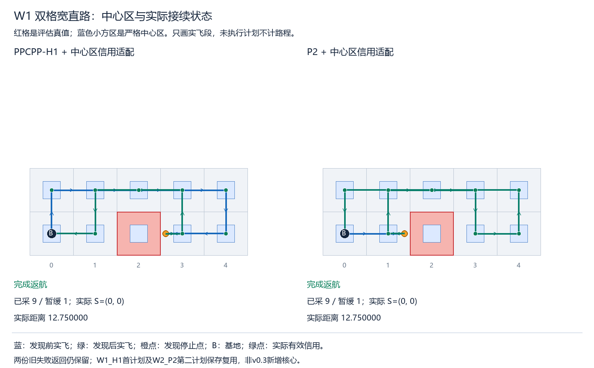
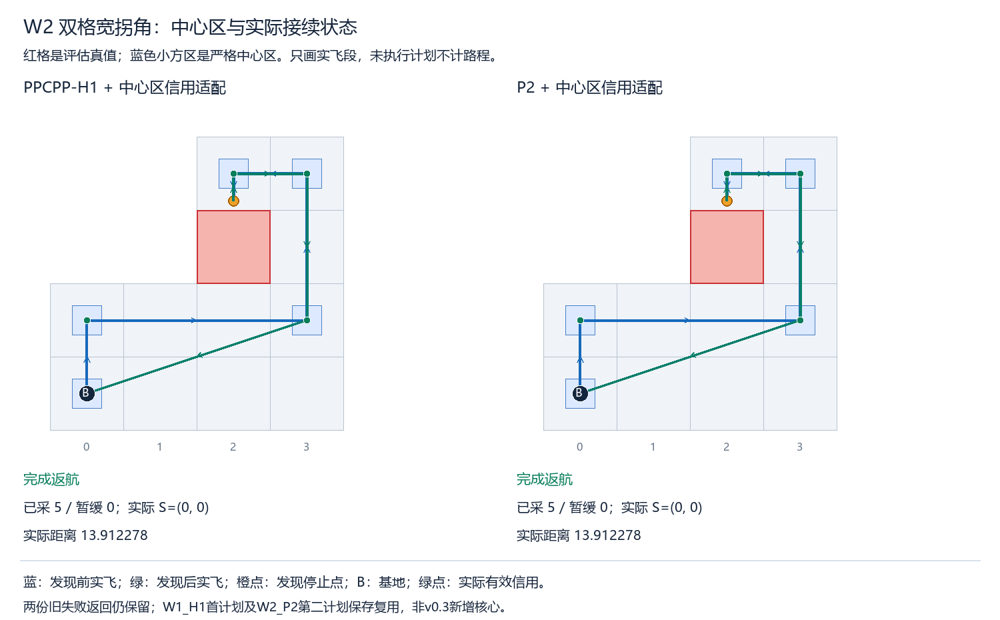
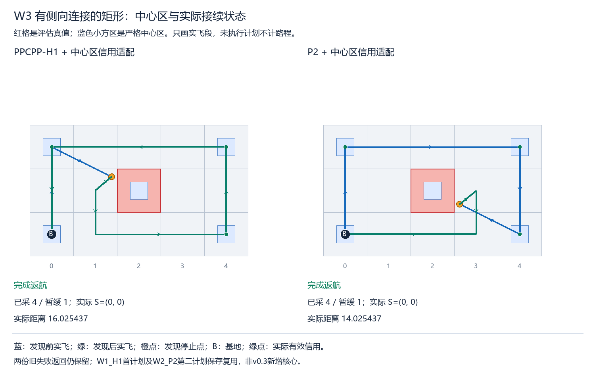

> 阅读副本，整理于2026-10-25。结论保留原报告当时的状态，不代表新增验收。权威原件：[00_通俗最终接续报告.md](../../../中心有效采集区统一接入最小验收_v0.3_20261022/00_通俗最终接续报告.md)。本副本仅调整本地链接。

# 中心区零查询契约与最终接续结果

跨版本完整六会话均完成当前可检任务并实际返航，保存独立回放通过。本轮 v0.3 新增真实核心6次（H1 4、P2 2），连同 v0.1 的1次、v0.2的5次，跨版本共12次，到原上限即停。没有重跑W1两会话，也没有重跑W2_P2第二次规划；旧失败状态和原始返回保持原样。

**仍有一项未验：实际“不经过目标格心的斜段区域采集”没有发生。** 两次真实斜段内障碍停止不等于这类采集，不能以纯斜向正控制或偏离格心的证明点替代。按稿不补地图、不追加调用。

## 三栏来源及六会话

|来源|保留或新增结果|调用口径|
|---|---|---|
|旧失败保留|v0.1首槽混计断言失败；v0.2的W2_P2第二返回缺键失败均保持failed|旧核心1+5，直达1+5，均不重跑|
|旧返回独立复核复用|W1_H1首计划在v0.2复用；W2_P2第二计划本版复核通过，标reused_saved_reaudited|本版复核核心/选择器/后处理/图搜索0；旧省略零字段及生命周期仅派生兼容，不冒充原trace|
|本版新实际执行|W2_P2从原停止点执行保存计划返航；随后完成W2_H1/W3_H1/W3_P2|W2_P2新增核心0，后三各2，本版6，跨版本12|

|会话|最终状态|v0.3新核心|实际已采/暂缓|实际总长度（米）|非零方向转弯数|实际终点|
|---|---|---:|---|---|---:|---|
|W1_H1|完成返航|0|9/1|51/4 ≈ 12.750000|8|(0, 0)|
|W1_P2|完成返航|0|9/1|51/4 ≈ 12.750000|8|(0, 0)|
|W2_P2|完成返航|0|5/0|43/4 + √10 ≈ 13.912278|8|(0, 0)|
|W2_H1|完成返航|2|5/0|43/4 + √10 ≈ 13.912278|8|(0, 0)|
|W3_H1|完成返航|2|4/1|14 + 11/16·√5 + 1/16·√61 ≈ 16.025437|7|(0, 0)|
|W3_P2|完成返航|2|4/1|12 + 11/16·√5 + 1/16·√61 ≈ 14.025437|6|(0, 0)|

W1各服务9格、障碍遮挡1格暂缓；W2各服务5格、暂缓0；W3各服务4格、遮挡1格暂缓。发布责任P没有删除，遮挡未完成格不记H，已完成信用不因后续发布删除。所有会话当前可检任务完成且实际S在基地，E非负。不同工作量分列，不平均排名；原保存计时和本版计时逐入口保存，不拼成同轮性能配对。

## 计数契约和兼容证据

计数契约.json逐项说明生产者、序列化与消费者。观察器初始化即写出shared总数、五个scope、引擎服务数、旧post总体保护数及started/finished/aborted字段，含零。审核要求字段完整、严格非负整数（bool拒绝）、未知scope拒绝、分类守恒、引擎精确相等、旧总体保护项相等并≤1200。未启动或异常退出不能当作正常零查询。没有把任意缺键统一get(0)，原相等断言与预算保护保留。

W2_P2第二份原返回main_complete，原核心开始/返回/完成和post_entry均1；真实停点(2,21/8)、原h=(0,-3/8)、已采5、D空、M=59/8、E=741/8，输入与当前实际状态一致。进入预测前后均无未采可检责任，后处理自己明确记录service_intersections=0；完整路线、资源、区域见证和来向复核通过，故仅对该旧Counter省略的必需查询键派生补0。legacy生命周期根据正常完整主管线证据另行派生，列明字段/证据/来源hash，未声称是旧运行时观测。原v0.1异常计数缺失继续披露，未用新schema覆盖。

恢复W2_P2原初态及已经执行的日志hash链，再恢复末端S/h/H/known/E/M；只追加保存第二计划的等待与实际后缀。旧飞行段、信用和距离不重复提交。W1两完成会话直接引用v0.2证据，只做保存审核，不再执行或求解。旧计数兼容仅作用于派生副本，不写回旧文件。

## 八项预检与真实判断

8个预登记案例首轮全通过，准备技术修复0轮：全零、单scope、多scope、空任务返航、零长度、序列化、异常/未启用/未知scope拒绝、缺键/不守恒/非法类型和值拒绝。7项预期负拒绝均成立。固定桩使用真实engine.credits、pipeline.main_audit和schema.validate，核心/后处理搜索/图搜索0；主几何3、距离3、服务5（引擎4、主管线1），无重做旧35纯案例或旧6组合测试。

逐项结论：

- 全部可检任务完成且实际返航：六会话均通过。
- 真实不经格心的斜段区域采集：0例，未验；虽然存在斜段停止，但本批取得新信用的实际段仍经过对应格心。
- 发现后真实历史接续：六会话均有一次发现及接续；其中W2_P2跨版本原停止点恢复后实际返航，非新规划。
- 资源与预测隔离：主/独立审核及保存回放一致；只实际执行前缀产生H/E/M/h，等待不移动，未执行预测不计信用或路程，没有碰障/漏检/距离或信用不一致的保存证据。

这些判断仅针对六个固定微型技术会话，不是普遍安全、性能、创新、一般无理停点或实际视觉识别的证明。中心区仍是每轴严格偏移<1/5米；探测仍为闭障碍格外L∞ 1/8，算法只得当前公开地图。核心、奖励、搜索、后处理路线选择、区域谓词、地图、seed和预算字节/机制保留，未新增跳过目标或中心区入口优化。

## 调用和审核费用

本版新核心开始/返回/完成6、新直达6，H1 4/P2 2。图搜索41=context BFS6＋距离行BFS12＋A*23，均完成；内部审核58合法、distance662/path159。跨版本图搜索2+90+41=133、内部审核2+102+58=162。跨版本12个核心调用包含两份旧failed返回复核复用，不能称本版新增12，也不能删去旧失败尝试。

本版主管线主几何165/距离159/区域服务166；直达source/candidate/output65/47/26、区域服务74。总共享区域查询240=引擎74＋预测14＋原生审核80＋主管线post35＋全路线37；旧post总体保护项109=74+35。六次观察器started/finished=6、aborted=0，包括零查询正常路径的完整schema。新计划独立审核几何191/距离165/区域704、点1849/边参数1606，均实际finally落盘；新实际执行动作38、等待7，探测/安全盒17/38、真值几何38/距离38、区域34。旧前缀费用不再计为新执行。

W2保存返回复核新增独立几何29/距离26/区域75、点213/边170，核心/选择器/后处理/搜索0。最终保存verify新增独立几何482/距离415/区域2633、点6594/边5522、探测/安全盒38/75；复核12份完整计划和六条实际历史，新核心/选择器/后处理/搜索0。全执行链共75条动作=57非零段+18显式零移动采集，12条等待；实际欧氏长度只来自实飞，未将中断计划累加。

旧v0.1/v0.2费用及未落盘计数缺口仍在各版原收据，本版三栏与跨版本查询总账.json按来源保存，不用保存复核冒充运行时trace。保存verify新增几何有费用，不称零计算。完整输出包含计数schema、diff、预检、兼容字段证据、真实请求/返回、独立计数、旧证据指针、实飞/中心区图及hash。

## 六会话实际路线图







完成本轮既定接续并达到跨版本12入口后封存停止，根进度更新，交负责人审核。未运行额外验证批、改图、留出、性能批、相机/视觉实验或推送。
