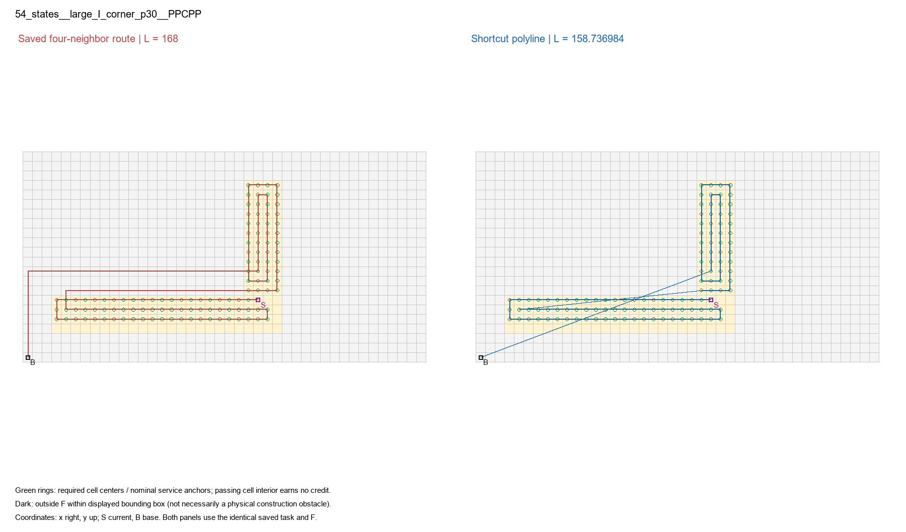
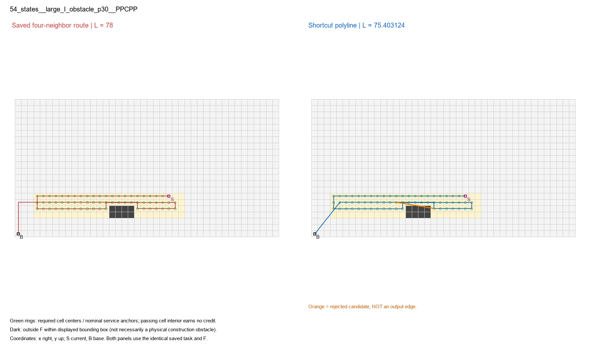

> 阅读副本，整理于2026-10-25。结论保留原报告当时的状态，不代表新增验收。权威原件：[03_实例与结论边界.md](../../../任意方向合法直达有限诊断_v0.1_20261022/03_实例与结论边界.md)。本副本仅调整本地链接。

# 可复核实例

示例选择规则为固定清单中首条正收益、首条含拒绝查询的PPCPP路线，仅用于解释，不代替全量统计。





橙色线是实际被拒绝的候选，绝非可飞输出。所有绿色圈为原未完成任务的指定中心及名义锚点；新折线保留中心责任。暗格仅表示显示包围盒中F外禁止域，不把所有暗格都说成新增施工障碍。原起点、基地、任务与通行域均来自该次输入。

真实117条均有正收益，因此无真实零收益图。零收益机制控制见门槛21：同一自由2×2格，原(0,0)→(1,0)→(1,1)，中间(1,0)必检，锁住该锚点，输出仍为2；门槛20中间无任务才可直接缩至√2。两者是技术夹具，未冒充真实样本。

结论仅适用于本固定开发保存批与预登记规则；没有留出、新地图或新seed证据。名义顺序固定不构成严格顺序最优；即使本批真实首次服务均相同，也只证明这些输出满足该顺序，不证明几何最优。剩余差不能全部叫顺序损失。停止，交负责人审核。
