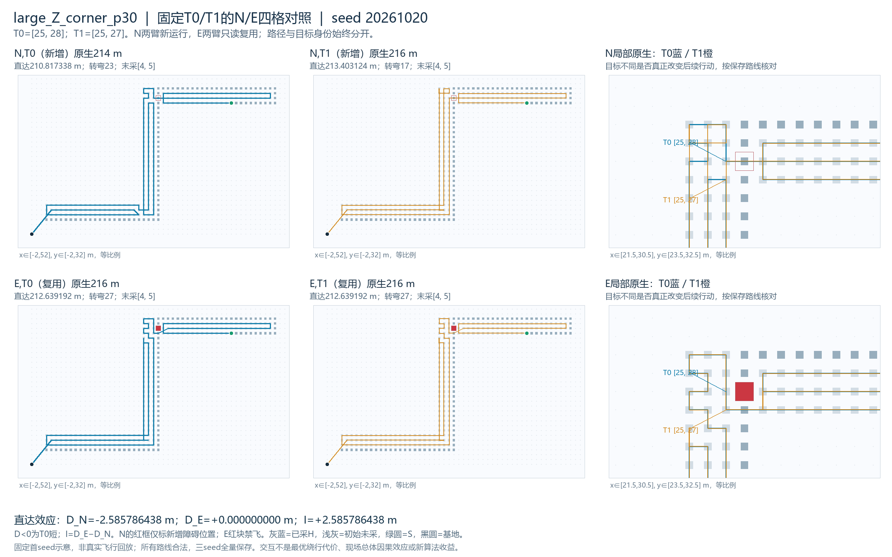
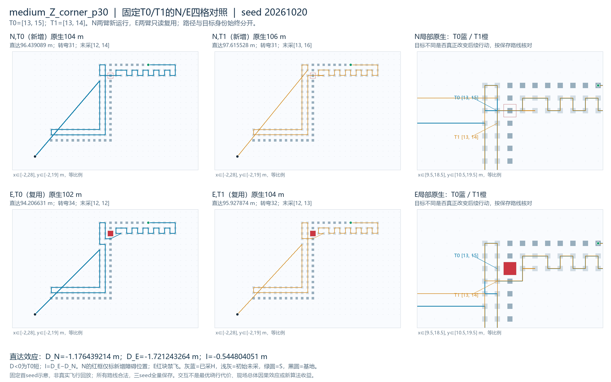

> 阅读副本，整理于2026-10-25。结论保留原报告当时的状态，不代表新增验收。权威原件：[00_通俗事件依赖性补齐报告.md](../../../恢复目标收益事件依赖性补齐_v0.1_20261023/00_通俗事件依赖性补齐报告.md)。本副本仅调整本地链接。

# 恢复目标收益：在没有新增障碍时是否也存在

2026-10-23。**中Z的T0优势在N中已经存在；障碍又增强了直达后优势的幅度，不能称事件专属收益。大Z则由N中T0较短，变成E中两目标物理同路、等长。** 两例均未出现严格的目标优劣反转。

本轮新增12次N核心、12次共同直达、24视图，六个N_OFF均现场复现旧B_N，全部独立决策/几何/信用审核通过，无失败、触顶、迟到或缺槽。旧E的12份处理输出及24视图只读复用，合计24条处理路线、48原/直达视图，不是24次新增核心。已完成固定额度，停止该两目标诊断链交负责人审核。

## 四格身份与完整距离

固定T0为原N默认目标，T1为原E默认目标。大Z T0=[25,28]、T1=[25,27]；中Z T0=[13,15]、T1=[13,14]。N_OFF=T0、N_ON=T1；复用E_ON=T0、E_OFF=T1。所有者输出、引用与汇总同时记录environment、target_label和干预开关，不按跨环境ON/OFF直接拼表。核心详细profile在两臂都关闭，与目标干预开关无关。

N逐字节复用上轮实际运行的冻结N，不从E手工补格，不重新生成历史。N是“没有本次新增障碍”，不是移除所有原有障碍。E仍为已有规范化E_contract_v02，未用首版E.json；旧E输入、输出和审核回执均未重算或改写。

下表每格为“原生米／完整直达米”，各状态三个原seed路线与长度相同。逐seed六组全量及精确证书见[四格效应表](../../../恢复目标收益事件依赖性补齐_v0.1_20261023/02_六组四格距离与效应表.md)。

|状态|N,T0（新增）|N,T1（新增）|E,T0（复用）|E,T1（复用）|
|---|---:|---:|---:|---:|
|large_Z_corner_p30|214／210.817338|216／213.403124|216／212.639192|216／212.639192|
|medium_Z_corner_p30|104／96.439089|106／97.615528|102／94.206631|104／95.927874|

定义D_N=L(N,T0)−L(N,T1)、D_E=L(E,T0)−L(E,T1)、I=D_E−D_N。负D表示T0更短，负I表示该障碍增强T0相对优势或减弱其劣势；I不是最优绕行代价或新算法收益。

|状态|原生D_N / D_E / I，米|直达D_N，米|直达D_E，米|直达I，米|N直达转弯T0/T1|E直达转弯T0/T1|
|---|---|---:|---:|---:|---:|---:|
|大Z|−2 / 0 / +2|−2.585786438|0|+2.585786438|23 / 17|27 / 27|
|中Z|−2 / −2 / 0|−1.176439214|−1.721243264|−0.544804051|31 / 31|34 / 32|

大Z直达D_N=−4+√2，I=4−√2。中ZD_N=1−5√17+2√85，D_E=−1+12√2−√313，I=−2+12√2+5√17−2√85−√313。已验根式模块与独立Fraction/isqrt有理界实现逐项核对，零值为空根式，非零符号由严格区间认证，不使用任意epsilon。均值/中位/范围/P95及原始值、差值均保存；三seed不增加几何样本量，不能以平均数掩盖两例不同现象。

## 大Z：N中的优劣，在E中变成同一个行动

N中默认T0的恢复是3步：`[28,28]→[27,28]→[26,28]→[25,28]`。原策略随后选择[25,29]，不是T1。N_ON恢复到T1时先经过并采集T0，再继续一格至[25,27]；到达后自然选择[25,26]。因此这次目标替换真正改变了后续方向，原生多2米、直达多2.585786米。

N两目标原生首次不同顶点为index64：T0路线去[25,29]，T1路线去[25,27]；直达首次不同index62。实际信用从rank61…182不同，末18项重新相同，末采均[4,5]。原生分账（共同前缀／恢复／后续覆盖／末采后返航）为T0的60+3+142+9=214，对T1的60+4+143+9=216；不是连接多1步就解释了全部总差。

E中近目标反过来是T1。去T0的5步恢复先经过T1，而原策略到T1后本来就会走一格到T0，所以两目标对应完全相同的217顶点原生路线、204顶点直达路线、201项锚点/实际信用序及信用事件。只是恢复与local的决策边界不同，末采仍[4,5]。继续标物理同路，不因目标标签改变虚构收益。

该例I>0说明这两个目标的相对价值确随环境改变：T0原有优势被消除为等长，未反转为T1严格更优。但E中没有两目标路线收益，仍关闭“换回这个旧目标解释大Z的R优势”的线索。本轮不追加第三目标、改连接平局或追查R的全部原因。

## 中Z：一般选择优势与障碍交互并存

N中默认T0恢复3步，经[15,15]、[14,15]到[13,15]。随后原local选择[12,15]，得分2.284519，高于[13,16]的2.25与T1的1.25。强制T1则先采T0再继续到[13,14]，后续自然去[13,13]，并非原策略自然延续的一格。N中T0本就比T1原生少2米、直达少1.176439米；“选择T0较好”不是新增障碍之后才出现。

E中默认近目标为T1。恢复到T0同样先采T1后继续一格，但原策略在T1本来会按2.25同分平局选[12,14]，而不是T0；到T0后原规则继续[13,16]。这里会实际改变后续方向，复用上轮已验证的原生−2米、直达−1.721243米及转弯+2。恢复段有实际采集，不能称为空飞。

N中原生首次物理分歧index33（T0去[12,15]、T1去[13,14]），直达index31；E中分别index34、32（T0去[13,15]、T1去[12,14]）。两环境实际信用都从rank30至末74改变。末采四格依次为N,T0 [12,14]，N,T1 [13,16]，E,T0 [12,12]，E,T1 [12,13]；返航不能从总账中省略。

N原生分账T0=29+3+46+26=104，T1=29+4+44+29=106。E分账T0=29+5+44+24=102，T1=29+4+46+25=104。两个环境T0均短2个原生单位步，原生I恰为0；同版公共直达之后优势幅度不同，才得到I=−0.544804米。因此这是**两个固定目标、后续政策/原路径展开/公共直达整个处理流程的计算实验交互**，不能把这0.544804米单独说成恢复目标距离的事件收益，或包装成新的障碍专属算法。

两目标恢复中“先经过对方”在本批四种环境/尺度都出现于去较远目标时；但在近目标处是否自然继续远目标并不相同：大Z E会，中Z E不会，两个N也不会。保存评分、平局、真实来向和后续原规则说明了“不同标签同一行动”与“实际转向”的差别。这只是事后解释，未实现或检验在线判断器，不能立即投入“总选更远目标”“延续一格”或改平局规则。

## 完整责任、转弯与新N成本

四格均完成全部初始U（大Z201、中Z75）、遗漏0、暂缓0、可检及发布完成率100%，基地结束、距离资源合格。N/E的P/H/S/来向/基地/资源/捕食者/seed/旧后缀相同，F和T=P∩F规范变化，物理H包括后来封堵的已采格且不回滚。分歧处完整pending141/46及此前完整原生语义/路径前缀四格一致，分别读取trace记录60/29和路径index，不以数量或编号巧合替代核对。事件在初始快照公开，没有传感/停止/闭环新语义。

大Z N中T0更短但转弯更多：直达总23对17，90°20对14、180°0对2、其他3对1；原生24对17。E中两目标直达均27（90°22/180°2/其他3）、原生均27。中Z N两目标原生均32、直达均31（90°29/180°1/其他1）；E中T0原生36对T1的34、直达34对32，均多2次90°，其他类别不变。没有把距离、转弯、计算时间暗加为统一分数或宣称真实节能。

|新N状态/目标|核心入口均值秒|钩子自计时均值秒|直达引擎均值秒|主端到端均值秒|主外独立审核均值秒|
|---|---:|---:|---:|---:|---:|
|大Z T0|0.046662|0.013535|0.281427|0.519225|0.377466|
|大Z T1|0.045723|0.013355|0.275796|0.517683|0.370389|
|中Z T0|0.011590|0.003266|0.048003|0.108715|0.094884|
|中Z T1|0.012783|0.003919|0.049793|0.113841|0.090704|

仅新N同轮诊断成本作配对记录；12次新N主端到端最坏0.549141秒，完整核心/包装/后处理/主外审核的每seed及均值/中位/范围/P95/最大另存。钩子计时不包含全部构造/编码开销，完整主计时已收费；旧E时间只保留来源，不计算跨批E/N时间交互或速度排名，三次单跑也不宣称稳定加速。

原生20秒、直达18软/4096/20迟到标记、父150兜底未提高；每次独立进程串行、四线程变量1。诊断核心、钩子与独立决策审核器逐字节复用，其他差异仅独立模块名、N配置基准键及稳定输出标签，diff/hash齐全，公共后处理不改。六个N_OFF现场等价旧B_N，两个首seed门槛先过再运行N_ON；不把旧N替代新控制，不从分歧处重启，不提前改pending，不做第二次local干预。

新N说明性距离查询24次，匹配12/替换6；1650条诊断状态、138351格次pending。新N公共直达候选1668、服务交277812；独立决策审核45 BFS/105660出队/422640邻居另计主外，旧E回执的查询未冒充本轮执行。详细核心profile计数null，计数别名不重复相加。

六项纯预检首次全过，准备修复0；标签8检查含4次反向拒绝、独占2次含1次拒绝、固定数字表6例含缺格（两算术实现均拒绝），无真实核心/后处理/几何/BFS。12组原/直达算术分别通过已验模块与独立核验：主层48证书读取、36差分/符号调用；独立48证书解析、174项系数累计、27轮区间、30次整数平方根界，实际计时主层约0.002119秒、独立约0.001018秒。这些是顶层记录，不是全部底层整数操作数，算术不称零计算；未新增可视查询、路线优化或覆盖最优搜索。

## 本轮裁决与停止

- **大Z：相对价值受环境影响，但E中实际同路等长。** N中T0占优，障碍使这项优势消失；不再以这次替换解释R优势。
- **中Z：一般目标选择差异与障碍交互并存。** T0在N中已短，E中直达优势进一步增强0.544804米；原生差距交互为0，不能把一般选择现象命名为事件专属创新，也不能说完全与环境无关。
- **未出现目标优劣严格反转。** 两例仍只有已见Z族两个尺度，目标事后由既有N/E分歧确定；是探索性补齐，不是独立确认样本、现场总体因果效应、显著性、在线可识别性或原创性证据。

全部新N输出、复用E引用与视图、六组四格、逐决策/路径/local评分/信用/末采证据、独立算术、查询/成本、正负与零结果、两张固定首seed图、根进度历史链及只读verify已交[review_packet](../../../恢复目标收益事件依赖性补齐_v0.1_20261023/review_packet.md)。本轮无不适用、正式失败、预算异常、缺格、导出失败或补跑。

完成后停止这条两目标诊断链，回负责人决定是否保留事件机制线索或归档为一般恢复选择现象。不自动第三目标、第二次干预、改平局、FIRST/rollout/候选择优、新性能批、新地图、留出、连续闭环、视觉、飞控或推送。旧包与旧final_receipt原样保留，根进度只前缀追加并核历史字节链。
