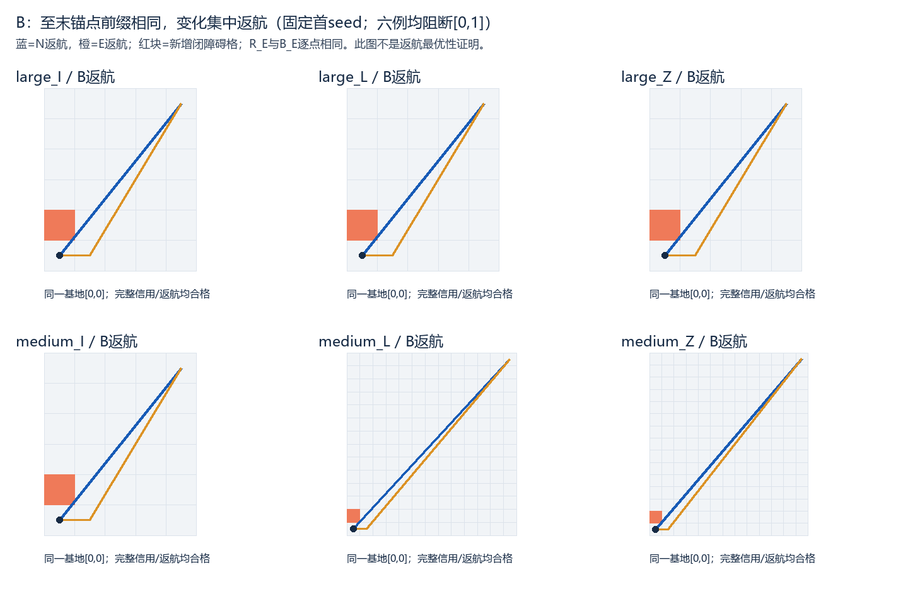

> 阅读副本，整理于2026-10-25。结论保留原报告当时的状态，不代表新增验收。权威原件：[00_通俗成对诊断报告.md](../../../旧计划真实受阻PPCPP成对诊断_v0.1_20261023/00_通俗成对诊断报告.md)。本副本仅调整本地链接。

# 旧计划真实受阻后，PPCPP＋直达发生了什么

报告导出v0.2；首个草稿把R的原生+2步误写成B，保存于report_export_v0.1，已仅据保存指标纠正，未重跑算法。

本批六例都证明了旧原生计划真实受阻。**重新调用PPCPP并直达后，覆盖顺序没有变化，增程集中在末端返航；未得到值得干预覆盖顺序的新问题线索。** 这只是本批返航端阻断的开发诊断，不证明其他阻断位置也如此，也不证明返航路线最优。

按v2完成108次处理：原PPCPP 36次、冻结P2 36次、保序修复R 36次；核心总72次，没有技术/热身入口。全部216个原/直达视图完成当前可检责任并返航，覆盖率均100%，D=0，资源符合输入约束。正式失败、触顶、迟到、未运行均0。到上限即停，未继续干预或补样。

## 输入确实对齐，但阻断位置很集中

按来源ID字典序扫描31/54个来源状态，优先不同基础几何，得到large_I/L/Z和medium_I/L/Z六个p30切点。来源名里的corner仅标识旧历史证据，**本批没有新增区域**。N从原prep真实读取的地图、目标及原生四邻接完整路线切点重建；H取原采用前缀的目标格心见证，不能用扩展后的任务集合。E仅删自由格，所有目标/H/S/来向/捕食者/基地/资源及旧后缀保持相同。

坐标优先规则在六例均首先选到非目标通路格[0,1]，位于旧后缀返航端。旧边穿过新增闭格的严格内部，有参数区间与内部点证据，非仅贴角；删格后所有剩余目标及基地仍由S四邻接可达。每例只查1个候选，没有运行算法按收益筛选。原始跳过/拒绝及来源、几何/BFS计数留在selection.json和history/。

本批明确建模为**在切点当场新增并公开障碍的事件后快照**；没有模拟预先存在障碍的探测发现、斜段停止或连续飞行。冻结history中的通用revealed/introduced字样不构成两种机制都验证的证据，见事件语义澄清.json。历史通路曾合法通过，不要求已执行过去在新增障碍后仍可执行。资源1,000,000米只是给定距离上限，不是真实能耗。

六个base ID虽不同、覆盖I/L/Z三族，但都在同一坐标、相同返航接口阻断，且没有small例。它们不能代表所有形状内部通路、桥接瓶颈或任务间阻断；按稿不改坐标或换例追正结果。

## 主比较：B_E相对B_N

B_N与B_E都真正从共同快照调用PPCPP。以下先列三个seed等权结果；18条逐seed原数、全部六分支计时见02_全量配对与状态等权表.md和CSV。

|基础几何|B增程ΔB（米）|相对N增程|端到端时间变化均值（毫秒）|
|---|---:|---:|---:|
|large_I|0.427828|0.582847%|+8.177|
|large_L|0.427828|0.301675%|−4.102|
|large_Z|0.427828|0.202938%|+9.553|
|medium_I|0.427828|1.362373%|−1.274|
|medium_L|0.337580|0.498702%|+1.044|
|medium_Z|0.365405|0.378897%|+3.006|

状态等权平均增程0.402383米，相对增程平均0.554572%；最大绝对增程0.427828米，最大相对增程1.362373%。18组符号均由原根式证书认证为正，没有按浮点近零猜测。B重新规划的原生四邻接边数18组均与N相同，只换了返航格路；R因保留旧有效片段，原始修复路线比R_N多2步。共同直达后的B与R增程如表，原生格路边数与最终欧氏距离必须分开，见原生与直达变化澄清.json。

18组均满足：完整PPCPP trace相同、名义格心锚点顺序相同、实际首次信用见证顺序相同、最后名义采集格及最后信用相同；直达路线至最后锚点的前缀逐点相同。每组总转弯增加1次，均为非90°/非180°的其他转弯。按已验内部中点见证口径，前往首次信用/首末信用间两段差精确为0，完整增量等于保存返航阶段的差，证书见行为补充与阶段分解.json。该标签不是唯一物理首次入区时刻，也不是必要绕行的最优下界。

共同端到端B_N均值0.163874秒，B_E均值0.166608秒；配对时间变化均值+0.002734秒、中位+0.001378秒、P95/最大+0.032388秒，最小−0.052332秒。三seed计时存在正负波动，不将这些毫秒差精确解释为障碍导致的固定计算成本。端到端含必要包装/信用/直达，详细核心查询为null未观测，不是零开销固有算法时间。



## R和P2能说明什么

R每次从输入旧后缀重新检测失效区间并BFS修复，没有免费使用选例证书。18次R_E均修1个区间，R_N不修复；邻居/平局顺序固定，合法旧分隔点和所有有效旧片段均保留，没有加入跳过锚点。R的原始修复路线与B_E不同18/18，经同版直达后的完整路线却逐点相同18/18；ΔR与ΔB也逐组精确相等。**本批保留旧计划简单恢复已产生与重新调用PPCPP相同的最终路线，未展示路线收益。** 这不证明两者最优，也不能反推内部阻断时永远无需重排。

本批R_E共同端到端均值0.150140秒，B_E比R_E平均多0.016468秒，范围0.001592–0.051439秒；R是诊断工具，种子重复只用于计时，不当独立路线或改进算法证据。R不是任意角度保序最优解。

P2_N和P2_E均自然完成有限流程，各18次，E端到端均值1.448857秒。P2在N已更短，E也更短18/18，E中B比C状态等权多走约1.358816–5.469313米。它证明同条件更短合法路线存在，但不是最优下界；不能把全部差距归因于新增障碍，更不能因为C次序不同就认定B的事件决策有错。流程间环境交互差单列保存，不作主要门槛或精确可避免损失分解。

六例均列第二档：**有同条件更短参照，未定位PPCPP的事件决策原因**。本批只有返航连接变化，没有两个不同几何上重复出现的覆盖顺序缺陷线索；不提出新干预，不称“必须重排”或“局部修复充分最优”。一般顺序改进与其他位置阻断仍未解决，后续由负责人讨论，不自动扩样。

## 验收、费用与交审

12个固定纯案例门槛经1轮准备修复通过。首轮第4项发现“合法旧分隔点被错误跨越合并”，失败回执和两份源码保留；修复后同一12项通过，真实入口仍为0才冻结正式。固定案例身份12个，含首轮失败共16项尝试，未增加第13类案例或正式前真实试跑。正式后未改执行代码、输入、种子或预算，未补跑。

选例实际独立合法性654次、闭障碍盒检测6次、开内部相交648次，连通BFS6次、弹出7866格、邻居检查31464次；不是零计算。正式R实际BFS18次、弹出216格、邻居检查864次，N/E运行时检测共3888条原边。共同post候选合法性10152次、原边校验11516次、输出校验10098次；主虚拟执行另有10098次合法性，独立post审核10098次。各命名空间信用/距离/格心证明、纯桩BFS及未观测细项见调用与几何BFS总账.json；同一次查询的别名不相加伪造总量。

计时边界、20秒原生/修复、post18秒软/4096/20秒迟到标记、父150秒均保持；post20秒不是硬中断。冷导入、前置哈希、两次实测证据flush、独立审核与进程墙钟另列，详见01及03。全部公开任务96/192/288/36/72/108，给定H29/58/87/11/22/33，未采67/134/201/25/50/75；E不遮挡这些责任、不把不可达任务塞进D。

审核入口：selection/input_freeze、history/、plan/active_freeze、prechecks及失败首版、attempts/status、outputs/三份原始返回/直达/独立回执、216视图完整指标、18组配对、行为与阶段证书、7张保存路线图、review_packet.json、verify_receipt和final_receipt。原旧文件只读，未用留出、未新增基础地图/区域实验或连续闭环、未推送。最终verify只查绑定/哈希/保存回执，新增核心、R、post、几何、BFS均0。完成封存后停止交审。

```powershell
.\运行环境\python\python.exe -B -X utf8 .\旧计划真实受阻PPCPP成对诊断_v0.1_20261023\verify.py
```
