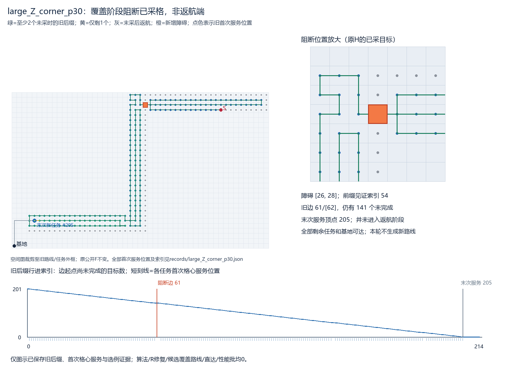

> 阅读副本，整理于2026-10-25。结论保留原报告当时的状态，不代表新增验收。权威原件：[00_通俗选例核查结论.md](../../../覆盖阶段受阻选例核查_v0.1_20261023/00_通俗选例核查结论.md)。本副本仅调整本地链接。

# 覆盖尚未结束时真实受阻的样本已经找到

**按固定规则取得2个不同基础几何的合格快照：large_Z和medium_Z，均为Z族。** 新障碍截断旧后缀时，分别还有141和46个目标未完成，不再是上一批末采后的返航端阻断。本轮只证明这种样本存在，没有运行PPCPP、P2、R修复、直达或性能比较，也没有证明需要改访问顺序。

## 两个合格位置

全部索引从0开始：旧后缀顶点0为S，边i连接顶点i和i+1；“末次服务索引”按原有效目标的首次格心服务位置确定，不是新算法执行或中心区重放。

|来源切点|新增障碍|旧后缀失效边|边起点未完成任务|末次新任务服务顶点|障碍身份|
|---|---|---|---:|---:|---|
|large_Z_corner_p30|[26,28]|61、62|141|205|原前缀已采目标，见证索引54|
|medium_Z_corner_p30|[14,15]|30、31|46|78|原前缀已采目标，见证索引29|

两例均第一单格候选即合格，没有通过算法收益或绕行长度挑选。失效边真正穿过新增闭格的严格内部，保存了开参数区间和内部点；不是只贴角。S、基地均合法，E中所有原剩余任务和基地仍由S四邻接可达。完整输入、历史来源、每个任务首次服务位置、索引/未完成计数、证书和图见[可用快照与阻断证书](../../../覆盖阶段受阻选例核查_v0.1_20261023/02_可用快照与阻断证书.md)。

来源ID保留corner标签仅用于追溯原切点，不代表本轮新增待检区域。N从原prep真正读取的公开F/目标、真实旧原生完整路线和采用前缀重建；没有拼入旧事件后的新增任务。H为外部给定、原前缀可证的目标格心历史，不扩大H，不把计划当已执行。图中绿色仍是保存的旧路线，不是修复路线。



## 54个标签怎样分类

按ID考虑原54个来源标签，涉及9个基础几何；44个后缀完成了详细分析，对应16个物理切点。large_Z和medium_Z首次合格后已按base冻结，其后10个同base标签跳过，没有当作不合格、返航或几何失败，也没有进一步判定这些后续进度是否可用。不能把54标签说成54个独立场景，或说所有位置都已穷尽。

|类别|标签数|实际含义|
|---|---:|---|
|覆盖阶段合格并冻结|2|上述两个Z图|
|没有身份合法的覆盖段阻断格|42|I族18、L族18、small_Z 6；合计14个物理切点|
|同base已有首个合格样本，跳过后续标签|10|不增加独立样本，也不算负例|

42个不合格标签中，满足“末采前且边起点仍有至少2个未完成任务”的单位格心边，其端点格只涉及**初始未采任务或S**。它们没有可用的初始已采格/非目标通路格可阻断。初始U格不能因为旧计划未来会先采到，就追认成切点时已完成。

对于这种四邻接单位格心边，真正穿过格内部只能涉及两个端点格；在它们都被身份限制排除时，相邻双格也不会产生新的合法可阻断端点。因此这里不是20次候选不够用，而是候选池为空。已采/非目标通行大多只出现在末采后返航段，那些边另列返航类别，未拿来填充新清单。

实际仅检查2个合法身份的单格候选，均连通通过；不可达拒绝0、源记录缺口0、候选上限耗尽0。不能由此宣称所有障碍都不影响连通。完整54行分类、跳过原因及每条旧边的阶段/剩余计数见[全扫描分类账](../../../覆盖阶段受阻选例核查_v0.1_20261023/01_全扫描分类账与索引.md)及CSV/records目录。

另保存6个初始未采格的只读身份注记，说明那些具体位置只有放宽遮挡限制才可作为障碍；没有为它们构造E、做几何/BFS或执行算法。它们不是已证明可行的遮挡样本，也不是自动放宽约束的建议。是否另研究遮挡责任，须由负责人另定协议。

## 已采障碍格的输入字段要分清

两格本来就在发布目标P和历史H中，阻断后仍留在P/H。按现有接口，当前可飞有效目标为T=P∩F，因此E的T分别从288变287、108变107；两例初始未采U=T−H仍分别为201和75，暂缓D=P−F−H仍为空。**没有删除任何未采任务，也没有把不可达任务塞进D。** S/来向/捕食者/基地/给定资源1,000,000米及旧后缀保持原值。

初次快照导出只改F，导致T还含已采禁飞格，不符合该接口。首个E.json和首轮冻结均原样保留，另存规范化E_contract_v02.json及契约证书/新冻结；可用清单以usable_snapshots_v02.json为准，旧E草稿不可直接投入算法。自由域和被查的U均未变，沿用原合法性/可达性证据，没有为修正字段重跑几何/BFS或换候选。

此轮只核查可达性和选例条件，未生成新覆盖路线或评价其耗时/资源消耗，不称连续飞行、探测停止或实机验证。

## 结论边界和停止

上一批六例的障碍[0,1]在最后采集之后，仅覆盖返航端；本批两个障碍在覆盖仍有大量未完成任务时截断旧计划，类别已经不同。上一批的顺序不变结论不能替代这两个样本的算法实验，而本轮也没有替它们补做实验。

目前只在两个尺度的Z图取得合格base，不能称跨形状复现；未填满6例，不增加地图、不放宽成返航端，也不把I/L或small_Z在当前隔离条件下无候选解释为算法优秀、障碍方向失败。已把2套快照冻结交审，不自动启动B/R/P2比较或任何性能批。

实际费用：2163次独立合法性，其中2157次为旧N后缀边、6次为候选域端点/失效边复核；闭禁飞盒检测2次、严格开内部相交4次；连通BFS 2次，弹出4006格、邻居检查16024次。逐状态费用及预先上限见scan_results/plan/ledger。这些是真实计算，不能称本轮零计算。算法/核心、R修复、候选覆盖路线、直达、性能批均0。

输入与来源hash、首次合格冻结、规范化契约、分类与费用、两张图及首版、只读verify与最终封存已保存。最终verify仅读取来源/哈希/保存回执，不重跑几何/BFS。根进度更新后停止交负责人审核，无留出、推送或后续自动比较。

```powershell
.\运行环境\python\python.exe -B -X utf8 .\覆盖阶段受阻选例核查_v0.1_20261023\verify.py
```
