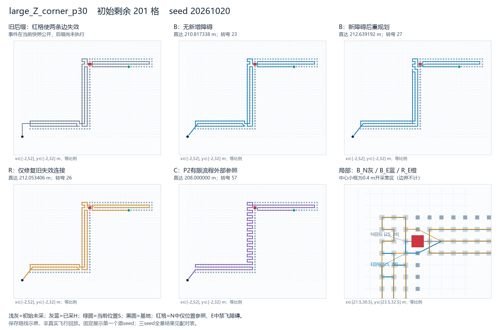
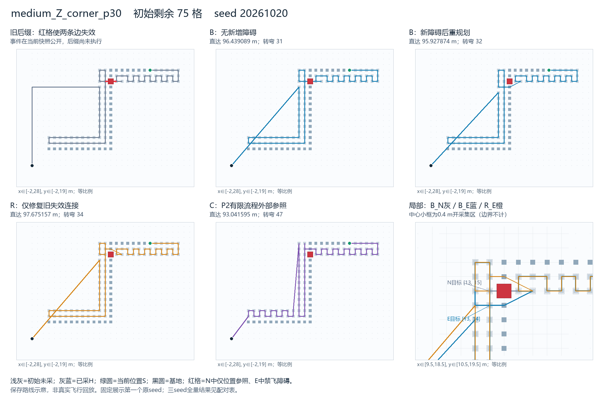

> 阅读副本，整理于2026-10-25。结论保留原报告当时的状态，不代表新增验收。权威原件：[00_通俗两例成对诊断报告.md](../../../覆盖阶段真实受阻两例成对诊断_v0.1_20261023/00_通俗两例成对诊断报告.md)。本副本仅调整本地链接。

# 覆盖阶段真实受阻：两例成对诊断

2026-10-23。固定两个已封存Z族快照、三个原seed；本轮36处理入口完成，包含PPCPP12、P2 12、R12，即24次真实核心。72个原生/直达视图全部完成相同剩余责任、合法返航且资源合格，36个独立审核回执通过，无正式失败、触顶、迟到、候选上限或未运行。已停止实验，交负责人审核。

本轮发现了具体行为变化，也保留了方向相反的结果：**大Z中B直达后增加1.821854米；中Z中B原生长度不变，直达后反而减少0.511215米。** 两例都从恢复连接时改变目标，并改变后续采集顺序。大Z的R比B短0.585786米，中Z的R却比B长1.747283米。因此目前可讨论的是跨尺度Z族的恢复目标/后续顺序线索，不能认定“重排导致损失”“保留旧序更好”，更没有已确认创新机制。

## 目的、输入与比较含义

主研究对象B是在初始快照真正重新调用当前原PPCPP，再接同版合法直达。N也真实调用，未用旧路线替代。R是保留旧有效片段、仅用固定四邻接FIFO BFS修复失效区间的诊断工具；C是冻结P2有限流程及同版直达的外部质量—时间参照。R/C不是本轮新改进算法，也不是最优解。

唯一输入入口为上一轮`usable_snapshots_v02.json`及其实际引用路径。large_Z_corner_p30阻断[26,28]，medium_Z_corner_p30阻断[14,15]；仅使用N与规范化E_contract_v02，未运行首版未更新T的E.json。所有旧包、输入、证书与依赖hash均核对，来源链见selection、history、input_freeze、source_guards及input_contract。

|状态|发布P / 初始H|初始未采U|N→E可检T|旧失效边（0基）|走到旧失效边时的未采计数|
|---|---:|---:|---:|---|---:|
|large_Z_corner_p30|288 / 87|201|288→287|61、62|141|
|medium_Z_corner_p30|108 / 33|75|108→107|30、31|46|

141/46不是初始U。事件在快照切点公开，旧后缀尚未执行，不加入历史。N/E保持P、物理H、S、来向、基地、资源、捕食者和旧后缀一致；E从F删除一个已采格并令T=P∩F，U=T−H不变，D=P−F−H均为空。实际冻结接口只要求H属于初始发布目标，并不要求H属于当前F/T，故直接保留原物理H，无需核心投影。全部视图最终H仍包含被封堵的已采格，发布分母288/108不缩水；当前可检分母E为287/107，两种完成率均100%。资源为原输入距离上限1000000，不称真实能耗模型。

统一1米格、中心每轴偏移严格<1/5米开采集区、合法任意方向直达和欧氏距离。四邻接原生移动与共同直达分别计量。算法不获取未来事件；本轮是给定历史的静态事件后快照，不是新增传感/斜段探测或连续闭环。

## 主要结果：B在受阻后如何变化

下面距离在各状态的三个seed完全相同；完整逐seed时间及全部R/C结果见[02全量配对表](../../../覆盖阶段真实受阻两例成对诊断_v0.1_20261023/02_全量配对与状态等权.md)。0差用保存的根式证书判定，非浮点近零猜测。

|状态|B_N原生→直达，米|B_E原生→直达，米|原生增量|直达增量|直达相对增量|
|---|---:|---:|---:|---:|---:|
|大Z|214→210.817338|216→212.639192|+2|+1.821854415|+0.864186%|
|中Z|104→96.439089|104→95.927874|0|−0.511214924|−0.530091%|

大Z直达增量精确为1+√5−√2；中Z为−2+√5+√313−2√85。两状态等权平均为+0.655320米，但这个平均掩盖正反方向，不能当稳定损失。最坏增程是大Z；中Z的负增量完整保留。缩小F且U不变不会令真最优距离下降，这里只是启发式返回路线改变；中Z不能解释为“障碍改善了最优环境”。B_E合法于E，因F_E⊂F_N且U相同，也合法于N，这是集合包含的可行性推论，不是新的求解结果或最优性结论。

**大Z：恢复目标改变后，覆盖中段增加，末采与返航不变。** 完整trace首个不同记录是第60条（0基），路线位置index60、当前[28,28]、来向[29,28]、未采141，kind均为recovery；N目标[25,28]，E目标[25,27]。此前60条完整记录（含可用选项）相同。原生路径首次不同顶点index62：N为被封堵的[26,28]，E为[27,27]。名义锚点与实际首次信用都在rank60从[25,28]变为[25,27]；实际信用改变范围rank60…182，末尾18项重新相同。两条原生路线末尾27个顶点相同；直达路线末尾19个顶点相同。后续不是只替换一条画出来的连接。

按已验内部中点见证切分，大Z原生首末见证之间+2米，直达在同一阶段+1.821854米；到首见证和末见证后返航项均不变。末次信用任务仍为[4,5]。这证明本例差异已进入覆盖过程，不能套用上一批“只影响末采后返航”的结论。

**中Z：相似的恢复目标变化，最终总距离反而更短。** 首个不同trace为第29条，路线位置index29、当前[16,15]、来向[15,15]、未采46，均为recovery；N目标[13,15]，E目标[13,14]。此前29条完整记录相同。原生首次不同顶点index31：N [14,15]，E [15,14]。信用从rank29开始不同，一直到末次rank74，没有相同信用尾部；原生路线最后14顶点重新相同，但直达路线只剩基地这个共同尾点。

中Z末采由[12,14]变为[12,13]。原生覆盖阶段+1米，末采后−1米，总量0；直达覆盖阶段+0.236068米，末采后−0.747283米，总量−0.511215米。这个负例说明，局部连接较长或覆盖阶段增加不等于完整路线变差，必须合计最后采集与返航。

图中固定展示首个原seed20261020，未挑最好种子。N面板的红格只是未来阻断位置参照，在N中仍可飞；E面板才是障碍。所有线均为保存路线的示意，不是真实飞行回放。图版已目视核验。

原生完整trace、去路线index的语义比较、名义格心锚点、实际首次信用分别保存于行为与阶段差异、顺序衔接与种子一致性及outputs。序列差异范围按共同前缀/最大不重叠共同后缀定义，只是索引对齐，不是精确因果影响范围。我们比较的是信用任务格顺序，未因见证点坐标不同就认定顺序不同。中心区内部中点只是固定存在性证据，并非唯一物理首次入区时刻。

## R与C提供的辅助证据

R_N无失效区间，原生及直达路线均与B_N逐点相同。R_E运行时自行检测出大Z [61,63]、中Z [30,32]两边长的最大失效区间（端点索引，右端开边区间），各用4条单位边替换2条，其他合法旧片段逐点保留。六个E入口共6次BFS，114次出队、456次邻居检查；不是免费使用选例证书。R_N六个入口BFS为0。

|状态|R_E原生→直达，米|B_E−R_E直达|B_E与R_E是否同路/同顺序|
|---|---:|---:|---|
|大Z|216→212.053406|+0.585786438|原生/直达均不同，名义与实际信用顺序也不同|
|中Z|106→97.675157|−1.747282902|原生/直达均不同，名义与实际信用顺序也不同|

大Z存在R给出的同任务合法更短路线，差为2−√2；但原生总长同为216，直达后才拉开。B/R同时存在恢复展开、后续任务次序和直达连接差异，**有差距、未定位单一原因**，不能把0.585786米完全归因于一次目标选择。中Z中B比R短，保留旧有效片段并非总占优。R保持合法原格心片段，却允许BFS途中提前采集，新增的首次触达可改变实际信用序；R不是任意方向的最优保序方案。本轮未做“只换目标、其余相同”的干预，不能证明哪次PPCPP选择因果错误，也不能说必须重排。

C在N/E的全部12个B/C配对中都更短，优势在无新增障碍N中已经存在。大Z C_N=C_E=208米，B−C由2.817338增至4.639192米；中Z逐seed为：

|seed|C_N直达米|C_E直达米|B_N−C_N米|B_E−C_E米|
|---:|---:|---:|---:|---:|
|20261020|93.041595|93.041595|3.397494|2.886279|
|20261021|88.485281|89.071068|7.953808|6.856806|
|20261022|91.062258|93.041595|5.376831|2.886279|

P2十二次均status finished、有限流程自然完成，无20秒触顶或fallback选中；完整多候选/深层/反向/扰动/shuffle阶段记录保留。自然完成指冻结有限流程结束，其中个别2-opt子阶段按原32轮pass_limit停止，不是无限收敛或全局最优。P2内部最终访问序列未由核心独立保存，不能从包装器锚点反推为内部顺序证据。P2更短只证存在更短可行路线，不是主要通过门槛，更不是障碍造成可避免损失的精确下界。

## 实际成本、转弯与统计边界

|状态/环境|B核心/主端到端均值秒|R修复/主端到端均值秒|C核心/主端到端均值秒|
|---|---:|---:|---:|
|大Z N|0.026457 / 0.497235|0.001576 / 0.441751|4.637232 / 5.084511|
|大Z E|0.024211 / 0.477548|0.001483 / 0.448848|4.739989 / 5.217995|
|中Z N|0.008424 / 0.115331|0.000754 / 0.091343|0.651705 / 0.734343|
|中Z E|0.007561 / 0.105916|0.000660 / 0.091875|0.618519 / 0.697710|

B六个E/N时间配对有4次变快、2次变慢；最大变慢+0.012545秒，最大变快−0.066662秒。大Z平均变化−0.019687秒、中Z−0.009415秒，三次单跑不足以作稳定计时因果判断。P2在这两个固定尺度上用时更大且返回更短，不能把它压成PPCPP的短时预算后称充分运行。

大Z B直达总转弯23→27（90°20→22，180°0→2，其他3→3）；中Z31→32（90°29→29，180°1→0，其他1→3）。原生大Z24→27，中Z32→34；各类别全量见03表和72视图。C虽更短，转弯通常更多，例如首seed大Z E为57、中Z E为47，对应B为27/32。本轮未给距离/转弯/计算成本暗加统一加权分数。

原生/修复20秒，直达18秒软候选停止、4096候选上限、20秒仅迟到标记，父150秒；OFF详细核心查询为null而非0。所有入口独立进程，四线程变量1，严格串行，环境/方法轮换。主计时复用已验边界，包括必要编码/虚拟执行/返回后核心hash；冷导入、启动前hash、两次证据落盘、独立审核与进程创建另列，不隐藏在“算法很快”里。直达本批共5031次候选合法性检查，835167次服务交检查；原/直达虚拟执行共2494521次包围盒筛查、20969次通过筛查后的中心区交检查。计数别名不可重复相加，完整范围与R/BFS/独立审核费用见调用与查询总账。

先保留每状态每seed全量，再状态三seed等权、最后两状态等权。B的E/N配对6、R6、C6，合计18；B/C每环境共有12配对，不是12组B的E/N。均值/中位/最小最大/P95/最坏例和各费用分项均可查。三个seed不增加几何样本量；两例都是Z族，不能称跨形状或普遍优势，未与上一批返航端混算。

## 三层判断与交审

1. **必要绕行未知。** 未求最优或固定信用序的精确下界，不能把B的增量直接命名可避免损失。重复触达/无新增信用段也不是可删距离证书。
2. **存在更短参照。** 大Z的R/C均比B_E短；中Z只有C比B_E短，R更长。C在N中已经占优，不能把全部差距归于事件。
3. **存在具体行为线索。** 两个不同尺度Z例都在恢复目标首次分歧，后续信用序发生变化；但总效果一正一反。大Z值得负责人审看恢复目标与后续覆盖衔接，中Z是必须保留的反例。尚未定位单一因果错误，不据此自动实现规则或启动干预批。

准备经2轮技术修复通过六项固定纯预检：先修导入环境顺序，再将历史字段核对改为新选例保存的完整N_source_reconstruction；失败与旧源码保留，未改算法、输入或预算。共10个纯项尝试（同6个身份，含失败轮），另一次导入失败发生在循环前；固定小路线R桩4次（3完成、1缺责任拒绝），无准备真实核心入口。正式后图导出首版因无matplotlib在导入时失败，保留plot_saved.py与export_failure_v01，仅另版Pillow从保存坐标出图，无正式重跑。

计划元数据说明：plan.json沿用上一批的source_states_are_labels_only解释字段，其中“E changes only free”文字过宽，应理解为只新增一个物理障碍；本轮T还随F按P∩F规范化。冻结前01协议、input_contract、plan.input_contract、实际输入及六项预检均已明确T变化且物理H/U不变。保留冻结计划不事后改写，此项不是核心或责任变化。

交付索引见[review_packet](../../../覆盖阶段真实受阻两例成对诊断_v0.1_20261023/review_packet.md)。输入/契约、预登记/冻结、预检与失败、36attempt、原始返回、全部路径/信用/独立回执、72指标、成对证书、阶段/成本/查询账、图版、最终hash与只读verify齐备。封存后停止，未启动机制干预、连续闭环、LAST、四方向、新图、留出、视觉或推送。
