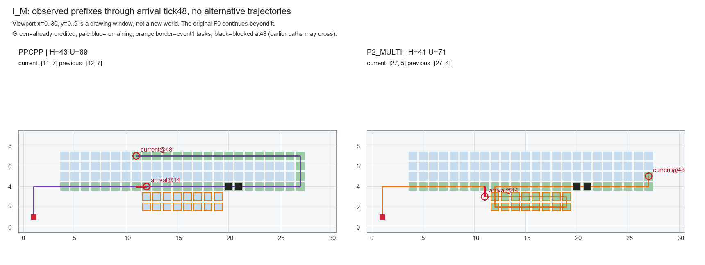

> 阅读副本，整理于2026-10-25。结论保留原报告当时的状态，不代表新增验收。权威原件：[通俗结论与裁决建议.md](../../../连续事件实际成本只读诊断_v0.1_20261022/通俗结论与裁决建议.md)。本副本仅调整本地链接。

# 六世界实际成本位置：只读结论

交付UTC：2026-10-22T05:05:31.608278+00:00。本次只读取已有六世界；规划、核心、候选、覆盖精确、BFS/Dijkstra/A*、反事实路线、新世界、新路线和模拟闭环均0。原verify未运行。

裁决建议：**A得到主要支持；B仅保留I_M的有限历史线索；C适用于I_S/T_S的任务信用比较边界。当前不支持另立连续事件新机制，建议不继续按奖励或局部步骤细分。**

L_S、L_M、T_M最后发布时，F、P、H、U、D、current、previous、base、E及零移动信用处理全部逐成员相同；三对各6步差恰好就是最后获准完整路线的长度差，且响应全部实际执行，无后续事件、等待或废弃后缀。现有证据更接近最后一次剩余规划质量差异，不能包装成已证明的连续事件专属问题。old_route不同、算法本身不同，不能归因为单一字段。

I_M的12步发生在已形成不同位置/方向/覆盖布局之后，保留“不同历史累积”的观察线索，但未识别历史影响与算法选择各占多少。禁止从本账推断交换历史后能节省多少；若与旧单事件残余规划问题没有实质区别，就不建议为保留B路线继续细分。I_S/T_S则完成工作量不同，先说明评价目标，不能拿其差值支撑同工作量优势。

## 三段边界与全六世界实际账

移动按出发tick唯一归段：[0,t1)、[t1,t2)、[t2,结束)。到达边界tick的信用按移动前地图，属于上一段；边界发布/当前格的零移动信用归下一段，二者不重复。前两段段末状态取边界发布前、该次到达信用之后；最后段末为终止状态。转弯用真实相邻移动方向，跨段、等待和重规划不清零。首次信用及逐成员H/U/D/current/previous/E全存于三段实际账与完成尾段.json。

|世界/方法|段1 M|段2 M|段3 M|总M|等待三段|首次信用三段|
|---|---:|---:|---:|---:|---|---|
|I_S_PPCPP|6|18|38|62|[0, 0, 0]|[1, 18, 25]|
|I_S_P2_MULTI|6|18|30|54|[0, 0, 0]|[1, 18, 23]|
|I_M_P2_MULTI|12|36|78|126|[0, 0, 0]|[7, 34, 71]|
|I_M_PPCPP|12|36|90|138|[0, 0, 0]|[7, 36, 69]|
|L_S_PPCPP|6|18|82|106|[0, 0, 0]|[1, 18, 61]|
|L_S_P2_MULTI|6|18|76|100|[0, 0, 0]|[1, 18, 61]|
|L_M_P2_MULTI|12|36|182|230|[0, 0, 0]|[7, 36, 165]|
|L_M_PPCPP|12|36|188|236|[0, 0, 0]|[7, 36, 165]|
|T_S_PPCPP|6|18|118|142|[0, 0, 0]|[1, 18, 97]|
|T_S_P2_MULTI|6|18|116|140|[0, 0, 0]|[1, 18, 95]|
|T_M_P2_MULTI|12|36|278|326|[0, 0, 0]|[7, 36, 261]|
|T_M_PPCPP|12|36|284|332|[0, 0, 0]|[7, 36, 261]|

全部会话无等待，到同一固定事件tick的累计移动自然相同。前两段移动差为0是该时钟与无等待的恒等式，不代表历史决策没有影响。I_M在相同步数中已采到不同任务，见后文。

|会话/段|首次采集移动|初始历史|会话重复|非目标|90°/180°|零移动信用|
|---|---:|---:|---:|---:|---|---:|
|I_S_PPCPP/1|1|0|0|5|1/0|0|
|I_S_PPCPP/2|18|0|0|0|6/0|0|
|I_S_PPCPP/3|25|0|2|11|21/0|0|
|I_S_P2_MULTI/1|1|0|0|5|1/0|0|
|I_S_P2_MULTI/2|18|0|0|0|6/0|0|
|I_S_P2_MULTI/3|23|0|1|6|15/0|0|
|I_M_P2_MULTI/1|7|0|0|5|1/0|0|
|I_M_P2_MULTI/2|34|0|1|1|7/0|0|
|I_M_P2_MULTI/3|71|0|0|7|6/0|0|
|I_M_PPCPP/1|7|0|0|5|1/0|0|
|I_M_PPCPP/2|36|0|0|0|2/0|0|
|I_M_PPCPP/3|69|0|2|19|9/0|0|
|L_S_PPCPP/1|1|0|0|5|1/0|0|
|L_S_PPCPP/2|18|0|0|0|1/0|0|
|L_S_PPCPP/3|61|0|4|17|20/1|0|
|L_S_P2_MULTI/1|1|0|0|5|1/0|0|
|L_S_P2_MULTI/2|18|0|0|0|1/0|0|
|L_S_P2_MULTI/3|61|0|7|8|32/1|0|
|L_M_P2_MULTI/1|7|0|0|5|1/0|0|
|L_M_P2_MULTI/2|36|0|0|0|1/0|0|
|L_M_P2_MULTI/3|165|0|10|7|52/2|0|
|L_M_PPCPP/1|7|0|0|5|1/0|0|
|L_M_PPCPP/2|36|0|0|0|1/0|0|
|L_M_PPCPP/3|165|0|4|19|18/1|0|
|T_S_PPCPP/1|1|0|0|5|1/0|0|
|T_S_PPCPP/2|18|0|0|0|0/0|0|
|T_S_PPCPP/3|97|0|4|17|45/1|0|
|T_S_P2_MULTI/1|1|0|0|5|1/0|0|
|T_S_P2_MULTI/2|18|0|0|0|2/0|0|
|T_S_P2_MULTI/3|95|0|15|6|47/1|0|
|T_M_P2_MULTI/1|7|0|0|5|1/0|0|
|T_M_P2_MULTI/2|36|0|0|0|0/0|0|
|T_M_P2_MULTI/3|261|0|10|7|101/2|0|
|T_M_PPCPP/1|7|0|0|5|1/0|0|
|T_M_PPCPP/2|36|0|0|0|0/0|0|
|T_M_PPCPP/3|261|0|3|20|25/0|0|

## 最后事件三层一致性

|世界|物理任务逐成员相同|initial_targets|old_route|捕食者/共同20秒/seed|完整末响应相同|响应全部执行|
|---|---|---|---|---|---|---|
|I_S|False|True|False|True|False|True|
|I_M|False|True|False|True|False|True|
|L_S|True|True|False|True|False|True|
|L_M|True|True|False|True|False|True|
|T_S|False|True|False|True|False|True|
|T_M|True|True|False|True|False|True|

六对的实际转交内部预算数值都不同，因为实际前处理耗时不同；共同总入口上限仍是20秒。逐次前处理/内部余量均保留，不能称所有输入完全相同。PPCPP/P0不以old_route选路，但用previous/捕食者；P2使用old_route作内生保底及访问顺序参考，P2不接收previous/捕食者。initial_targets对这两个入口主要承担H子集契约，不能把未启用的OARP语义混入。PPCPP记录seed_used=False，P2用固定seed生成内部额外候选。详见接口字段实际使用与源码锚点.json；这些只是代码用途，不是因果消融。

## 四对同信用配对的两种成本分解

以下Δ均为PPCPP−P2。四类移动是一种分区；采完前/返航是另一种分区，两表分别守恒，不能重复相加。

|世界|ΔM|三段ΔM|首次采集Δ|初始历史Δ|会话重复Δ|非目标Δ|最后末响应Δ|
|---|---:|---|---:|---:|---:|---:|---:|
|I_M|12|[0, 0, 12]|0|0|1|11|12|
|L_S|6|[0, 0, 6]|0|0|-3|9|6|
|L_M|6|[0, 0, 6]|0|0|-6|12|6|
|T_M|6|[0, 0, 6]|0|0|-7|13|6|

四对描述性合计：首次采集移动差0、初始历史0、会话重复−15、非目标+45，合为+30。不能把这些结果简化为“PPCPP重复采集更多”；三对同物理状态案例中，PPCPP会话重复反而更少，非目标移动更多。非目标通行可能是覆盖/返航所需，未证明它不必要。

|世界|最后发布后采完前移动(PPCPP/P2)|采完后返航移动(PPCPP/P2)|Δ采完前+Δ返航|最终采集位置(PPCPP/P2)|
|---|---|---|---|---|
|I_M|78/71|12/7|7+5=12|[12, 2]/[4, 5]|
|L_S|73/68|9/8|5+1=6|[9, 2]/[8, 2]|
|L_M|176/175|12/7|1+5=6|[12, 2]/[4, 5]|
|T_M|272/271|12/7|1+5=6|[12, 2]/[4, 5]|

每个完成边界均由最后发布时剩余U的实际首次信用逐格定位；采完移动包含最后一次采集到达，之后的出发移动才归返航。无剩余任务时边界定义为最后发布tick，本批所有末次发布均还有U，因此未出现该空集情形。完整十二会话完成tick、末格、等待和原始信用索引已保存。没有独立最短距离证据，不称上述返航片段最短、绕路或可删。

## 保存片段的具体证据

每方法每类按“连续实际步数最长，并列取最早tick”列一个保存片段。全部连续重复/非目标片段及完整点序列和原决策/输出指针均保留，未拼接替代路线。分类“重复”指重访已取得信用的目标，不等于重复边，也不自动代表浪费。

|世界/方法|分类|出发至到达tick|实际步数|片段起点→终点|原动作索引|
|---|---|---|---:|---|---|
|I_M_PPCPP|session_repeat|101→103|2|[5, 6]→[5, 4]|101..102|
|I_M_PPCPP|non_target|126→138|12|[12, 2]→[1, 1]|126..137|
|I_M_P2_MULTI|session_repeat|30→31|1|[12, 2]→[12, 3]|30..30|
|I_M_P2_MULTI|non_target|119→126|7|[4, 5]→[1, 1]|119..125|
|L_S_PPCPP|session_repeat|86→89|3|[11, 7]→[11, 4]|86..88|
|L_S_PPCPP|non_target|77→86|9|[13, 14]→[11, 7]|77..85|
|L_S_P2_MULTI|session_repeat|77→84|7|[14, 5]→[8, 4]|77..83|
|L_S_P2_MULTI|non_target|92→100|8|[8, 2]→[1, 1]|92..99|
|L_M_PPCPP|session_repeat|199→201|2|[5, 6]→[5, 4]|199..200|
|L_M_PPCPP|non_target|224→236|12|[12, 2]→[1, 1]|224..235|
|L_M_P2_MULTI|session_repeat|155→157|2|[19, 6]→[19, 4]|155..156|
|L_M_P2_MULTI|non_target|223→230|7|[4, 5]→[1, 1]|223..229|
|T_M_PPCPP|session_repeat|295→297|2|[5, 6]→[5, 4]|295..296|
|T_M_PPCPP|non_target|320→332|12|[12, 2]→[1, 1]|320..331|
|T_M_P2_MULTI|session_repeat|251→253|2|[19, 6]→[19, 4]|251..252|
|T_M_P2_MULTI|non_target|319→326|7|[4, 5]→[1, 1]|319..325|

## I_M：不同历史的实际内容

事件1为tick12，首次真实动作分歧发生于出发tick13：两者都从(11,4)出发，PPCPP到(12,4)，P2到(11,3)。前者原P0 trace[1]为已保存的local选择；后者来自保存的H_scan_opt输出第1→2段。该指针只说明已返回且执行了哪一步，不评价另一动作会怎样。

tick48发布后，PPCPP current=(11,7)、previous=(12,7)、H=43、U=69；P2 current=(27,5)、previous=(27,4)、H=41、U=71。F/P/D及E相同，位置/方向/H/U不同。PPCPP独有18格历史，P2独有16格；互为对方剩余任务。

PPCPP独有：[[11, 7], [12, 7], [13, 7], [14, 7], [15, 7], [16, 7], [17, 7], [18, 7], [19, 7], [20, 7], [21, 7], [22, 7], [23, 7], [24, 7], [25, 7], [26, 7], [27, 6], [27, 7]]。

P2独有：[[12, 2], [12, 3], [13, 2], [13, 3], [14, 2], [14, 3], [15, 2], [15, 3], [16, 2], [16, 3], [17, 2], [17, 3], [18, 2], [18, 3], [19, 2], [19, 3]]。

对应的每格首次信用时间、真实移动、末次响应来源和PPCPP决策索引见I_M独有采集格及原始输出指针.json。PPCPP此前采了上沿目标，P2此前采了新增下方任务，不能只比较H数量断言哪个历史更好。其后78/71步采完、12/7步返航是实测分区；不能把7+5的12步直接分配给“历史造成多少”和“算法造成多少”。控制历史或算法后的反事实成本未知。

## I_S/T_S：遮挡信用时间线

|世界|目标|原始公开|PPCPP首次采集|遮挡发布|P2首次信用|最终归属|
|---|---|---:|---:|---|---|
|I_S|[12, 4]|初始|14|24|无|PPCPP保留H，P2计D|
|I_S|[13, 4]|初始|15|24|无|PPCPP保留H，P2计D|
|T_S|[12, 4]|初始|14|24|无|PPCPP保留H，P2计D|
|T_S|[13, 4]|初始|15|24|无|PPCPP保留H，P2计D|

四条信用均是事件前真实arrival，不是事后补信用，也没有以经过过目标/基地追溯完成。P2按当前协议仍完成当前可检任务并返航，不能自动判失败；PPCPP多完成两格也不能自动判为浪费。这两对的8/2步差不并入同工作量30步。

## 证据缺口与停止建议

A：三对共18步的现象表现为同物理任务下末次剩余规划差，算法和old_route参考仍不同，尚无单字段因果识别；不据此立项新连续机制。B：I_M真实历史不同，可作为以后讨论控制问题的有限线索，但没有交换历史、固定算法或干预收益证据；本轮不自动拟新实验。C：两对信用不等价，先明确任务评价目标，不为保住路线结论改遮挡或时钟。

建议以A为当前主要解释，B保留未解决而不继续细分，C限定两对工作量比较。若进一步问题仍只是同一残余任务上的路线选择，应明确归回已有单事件/静态剩余规划问题，不能以连续事件包装新意。六模板单seed不是普遍结论，未确认主算法或创新。

来源hash、原指针和独立核验均在本包；来源包和冻结源码未修改，原单步候选关闭，留出不用，未提交推送。完成封存停止，不追加任务、改奖励或改事件。
