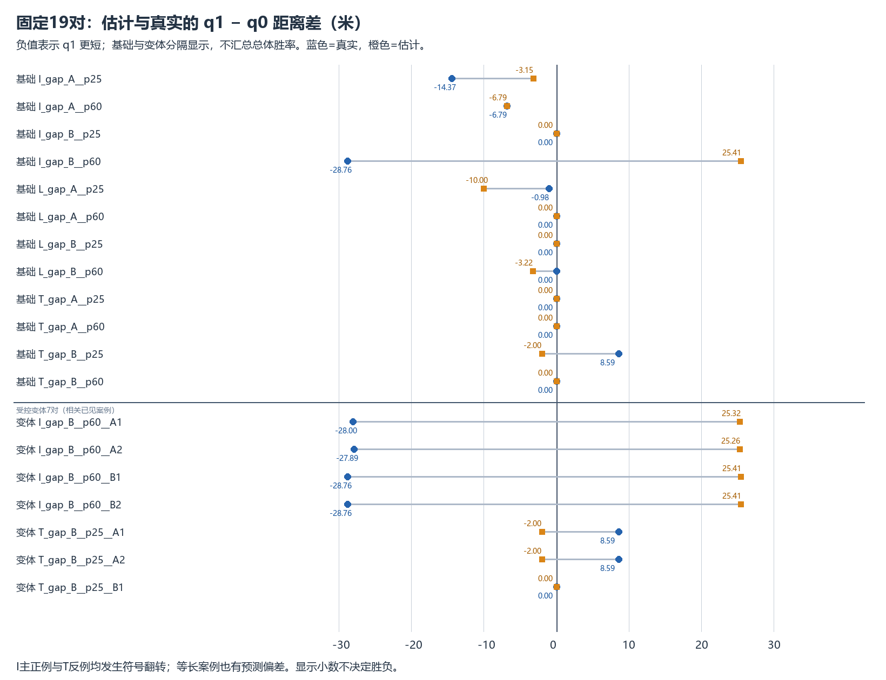
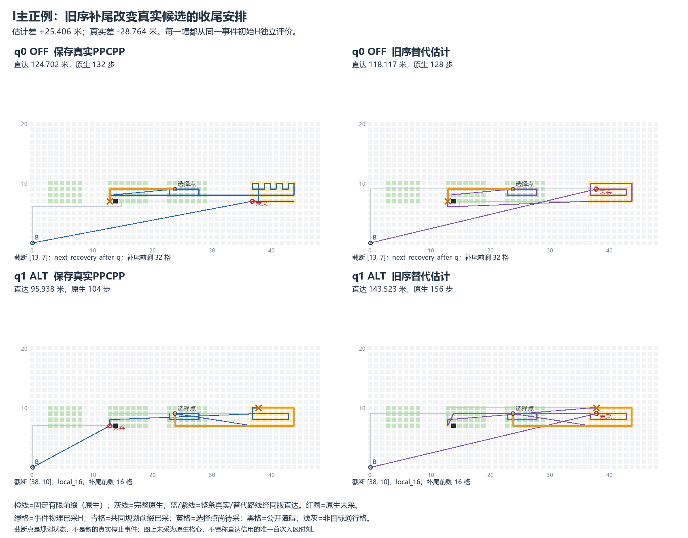
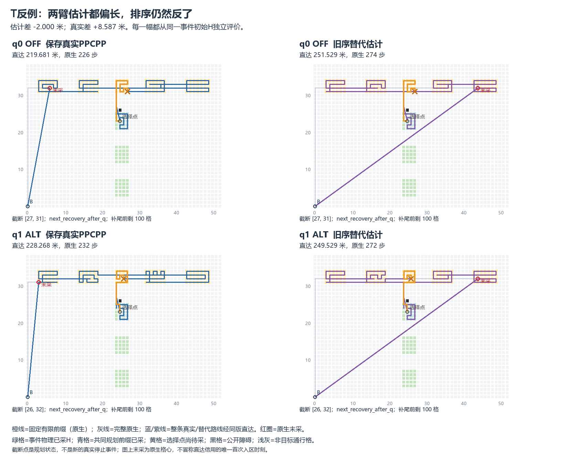
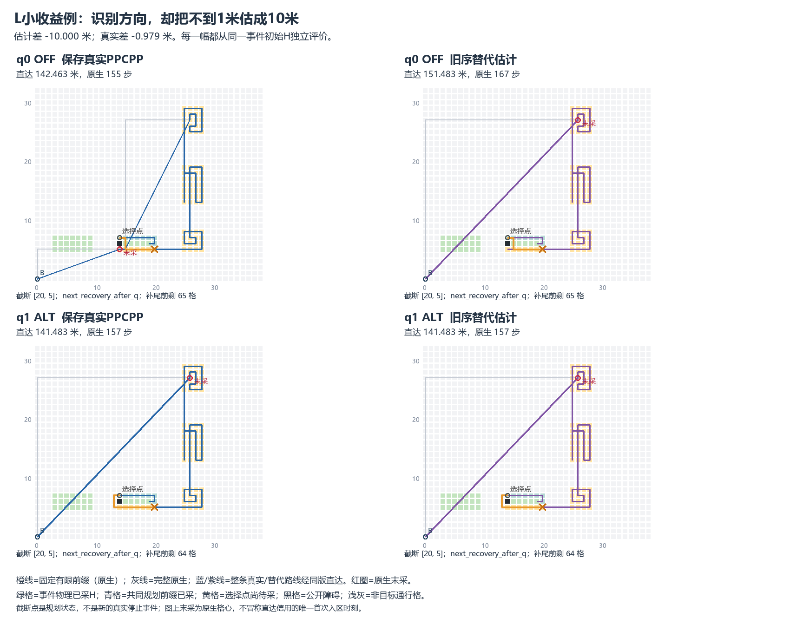

> 阅读副本，整理于2026-10-25。结论保留原报告当时的状态，不代表新增验收。权威原件：[00_通俗影子评估结论.md](../../../障碍后接续估计器影子诊断_v0.1_20261023/00_通俗影子评估结论.md)。本副本仅调整本地链接。

# 固定估计器影子诊断：未过继续门槛

这是19对已见开发材料的阶段A诊断；没有接管规划、没有运行真实有限推演、没有调整16/64或旧序尾段政策。**本固定配置的继续信号关闭，不进入阶段B同机计时。**

它能抓住部分改善，但关键两项均失败：I_gap_B__p60被判q0更好，真实q1明显更短；T_gap_B__p25及两个障碍变体均被判q1更好，真实却退化。基础12对采用建议后的合计距离仍为负，只满足第三项，不能抵消前两项失败。

|固定检查|估计q1−q0（米）|真实q1−q0（米）|建议|结论|
|---|---:|---:|---|---|
|base__I_gap_B__p60|25.406018257|-28.763940280|q0|漏掉改善|
|base__T_gap_B__p25|-2.000000000|8.587181813|q1|错误接受退化|
|base__I_gap_A__p25|-3.148163406|-14.372543110|q1|抓住改善|
|base__I_gap_A__p60|-6.793888511|-6.793888511|q1|抓住改善|
|base__L_gap_A__p25|-10.000000000|-0.979486872|q1|抓住改善|
|base__L_gap_B__p60|-3.219810994|0.000000000|q1|实际等长却估q1更短|



基础12对：4个真实改善中抓住3个、漏1个；唯一真实退化被错误接受；7个真实等长中6个保留q0，L_gap_B__p60却估计q1少3.219810994米而实际等长。没有不可用、失败或数值未知。建议q1共5对，相对全保留q0合计−13.558736680米；六几何各两状态，先状态均值再几何等权为−1.129894723米。两候选遗憾合计37.351122093米，最坏实际退化+8.587181813米，最坏单例遗憾28.763940280米。这里的遗憾只相对已测试的两个候选。

变体7对单列：4个I改善全部漏掉，2个T退化全部误收，1个等长保留q0；建议q1共2对，相对q0合计+17.174363625米。它们复用已见基础几何，其中I的B进度变体还与原例触发状态及两臂原生尾部重复；不得与12对拼总体胜率、独立样本数或显著性。5个原无资格槽不进入预测，不算等长或求解失败。

## 为什么I主正例会被漏掉

OFF有限前缀13边，到[13,7]后将再次恢复，停时右块还剩32格；ALT有限前缀31边（恢复15＋局部16），停在[38,10]，还剩左侧1格及右侧15格。按被冻结的旧序，ALT补尾先回左侧[13,7]（旧rank11），再去右侧[37,9]（rank30）继续收尾，两臂替代轨迹最终都在右侧[38,9]末采。保存的真实ALT则先完成右块、最后回左侧[13,7]再返航。旧序补尾把真实候选的重要收尾安排重新打散。

OFF完整替代估计118.117433696米，真实124.701701785米，误差e0=−6.584268089；ALT估计143.523451953米，真实95.937761505米，误差e1=+47.585690448。两误差之差+54.169958537米，把真实−28.763940280反成估计+25.406018257。两个A障碍变体同样漏判；两个B变体重复这一局部模式，不能作五次独立验证。



## 为什么T会被误收

两臂均从选择点推进24边，OFF停[27,31]、ALT停[26,32]，都将再次恢复、都剩100任务。旧序补尾均先向左侧[19,31]，最后在右侧[44,32]末采；真实后续则先右后左，并以左侧不同位置收尾。估计的补尾不是原PPCPP的未来。

OFF估计251.528987661米、真实219.680746818米，e0=+31.848240843；ALT估计249.528987661米、真实228.267928630米，e1=+21.261059030。两误差都为正，却不相等；差−10.587181813米将真实+8.587181813反成估计−2米。两个障碍变体完全重复该排序错误；早公开B变体换了目标对且真实同路等长，估计也等长，不能算正确避免原T退化。



## 其他结果不能略去

I_gap_A_p25估计差−3.148163406、真实−14.372543110：OFF绝对误差−11.224379704、ALT误差0，排序仍正确。p60两臂估计与真实距离均精确相等，识别同块改善−6.793888511米。L_gap_A_p25估计−10、真实仅−0.979486872米：抓住直达改善，但明显夸大；其真实原生差仍为+2步，不能说原生路线改善。L_gap_B_p60两臂绝对误差+3.607417978/+0.387606984，使真实等长被判为q1更短。



5对真实原生/直达同路等长（基础4＋变体1）全部估计等长；基础3对等长不同路中2对估计等长、1对偏向q1。逐例两臂估计、真值、误差、停止位置/剩余责任、选择实际损益和两候选遗憾见[全表](../../../障碍后接续估计器影子诊断_v0.1_20261023/02_逐例预测与真实结果.md)及joined_results.json。

误差恒等式(delta_hat−delta_true)=(e1−e0)已逐对精确核验；它只是数学分账，不是独立机制因果。本轮改变了停止状态后的整条替代路线，并对完整路线共同直达，不能把误差一概视为某段局部路径代价。结果与旧序尾段的两臂非对称误差一致；未验证“延长前瞻一定解决”，也没有据此提出第二个配置。

## 调用、成本与结论边界

固定提取38臂、补尾38条、公共直达38次，新增原生/直达视图76；真实历史、完整PPCPP/H1/P2、真实有限推演核心均0。18项纯技术首轮通过，修复0；38臂全合法完整并返航、无超限/失败/未运行，独立前缀及完整替代路线审核通过。预测封存后才合并真值；设计者早已见过案例，信息隔离不能消除开发偏差。

补尾共2160次任务连接＋38次返航，生成5677边；完整替代原生共6694边，公共直达候选3426次。每臂仍构造完整替代路线并做完整post及信用验证。读取保存前缀的耗时不能代替真实推演成本，本轮不能证明加速。详见[工作量与未知](../../../障碍后接续估计器影子诊断_v0.1_20261023/03_计算工作量与未验证事项.md)。

这只关闭本次固定估计配置在这19对已见材料上的继续信号，不证明所有尾段估计、所有有限前瞻都无效，也不把部分识别成功称为规则可靠或创新。旧H2保持未确认，不改写旧封存结论。完成后封存、根进度仅前缀追加，停止交负责人审核。
