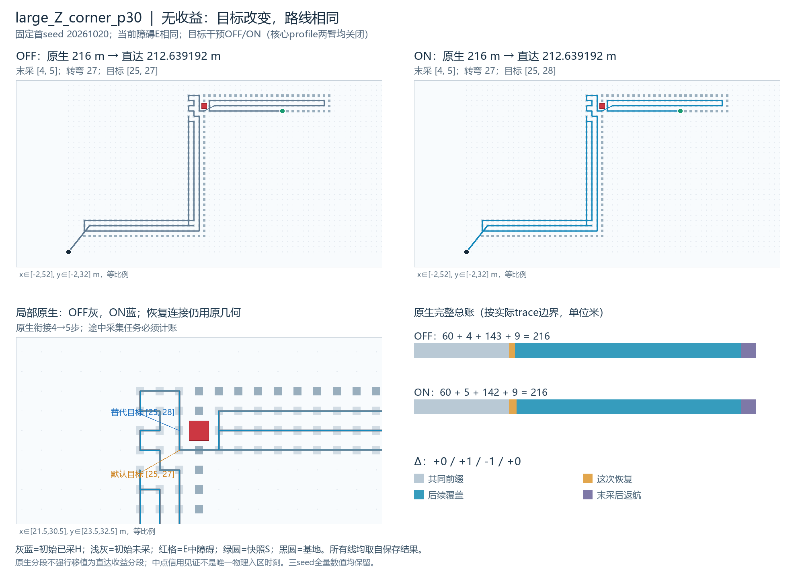
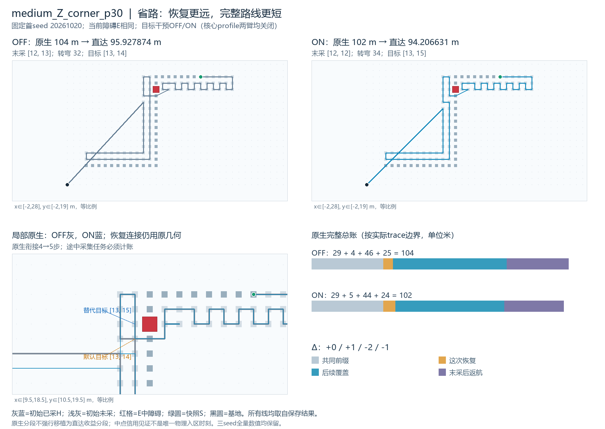

# 覆盖受阻恢复目标单变量诊断

2026-10-23。**大Z换回这个旧目标没有收益；中Z有收益，但转弯增加。** 12次真实PPCPP核心、12次同版直达及24视图已完成，六个OFF全部复现旧B_E，全部入口及独立决策/几何/信用审核通过，无正式失败、不适用、触顶、迟到或未运行。停止交审，不试第三目标，不恢复FIRST或新性能批。

本轮回答的是同一个障碍E下，其他规则不变、只在唯一指定恢复记录替换目标的完整路线效果。主差值始终为新ON−新OFF，不是ON_E−旧B_N。三seed完整结果见[六配对表](03_六配对与全指标入口.md)，先逐例解释，再状态等权；只有两个尺度Z族，六配对不是六张独立几何。

|状态|OFF原生→直达米|ON原生→直达米|ON−OFF原生|ON−OFF直达|直达相对变化|
|---|---:|---:|---:|---:|---:|
|large_Z_corner_p30|216→212.639192|216→212.639192|0|0（逐点同路）|0|
|medium_Z_corner_p30|104→95.927874|102→94.206631|−2|−1.721243264|−1.794310%|

每个状态的三个原seed均得到表中相同路线和长度。大Z零差是空根式且原生/直达逐点相等；中Z直达差精确为−1+12√2−√313，认证区间严格小于0。两状态等权平均−0.860622米只用于完整登记，不能取代“一例无效、一例有效”的事实。

## 实际只改了什么

两个E字节逐项追溯上轮实际输入及选例包usable_snapshots_v02所指E_contract_v02；没有用首版E.json。初始U为201/75；在指定记录的pending分别141/46，完整集合、此前全部语义记录、原生路线前缀、当前点与上一格都精确匹配，未以数量代替集合，未把trace编号默认当路径顶点index。两者本次恰好数值相同，仍分别由保存字段读取并审核。

|状态|trace记录（0基）|当前 / 上一格|原E默认目标|唯一替代目标（旧N）|默认/替代距离|
|---|---:|---|---|---|---:|
|大Z|60|[28,28] / [29,28]|[25,27]|[25,28]|4 / 5|
|中Z|29|[16,15] / [15,15]|[13,14]|[13,15]|4 / 5|

默认最近目标仍完整计算，然后在ON仅改一次目标，用同一个原几何对象的原path函数展开；之后全部回到原PPCPP规则。OFF同样经过诊断钩子、完整日志与两个目标的说明性重复距离查询。没有重置核心、回滚轨迹、偷跑正常完整分支择优、改变最短路平局或手拼R。替代目标在当时pending、可飞且可达，可以比默认远，这是唯一授权偏离。

规范P/H/F/T、S、真实来向、基地、资源、捕食者、旧后缀和seed均不变。全局物理H保留被封堵的已采格，未把预测到分歧处的采集写入初始真实H；事件已在原快照起点公开，不是在飞到分歧点时才发现。原生仍按原每格pending采集，中心区信用由公共层计算输出轨迹，不反馈决策。原生/直达全部新信用201/75、遗漏0、暂缓0、可检/发布完成率100%，合法返航且完整距离小于原资源上限1000000。

目标干预OFF/ON和核心详细profile是两个不同开关；核心profile在两臂都关闭，详细核心查询null。诊断副本、审核器及帮助模块均独立recovery_diag_命名，不覆盖冻结源码、不使用历史audit.py路径替换。原生、candidate、runtime、worker最小diff及原源码保留source_snapshot。

## 大Z：目标标签变了，物理路线没有变

OFF的恢复路径为：

`[28,28]→[27,28]→[27,27]→[26,27]→[25,27]`

到达默认目标[25,27]后，原邻格规则自然选择[25,28]。ON把目标改为[25,28]，原几何展开恰好是上面同一路径再走到[25,28]，途中依次采集[25,27]和[25,28]。之后状态、来向和余下路线再次完全一致。

原生总账（共同前缀／这次恢复／后续覆盖／末采后返航）为：

- OFF：60＋4＋143＋9＝216。
- ON：60＋5＋142＋9＝216。

恢复多1与后续少1只是决策段边界重分，**没有实际省路**。ON少一条local决策记录：OFF 202条、ON 201条；除这一合并外末尾140条完整记录重新相同。原生路径217顶点、直达204顶点逐点一致；201项名义锚点、实际信用序及全部信用事件相同；末采仍[4,5]。原生转弯27（90°25/180°2/其他0）、直达27（90°22/180°2/其他3）均不变。

这关闭了“仅换回[25,28]就能解释大Z旧R优势”的具体线索。旧R_E直达212.053406米，仍比新ON短0.585786米，新ON并未与R同路。旧R和本轮原几何的绕行/后续组合不同，**有差距、未定位这段R优势的单一原因**。不能据此认定所有其他目标无效，也不自动更换连接平局、改第三目标或扩大试走。

## 中Z：连接更远，但完整总账减少

OFF恢复到[13,14]，路径为：

`[16,15]→[15,15]→[15,14]→[14,14]→[13,14]`

ON沿同一路径先采[13,14]，再到固定目标[13,15]，恢复多1步。OFF在[13,14]按原邻格规则选[12,14]（与[13,15]同为2.25分，使用原平局），而ON仍在执行已授权的这次恢复，继续到[13,15]；之后自然遵循原规则，先去[13,16]。没有另一次手工改邻格，也没有以中心区信用改变原生pending。

原生总账为：

- OFF：29＋4＋46＋25＝104。
- ON：29＋5＋44＋24＝102。
- 变化：0／+1／−2／−1，净−2步。

这次衔接不是空飞：OFF采到[13,14]，ON采到[13,14]与[13,15]。原生路径首次不同顶点index34：OFF [12,14]、ON [13,15]；原生末尾13顶点重新相同。实际信用和名义锚点从rank30开始不同，一直到末次rank74；末采[12,13]→[12,12]。

完整公共直达后由95.927874降至94.206631米，省1.721243米。直达首次不同顶点index32，同样是[12,14]与[13,15]；直达仅基地这个共同尾点。按原内部中点见证，首末信用之间−1米、末信用后返航−0.721243米，合计−1.721243米；这不是把原生三段差直接移植到直达。保存post边索引表明，本批并无边严格跨过指定恢复起止边界，但阶段口径仍分别保存，未伪造唯一物理首次入区时刻，也未锁住公共后处理前缀。

收益不是“替代目标本身更近”，也不是“只减少连接距离”。在这个E快照、指定目标和当前规则下，单次替换引起的后续覆盖/末采变化足以改善完整返回路线，支持该次恢复选择存在可干预的完整路线损失。这个结论局限于已见中Z开发状态，不证明全部障碍增程可避免，不证明保留旧目标普遍优越。

代价也存在：原生转弯34→36（90°33→35、180°1不变）；直达32→34（90°29→31、180°0/其他3不变）。短路程不等于所有指标改善，更不等于真实节能。旧N/R/P2仅作保存参考，未新增调用；中ZON也不与旧R同路。旧时间在独立参考文件中标为历史，不混入本轮排名。

## 控制、审核与实际成本

两个首seed OFF先完成，并逐点/逐决策通过旧B_E等价，才允许第一个ON；后续四个同状态seed配对按冻结顺序交替臂先后。六个OFF都核对了完整原返回（仅排除明确时钟/version元数据）、每条trace的目标/options/index/pending等语义、原生路线、直达路线/信用事件/全部指标，不用旧结果代替新OFF。

ON/OFF在指定记录前完整语义、路线及完整pending一致，指定记录当时除goal外全部字段一致；ON每次仅触发1次，OFF匹配1次而替换0次。独立决策审核不调用规划器、钩子或原奖励函数，独立重算奖励/平局和BFS距离，检查逐格pending、实际到达、全体后续恢复/邻格/返航规则，仅放行一条明确授权非最近目标；两套公共几何/信用审核照常执行。独立核验最短长度，原路径平局函数通过原对象与不变源码绑定，没有声称重写第二套相同平局实现。

|状态/臂|完整核心入口均值秒|其中钩子计时均值秒|直达引擎均值秒|主端到端均值秒|主外独立审核均值秒|
|---|---:|---:|---:|---:|---:|
|大Z OFF|0.039826|0.013140|0.296310|0.534242|0.384814|
|大Z ON|0.039667|0.013190|0.289086|0.521192|0.358962|
|中Z OFF|0.011189|0.003171|0.048170|0.106618|0.094041|
|中Z ON|0.010623|0.003354|0.052202|0.113025|0.085743|

大Z主端到端ON−OFF均值−0.013050秒、范围[−0.040134,+0.004551]；中Z+0.006407秒、范围[−0.000155,+0.016778]。各三次单跑不足以宣称稳定速度变化。钩子自计时包括choose/记录/finish，未涵盖全部构造/编码成本；完整核心与主端到端已包含这些额外成本，不能把“钩子秒”冒称完整诊断开销，也不以旧批时钟相减推算新同轮纯开销。本轮只测诊断成本，不声称ON是可部署快速算法。

核心20秒；直达18秒软候选/4096/20秒迟到标记（非硬中断）；父150秒仅兜底。每次新进程、严格串行、四线程变量1；主包装、诊断、原/直达虚拟执行、编码和返回后实际模块hash计时，冷导入、启动前hash、两次原证据落盘、独立审核/进程创建另列。保存timing.main_measured_includes继承旧控制器的profile ON文字，但本轮真实config与native_observation均为profile OFF/null；它与target_intervention_enabled不是同一开关，不能按该旧描述认定ON臂开了profile。

正式钩子记录1650条决策状态、138351格次pending；匹配12、应用6，说明性距离查询24次，只查询已定默认与替代两目标且全部收费。公共直达1692次候选合法检查、279468次服务交检查；主虚拟837078次包围盒测试、7080次通过筛查后的交检查；独立决策审核45次BFS/105615出队/422460邻居检查，单列主外成本。原核心详细查询未观测为null，不用诊断或审核数冒充核心总查询。计数别名不重复相加。

## 已完成、未发生与尚未知

已完成：8个固定纯身份验收、12个真实入口、12次真实公共后处理、24视图、6配对、全部干预证明和独立回执、两张固定首seed图及逐状态/逐seed统计。准备首轮八项断言全过，但失败桩的部分查询计数未留存；1轮计账修复后同八项再过，旧源码/结果/diff保留，共16项尝试。纯choose共20、finish2、独立审核桩10、独占创建4次；首轮拒绝桩部分查询确未观测，标未知而非0，次轮全部计账。准备阶段真实核心/真实后处理0，正式后无修复或重跑。

本轮没有不适用、正式失败、触顶、迟到、缺槽或报告导出失败；这些账均显式保留为空，不删除零收益大Z。没有新增N/R/P2、历史准备、热身、新地图、留出、连续闭环、视觉或推送。

尚未知：大Z的R优势究竟由哪项路径/顺序组合形成；哪些在线条件能选出有用替代目标；其他目标、形状、未见数据的效果。大Z无效不代表所有目标无效；中Z有效也不授权“总保留旧目标”，本轮未设计或检验在线条件判断器。

旧FIRST已经做过首次恢复最多三个目标完整试走择优，并有开发收益和额外成本。本轮没有重新命名该技术为创新；旧N目标来自离线人工固定证据，不是已实现的免费在线识别能力。本轮结论是关闭大Z的一条具体解释，同时确认中Z的单次固定替换收益。全部结果回负责人讨论，不自动恢复FIRST/rollout/贪心择优或追加开发批。

交付索引见[review_packet](review_packet.md)。根进度开工字节和上轮只读verify成功回执已保存；新进度仅前缀追加，旧正文逐字节保留。上轮文件封存与根进度历史链分开核验，不改旧final_receipt、不把预期进度演进误报算法证据损坏。封存后停止交审。
